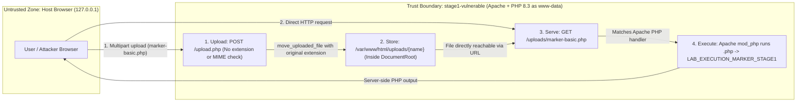
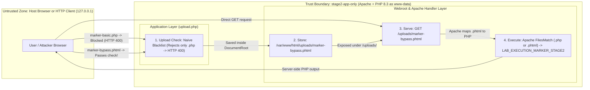
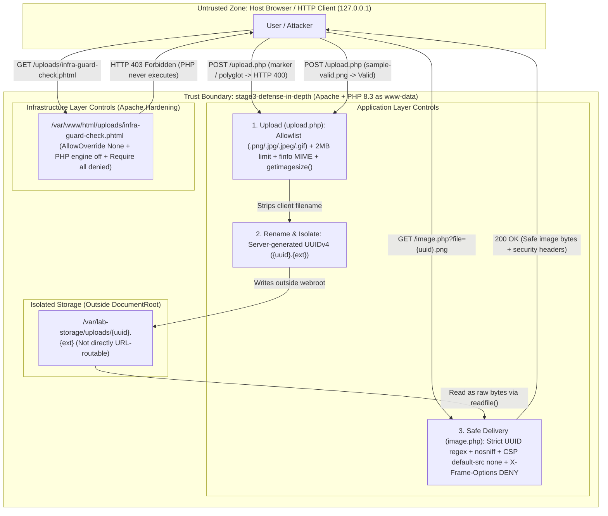

# Lab 01: File Upload to Code Execution & Defense in Depth on PHP + Apache

**[📂 Lab Index (README.md)](./README.md)** | **[🇯🇵 日本語 (README.ja.md)](./README.ja.md)** | **[🏠 Root Guide (../../README.en.md)](../../README.en.md)** | **[🛡️ Safety Policy (../../docs/safety.en.md)](../../docs/safety.en.md)**

---

> [!CAUTION]
> **FOR LOCAL EDUCATIONAL USE ONLY — DO NOT DEPLOY PUBLICLY**
>
> Stage 1 (`127.0.0.1:8081`) and Stage 2 (`127.0.0.1:8082`) intentionally reproduce file upload vulnerabilities that lead to server-side code execution. Run them strictly on your personal local machine (`127.0.0.1` loopback binding over an `internal: true` isolated Docker network) and never expose them to public servers or shared networks.

---

## 1. Learning Objectives

By completing Lab 01, you will be able to explain and apply four core security engineering concepts:

1. **Tracing the End-to-End Attack Chain (`Upload -> Store -> Serve -> Execute`)**: Understand that server-side code execution is never caused by upload ingestion alone—it requires an unbroken chain across validation (Upload), filesystem placement and naming (Store), URL routing (Serve), and Web server interpreter mapping (Execute).
2. **Trust Boundaries & Untrusted Client Metadata**: Explain why filenames, extensions, and client-supplied HTTP `Content-Type` headers lie outside the server trust boundary and can be trivially forged.
3. **Why Application-Only Blacklists Fail (Parser & Handler Mismatches)**: Demonstrate why blocking `.php` in PHP application code still allows code execution when Apache's handler configuration (`FilesMatch`) also executes `.phtml`.
4. **Designing Application + Infrastructure Defense in Depth**: Combine independent controls across the Application Layer (strict allowlist, server-side `finfo` + `getimagesize()`, 2MB cap, UUIDv4 renaming, outside-webroot storage, and hardened delivery via `/image.php`) and Infrastructure Layer (`AllowOverride None`, PHP engine disabled on `/uploads`, and `Require all denied`) so no single misconfiguration leads to RCE.

---

## 2. Quickstart & Automated Verification

### 2.1 Start the Lab & Open in Browser

From `labs/01-php-upload-defense/`, build and start the three stages in detached mode (runs 100% offline once built):

```bash
cd labs/01-php-upload-defense
docker compose up --build -d
```

All stages run Apache + PHP 8.3 as non-root user `www-data` on internal port `8080`, bound strictly to `127.0.0.1` on the host:

| Stage | Local URL | UI Language Toggle | State Reset |
| :--- | :--- | :--- | :--- |
| **Stage 1: Vulnerable** | `http://127.0.0.1:8081` | `?lang=ja` / `?lang=en` | UI Reset button (`POST /reset.php`) |
| **Stage 2: App-Only Insufficient Defense** | `http://127.0.0.1:8082` | `?lang=ja` / `?lang=en` | UI Reset button (`POST /reset.php`) |
| **Stage 3: Defense in Depth** | `http://127.0.0.1:8083` | `?lang=ja` / `?lang=en` | UI Reset button (`POST /reset.php`) |

### 2.2 Included Harmless Sample Files (`samples/`)

See [`samples/README.md`](./samples/README.md) for full details. Every marker script is completely harmless: zero user input handling and zero OS command execution functions.

| File Path | Purpose | Expected Behavior Across Stages |
| :--- | :--- | :--- |
| [`samples/sample-valid.png`](./samples/sample-valid.png) | Valid baseline PNG image | Accepted and displayed cleanly in Stage 1, Stage 2, and Stage 3 |
| [`samples/marker-basic.php`](./samples/marker-basic.php) | `.php` execution marker | Executes in Stage 1 (`LAB_EXECUTION_MARKER_STAGE1`); blocked (`HTTP 400`) in Stage 2 and Stage 3 |
| [`samples/marker-bypass.phtml`](./samples/marker-bypass.phtml) | `.phtml` blacklist-bypass marker | Bypasses `.php` check and executes in Stage 2 (`LAB_EXECUTION_MARKER_STAGE2`); blocked (`HTTP 400`) in Stage 3 |

### 2.3 Run Automated Verification & Teardown

Run the built-in `verifier` service on `lab_net` to verify all stages, headers, resets, and static safety checks (see [`tests/README.md`](./tests/README.md)):

```bash
# End-to-end automated verification via Docker Compose test profile
docker compose --profile test run --rm verifier

# (Optional) Host-side smoke test on Windows PowerShell
pwsh -File tests/host-smoke.ps1

# (Optional) Host-side smoke test on macOS / Linux
sh tests/host-smoke.sh

# Stop and remove containers when done
docker compose down
```

---

## 3. Architecture, Data Flow Diagrams (DFDs) & Trust Boundaries

Every file upload feature processes untrusted bytes across four distinct phases:

- **Upload (Ingest & Validate)**: Receive multipart form data (filename, client `Content-Type`, raw bytes) across the client-to-server trust boundary.
- **Store (Persist & Place)**: Write the bytes to a filesystem directory under a chosen filename.
- **Serve (Route & Deliver)**: Map an incoming `GET` URL to either a static path or a controlled delivery script.
- **Execute (Interpret)**: Decide whether the target file is returned as inert data bytes or passed to a server-side interpreter (`mod_php`).

The Data Flow Diagrams below illustrate how each stage handles these four phases.

---

### 3.1 Stage 1: Vulnerable (`http://127.0.0.1:8081`) — Unvalidated Webroot Upload

Stage 1 performs zero extension or content validation. Aside from stripping directory components with `basename()`, it preserves the user-supplied filename and writes directly into `/var/www/html/uploads/{name}` inside Apache's `DocumentRoot`.



**Why Stage 1 Fails (Broken Assumptions):**
- Untrusted input simultaneously satisfies all **three preconditions for upload-driven RCE**:
  1. Stored with an **attacker-controlled extension** (`.php`).
  2. Placed **inside `DocumentRoot`** (`/var/www/html/uploads/`), making it directly addressable by URL.
  3. Served from a directory where **Apache's PHP interpreter handler is active**, turning uploaded data into executed code.

---

### 3.2 Stage 2: App-Only Insufficient Defense (`http://127.0.0.1:8082`) — Naive Blacklist vs. Server Handler Mismatch

In Stage 2, the developer attempts a quick fix in PHP by rejecting the `.php` extension (`HTTP 400`). However, uploaded files are still saved under `/var/www/html/uploads/{name}`, while Apache's configuration maps `<FilesMatch "\.(php|phtml)$">` to the PHP interpreter.



**Why Stage 2 Fails:**
1. **Security Policy Mismatch Between App Code and Web Server**: The PHP validation code assumes only `.php` is executable, whereas Apache executes both `.php` and `.phtml`. Blacklists fail structurally because the application must anticipate every handler extension (`.phtml`, `.php5`, `.phar`), case variation, or per-directory configuration override (`.htaccess`) supported by the underlying Web server.
2. **Why Client `Content-Type` Headers Cannot Be Trusted**: Even if an application checks `$_FILES['file']['type'] === 'image/png'`, that header comes directly from the untrusted client request. An attacker can spoof it in one command—e.g., `curl -F "file=@samples/marker-bypass.phtml;type=image/png"`—so client-declared MIME types provide zero security assurance (covered in the Hands-On Guide's optional `curl` lab).

---

### 3.3 Stage 3: Defense in Depth (`http://127.0.0.1:8083`) — Coordinated Application + Infrastructure Controls

Stage 3 places **independent security controls at every phase** of `Upload -> Store -> Serve -> Execute`. Furthermore, even if an application bug or operational mistake ever wrote a `.phtml` file into `/var/www/html/uploads/` (simulated by the pre-seeded fixture `infra-guard-check.phtml`), Apache's infrastructure hardening independently blocks access and disables PHP execution.



**Why Stage 3 Succeeds (Eliminating Single Points of Failure):**
- **Layer 1 (Upload — Strict Allowlist & Content Inspection)**: Enforces a strict extension allowlist (`png`, `jpg`, `jpeg`, `gif`), a 2MB size limit, server-side magic-byte inspection via `finfo(FILEINFO_MIME_TYPE)`, and structural image header validation via `getimagesize()`. Disguised PHP scripts renamed to `evil.png` with `Content-Type: image/png` are rejected (`HTTP 400`).
- **Layer 2 (Store — UUIDv4 Renaming & Outside-Webroot Isolation)**: Discards the original filename completely, assigns a random `UUIDv4.<ext>`, and stores the file in `/var/lab-storage/uploads/` **outside** Apache's `DocumentRoot` (`/var/www/html`). Uploaded files have no direct URL route.
- **Layer 3 (Serve — Controlled Delivery Endpoint & Hardened Headers)**: Serves images exclusively via `GET /image.php?file=<uuid>.<ext>` after validating a strict UUIDv4 + allowlisted-extension regular expression. Streams raw bytes with `X-Content-Type-Options: nosniff`, `Content-Security-Policy: default-src 'none'`, and `X-Frame-Options: DENY` to prevent browser MIME sniffing or active content execution.
- **Layer 4 (Execute / Infra — Independent Apache Hardening)**: Sets `AllowOverride None` (ignoring any `.htaccess` files) and locks down `/var/www/html/uploads/` with PHP execution disabled, `Options -ExecCGI -Indexes`, and `Require all denied`. Requesting the pre-seeded probe `GET /uploads/infra-guard-check.phtml` returns **HTTP 403 Forbidden** and never executes PHP.

---

## 4. Threat-to-Mitigation Defense-in-Depth Matrix

| Phase | Threat / Attack Vector | Stage 1 (Vulnerable) | Stage 2 (App-Only) | Stage 3: Application Controls | Stage 3: Infrastructure Controls |
| :--- | :--- | :--- | :--- | :--- | :--- |
| **Upload** | Direct `.php` script upload (`marker-basic.php`) | ❌ Accepted & executed | ⚠️ Blocked by `.php` blacklist (`HTTP 400`) | ✅ Blocked by image extension allowlist (`HTTP 400`) | ✅ Even if placed in `/uploads`, PHP engine is off & denied |
| **Upload** | Alternate executable extension (`marker-bypass.phtml`) | ❌ Accepted & executed | ❌ **Bypassed & executed** | ✅ Blocked by strict allowlist (`HTTP 400`) | ✅ PHP engine disabled on `/uploads` + `HTTP 403` |
| **Upload** | Spoofed `Content-Type: image/png` or PHP disguised as `evil.png` | ❌ Accepted | ❌ Accepted if non-`.php` extension | ✅ Ignores client header; `finfo` + `getimagesize()` reject (`HTTP 400`) | ✅ Never routed through PHP interpreter |
| **Upload** | Oversized file upload resource exhaustion | ❌ No app cap | ❌ No app cap | ✅ Enforces 2MB maximum size | ✅ Contained within isolated non-root container |
| **Store** | Attacker-controlled filename / path traversal tricks | ⚠️ `basename()` only (keeps client name) | ⚠️ `basename()` only (keeps client name) | ✅ Discards client name; generates random `UUIDv4.<ext>` | ✅ Runs as `www-data`; app code & config are read-only |
| **Store** | `.htaccess` upload to override Apache handlers | ❌ Can write inside webroot | ❌ Allowed (not `.php`) | ✅ Rejected by allowlist + stored outside webroot (`/var/lab-storage/uploads/`) | ✅ `AllowOverride None` ignores `.htaccess` server-wide |
| **Serve** | Direct URL navigation to uploaded file | ❌ Reachable at `/uploads/<name>` | ❌ Reachable at `/uploads/<name>` | ✅ Not in webroot; served only via `/image.php?file=<uuid>.<ext>` | ✅ `/var/www/html/uploads` enforces `Require all denied` (`HTTP 403`) |
| **Serve** | Browser MIME-type sniffing or embedded active content | ❌ No defensive headers | ❌ No defensive headers | ✅ Sends `X-Content-Type-Options: nosniff`, `Content-Security-Policy: default-src 'none'`, `X-Frame-Options: DENY` | ✅ Hardened server delivery defaults |
| **Execute** | Server-side PHP interpreter execution of uploaded bytes | ❌ Executed by `mod_php` | ❌ `.phtml` executed by `mod_php` | ✅ Streamed solely as raw bytes via `readfile()` | ✅ PHP engine disabled & `-ExecCGI` on `/uploads` |

---

## 5. Workshop Materials & Next Steps

Explore the companion materials in `docs/en/` for self-study, team workshops, or conference talks:

- **📘 Hands-On Workshop Guide (60–90 min study group pacing + optional `curl` spoofing lab)**:
  - [docs/en/hands-on-guide.md](./docs/en/hands-on-guide.md)
- **📝 Participant Threat Modeling Worksheet (with collapsible facilitator answer key)**:
  - [docs/en/worksheet.md](./docs/en/worksheet.md)
- **🎤 Lightning Talk Live Demo Script (5-min & 10-min scripts)**:
  - [docs/en/lt-script.md](./docs/en/lt-script.md)
- **🧪 Samples & Verification Suite Documentation**:
  - [samples/README.md](./samples/README.md) | [tests/README.md](./tests/README.md)
- **🗺️ Future Advanced Threat Modeling Labs (Nginx + PHP-FPM, Polyglots, Presigned URLs)**:
  - [Multi-Lab Expansion Roadmap (../../docs/roadmap.en.md)](../../docs/roadmap.en.md)
