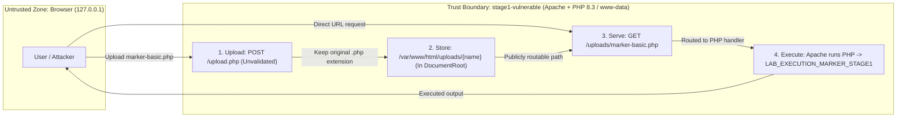
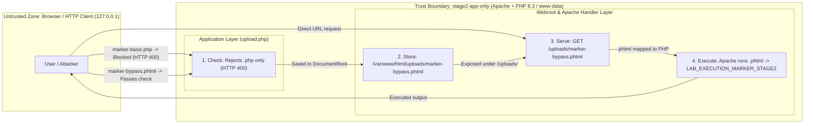
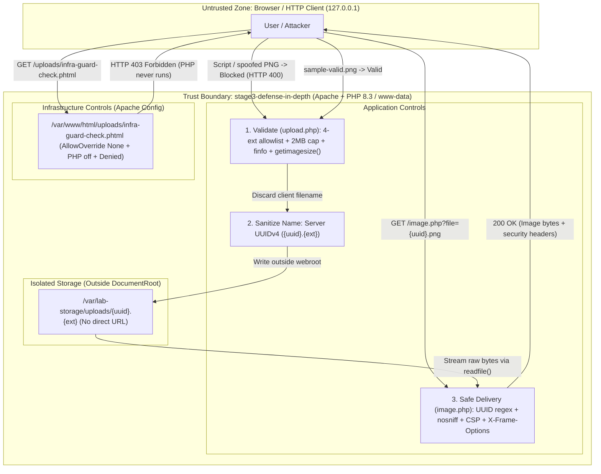

# Lab 01: File Upload Defense & Defense in Depth on PHP + Apache

[日本語](./README.md) | [Root Guide](../../README.en.md) | [Safety Policy](../../SAFETY.en.md) | [Roadmap](../../docs/roadmap.en.md)

> [!CAUTION]
> Stage 1 (`8081`) and Stage 2 (`8082`) are intentionally vulnerable environments strictly for local study. Never expose them on public servers or shared networks; follow [SAFETY.en.md](../../SAFETY.en.md).

## 1. Learning Objectives

1. **Structure the Attack Chain**: Explain why server-side code execution requires all four phases (`Upload -> Store -> Serve -> Execute`) to align.
2. **Distrust Client Metadata**: Explain why filenames, extensions, and client-supplied `Content-Type` headers are trivially spoofed untrusted inputs.
3. **Spot Denylist Gaps**: Explain why blocking `.php` in application code still fails when Apache maps `.phtml` to the PHP interpreter.
4. **Build Defense in Depth**: Combine Application controls (allowlist, server-side content checks, `UUIDv4` rename, outside-webroot isolation, controlled delivery) with Infrastructure controls (`AllowOverride None`, PHP engine off, direct access denied) to eliminate single points of failure.

## 2. Quickstart & Automated Verification

```bash
cd labs/01-php-upload-defense
docker compose up --build -d
```

All stages run Apache + PHP 8.3 (internal port `8080`, non-root user `www-data`, `internal: true` isolated network) bound strictly to `127.0.0.1`:

| Stage | Local URL | Language Toggle | State Reset |
| :--- | :--- | :--- | :--- |
| **Stage 1** | `http://127.0.0.1:8081` | `?lang=ja` / `?lang=en` | UI Reset button (`POST /reset.php`) |
| **Stage 2** | `http://127.0.0.1:8082` | `?lang=ja` / `?lang=en` | UI Reset button (`POST /reset.php`) |
| **Stage 3** | `http://127.0.0.1:8083` | `?lang=ja` / `?lang=en` | UI Reset button (`POST /reset.php`) |

### Sample Payloads ([`samples/README.en.md`](./samples/README.en.md))

All marker scripts output fixed strings and read-only runtime info only—zero user input reading and zero OS command execution functions.

| File | Purpose | Outcome Across Stages |
| :--- | :--- | :--- |
| [`samples/sample-valid.png`](./samples/sample-valid.png) | Valid PNG image | Accepted and displayed in Stages 1, 2, and 3 |
| [`samples/marker-basic.php`](./samples/marker-basic.php) | `.php` execution marker | Executes in Stage 1 (`LAB_EXECUTION_MARKER_STAGE1`); blocked (`HTTP 400`) in Stages 2 & 3 |
| [`samples/marker-bypass.phtml`](./samples/marker-bypass.phtml) | `.phtml` bypass marker | Bypasses filter and executes in Stage 2 (`LAB_EXECUTION_MARKER_STAGE2`); blocked (`HTTP 400`) in Stage 3 |

### Automated Verification & Teardown ([`tests/README.en.md`](./tests/README.en.md))

```bash
# Verify stage behaviors, security headers, and static safety rules
docker compose --profile test run --rm verifier

# Stop and remove containers
docker compose down
```

## 3. Data Flow Diagrams & Trust Boundary Analysis

### 3.1 Stage 1 (`127.0.0.1:8081`): Unvalidated Webroot Upload

Stage 1 performs no extension or content checks, applying only `basename()` before writing directly into `/var/www/html/uploads/{name}` inside `DocumentRoot`.



**Why Stage 1 Executes**:
- Saved on disk with an attacker-controlled `.php` extension.
- Stored inside `DocumentRoot`, making it directly reachable by URL.
- Served from a directory where Apache's PHP handler is active, turning uploaded data into executed code.

### 3.2 Stage 2 (`127.0.0.1:8082`): Naive App Denylist vs. Handler Mismatch

Stage 2 rejects `.php` in PHP code (`HTTP 400`), yet still stores files in `/var/www/html/uploads/{name}` while Apache maps both `.php` and `.phtml` to PHP.



**Why Stage 2 Fails**:
- **App vs. Server Handler Mismatch**: The PHP filter assumes only `.php` executes, whereas Apache's `<FilesMatch "\.(php|phtml)$">` also executes `.phtml`. Denylists fail whenever any server-handled extension or `.htaccess` override is missed.
- **Untrusted Client `Content-Type`**: Checking the request's `Content-Type: image/png` header adds no security because any client (`curl`) can spoof it in a single command.

### 3.3 Stage 3 (`127.0.0.1:8083`): App + Infra Defense in Depth

Stage 3 places independent controls across all four phases and locks down `/var/www/html/uploads/` at the Apache layer (verified via the pre-seeded probe `infra-guard-check.phtml`).



**How Stage 3 Breaks the Chain**:
- **Upload Validation**: Enforces a 4-extension allowlist (`png`, `jpg`, `jpeg`, `gif`), 2MB cap, `finfo(FILEINFO_MIME_TYPE)` magic-byte inspection, and `getimagesize()` structural checks.
- **Outside-Webroot Storage & Renaming**: Replaces client filenames with random `UUIDv4.<ext>` names and stores files in `/var/lab-storage/uploads/` outside `DocumentRoot`, removing direct URL routing.
- **Controlled Delivery**: Streams bytes via `/image.php?file=<uuid>.<ext>` after strict UUID regex validation, attaching `X-Content-Type-Options: nosniff`, `Content-Security-Policy: default-src 'none'`, and `X-Frame-Options: DENY`.
- **Independent Apache Hardening**: Enforces `AllowOverride None`, disables PHP execution and CGI/Indexes, and sets `Require all denied` on `/var/www/html/uploads/` so `GET /uploads/infra-guard-check.phtml` returns `HTTP 403` without executing PHP.

## 4. Threat-to-Mitigation Matrix

| Phase | Threat Vector | Stage 1 | Stage 2 | Stage 3: App Layer | Stage 3: Infra Layer |
| :--- | :--- | :--- | :--- | :--- | :--- |
| **Upload** | Direct `.php` upload (`marker-basic.php`) | Executes | Blocked (400) | Blocked by allowlist (400) | PHP off & access denied |
| **Upload** | Alternate extension (`marker-bypass.phtml`) | Executes | Bypassed & Executes | Blocked by allowlist (400) | PHP off & denied (403) |
| **Upload** | Spoofed `Content-Type` or PHP disguised as `.png` | Accepted | Accepted if non-`.php` | Rejected by `finfo` + `getimagesize()` (400) | Not routed to PHP |
| **Upload** | Oversized upload resource exhaustion | Uncapped | Uncapped | Blocked above 2MB (400) | Contained in non-root container |
| **Store** | Attacker-chosen filename / path traversal | `basename()` only | `basename()` only | Forced `UUIDv4.<ext>` rename | Minimal `www-data` write perms |
| **Store** | `.htaccess` handler override upload | Writable in webroot | Allowed (not `.php`) | Allowlist block + outside webroot | Ignored via `AllowOverride None` |
| **Serve** | Direct URL navigation to stored upload | Reachable at `/uploads/<name>` | Reachable at `/uploads/<name>` | Outside webroot; `/image.php` only | `/uploads` returns `HTTP 403` |
| **Serve** | Browser MIME sniffing / embedded script execution | No security headers | No security headers | `nosniff` + `CSP: default-src 'none'` + `DENY` | Hardened header defaults |
| **Execute** | Server-side PHP execution of uploaded file | Executed by `mod_php` | `.phtml` executed | Streamed as raw bytes (`readfile()`) | PHP engine disabled & `-ExecCGI` |

## 5. Companion Materials

- **Hands-On Workshop Guide (60–90 min + `curl` spoofing appendix)**: [docs/en/hands-on-guide.md](./docs/en/hands-on-guide.md)
- **Participant Threat Modeling Worksheet (with answer key)**: [docs/en/worksheet.md](./docs/en/worksheet.md)
- **Lightning Talk Demo Script (5-min & 10-min)**: [docs/en/lt-script.md](./docs/en/lt-script.md)
- **Samples & Automated Verifier Reference**: [samples/README.en.md](./samples/README.en.md) | [tests/README.en.md](./tests/README.en.md)
- **Future Multi-Lab Candidates**: [../../docs/roadmap.en.md](../../docs/roadmap.en.md)
