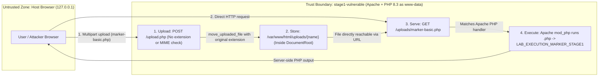
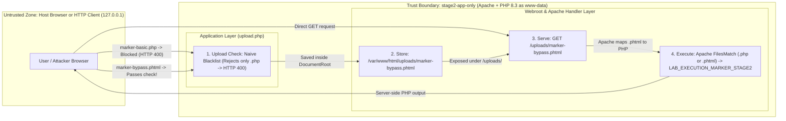
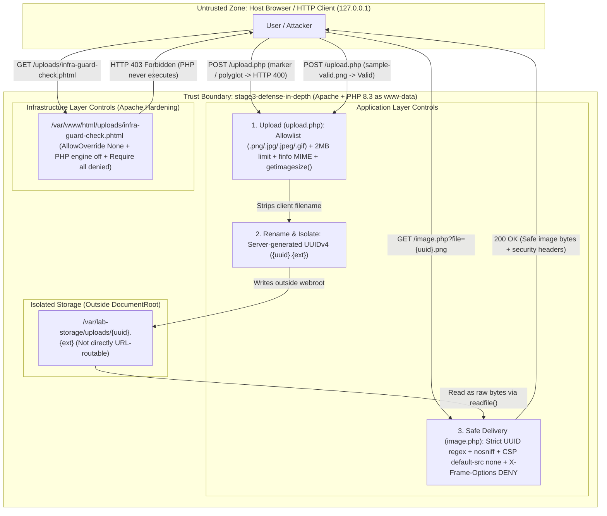

# Lab 01: PHP + Apache ファイルアップロードからコード実行への連鎖と多層防御

**[📂 Lab Index (README.md)](./README.md)** | **[🇺🇸 English (README.en.md)](./README.en.md)** | **[🏠 ルートガイド (../../README.ja.md)](../../README.ja.md)** | **[🛡️ 安全ポリシー (../../docs/safety.ja.md)](../../docs/safety.ja.md)**

---

> [!CAUTION]
> **ローカル学習専用・公開サーバへのデプロイ厳禁**
>
> Stage 1（`127.0.0.1:8081`）および Stage 2（`127.0.0.1:8082`）は、ファイルアップロード設計の不備によるサーバーサイドコード実行を再現するための意図的な脆弱環境です。必ず個人のローカル環境（`127.0.0.1` 限定バインド・`internal: true` 内部隔離ネットワーク）でのみ実行し、公開サーバーや共有ネットワークへ絶対に露出させないでください。

---

## 1. 学習目標（Learning Objectives）

本ラボを完了すると、次の 4 点をデータフローと実装の両面から説明できるようになります。

1. **攻撃連鎖（`Upload -> Store -> Serve -> Execute`）の追跡**: ファイルを受け取る処理（Upload）だけでなく、どこにどの名前で保存し（Store）、どの経路で配信し（Serve）、Web サーバーがどう解釈するか（Execute）の組み合わせでコード実行が発生することを構造的に説明できる。
2. **信頼境界（Trust Boundary）とクライアント入力の不信原則**: ファイル名、拡張子、HTTP リクエストの `Content-Type` ヘッダはいずれも攻撃者が自由に偽装できる「信頼できない入力」であることを説明できる。
3. **アプリケーション単体ブラックリストの限界（パーサー解釈の不一致）**: アプリ層で `.php` を拒否しても、インフラ層（Apache）が `.phtml` 等の別拡張子を PHP ハンドラへ渡す設定になっていれば防御が突破される理由を説明できる。
4. **App 層 × Infra 層の多層防御（Defense in Depth）の設計**: 仮に片方の層に設定ミスや将来の機能変更が生じてもコード実行に至らないよう、App 層（拡張子ホワイトリスト・マジックバイト／画像構造検査・UUIDv4 リネーム・Web 公開領域外への隔離・安全な配信エンドポイント）と Infra 層（`AllowOverride None`・スクリプト実行エンジン無効化・直接アクセス遮断）を重ね合わせる設計を実践できる。

---

## 2. クイックスタートと自動検証

### 2.1 起動とブラウザアクセス

`labs/01-php-upload-defense/` ディレクトリに移動して起動します（初回ビルド完了後は完全オフラインで動作します）。

```bash
cd labs/01-php-upload-defense
docker compose up --build -d
```

すべてのステージは Apache + PHP 8.3（コンテナ内部ポート `8080`、非特権ユーザー `www-data` 実行）で構成され、ホストの `127.0.0.1` にのみ公開されます。

| ステージ | ローカル URL | UI 言語切替 | 初期化（Reset） |
| :--- | :--- | :--- | :--- |
| **Stage 1: Vulnerable** | `http://127.0.0.1:8081` | `?lang=ja` / `?lang=en` | UI 内 Reset ボタン（`POST /reset.php`） |
| **Stage 2: App-Only Insufficient Defense** | `http://127.0.0.1:8082` | `?lang=ja` / `?lang=en` | UI 内 Reset ボタン（`POST /reset.php`） |
| **Stage 3: Defense in Depth** | `http://127.0.0.1:8083` | `?lang=ja` / `?lang=en` | UI 内 Reset ボタン（`POST /reset.php`） |

### 2.2 同梱されている無害な検証用サンプルファイル（`samples/`）

詳細は [`samples/README.md`](./samples/README.md) を参照してください。すべてのスクリプトは外部入力を一切受け取らず、OS コマンド実行関数も含まない安全な固定マーカー出力ファイルです。

| ファイルパス | 用途 | 期待される挙動 |
| :--- | :--- | :--- |
| [`samples/sample-valid.png`](./samples/sample-valid.png) | 正常な PNG 画像 | Stage 1 / 2 / 3 すべてでアップロード・表示に成功する |
| [`samples/marker-basic.php`](./samples/marker-basic.php) | `.php` 実行確認マーカー | Stage 1 で実行成立（`LAB_EXECUTION_MARKER_STAGE1` 出力）、Stage 2・Stage 3 では HTTP 400 で拒否 |
| [`samples/marker-bypass.phtml`](./samples/marker-bypass.phtml) | `.phtml` ブラックリスト回避マーカー | Stage 2 でアプリ検査を通過して実行成立（`LAB_EXECUTION_MARKER_STAGE2` 出力）、Stage 3 では HTTP 400 で拒否 |

### 2.3 自動検証スイートの実行と停止

コンテナ内部ネットワーク（`lab_net`）から全ステージの挙動・ヘッダ・安全制約を自動検証できます（詳細は [`tests/README.md`](./tests/README.md)）。

```bash
# Docker Compose test プロファイルによる E2E 自動検証
docker compose --profile test run --rm verifier

# （任意）ホスト側からのスモークテスト（Windows PowerShell）
pwsh -File tests/host-smoke.ps1

# （任意）ホスト側からのスモークテスト（macOS / Linux）
sh tests/host-smoke.sh

# 演習終了後のコンテナ停止・削除
docker compose down
```

---

## 3. アーキテクチャとデータフロー図（DFD）・信頼境界分析

ファイルアップロードからコード実行に至るリスクは、以下の 4 フェーズの連鎖として整理できます。

- **Upload（受信・検証）**: クライアントからマルチパートデータ（ファイル名・`Content-Type`・バイト列）を受け取る。
- **Store（保存・配置）**: サーバー上のファイルシステムへ特定のパス・ファイル名で書き込む。
- **Serve（ルーティング・配信）**: クライアントからの `GET` リクエストに対し、URL パスを解決してファイルまたはエンドポイントへ振り分ける。
- **Execute（解釈・実行）**: Web サーバー／スクリプトエンジンが対象ファイルを「静的バイト列」として返すか、「サーバーサイドコード」として実行するか決定する。

以下、Stage 1 → Stage 2 → Stage 3 のデータフロー図（DFD）と信頼境界（Trust Boundary）の推移を示します。

---

### 3.1 Stage 1: Vulnerable（`http://127.0.0.1:8081`）— 無防備な Web ルート直下保存

Stage 1 では拡張子検査もファイル内容検査も行わず、`basename()` でディレクトリトラバーサルを除いた元のファイル名のまま公開ディレクトリ `/var/www/html/uploads/{name}` に保存します。



**何が問題か（破綻した前提）:**
- 未検証の外部入力が、そのまま以下の **3 つの危険条件** をすべて満たしています。
  1. **攻撃者が制御可能な拡張子**（`.php`）のまま保存される。
  2. **DocumentRoot 配下**（`/var/www/html/uploads/`）に置かれ、外部から直接 URL 指定でリクエストできる。
  3. **Apache の PHP 実行ハンドラが有効**なディレクトリであるため、静的ファイルではなく PHP コードとして実行される。

---

### 3.2 Stage 2: App-Only Insufficient Defense（`http://127.0.0.1:8082`）— ブラックリストとパーサー解釈の不一致

Stage 2 では開発者が「`.php` さえ弾けば安全だろう」と考え、アプリケーション側で拡張子 `.php` を拒否するブラックリスト（`HTTP 400`）を追加しました。しかし保存先は依然として `/var/www/html/uploads/{name}` であり、Apache 側では `<FilesMatch "\.(php|phtml)$">` が PHP ハンドラに紐付いています。



**なぜ防御が失敗したのか:**
1. **App 層と Infra 層の「実行可能拡張子」の認識ギャップ**: アプリコードは `.php` だけを危険とみなしていますが、実行主体である Apache は `.phtml` も PHP として解釈・実行します。ブラックリスト方式は `.phtml`、`.php5`、`.phar`、大文字小文字揺れ、設定ファイル（`.htaccess`）など「Web サーバー側が解釈し得るすべてのパターン」を永久に網羅し続けなければならず、構造的に脆弱です。
2. **クライアント申告 `Content-Type` ヘッダが信用できない理由**: 仮にアプリ側で `$_FILES['file']['type'] === 'image/png'` をチェックしたとしても、この値はブラウザや HTTP クライアントが自己申告する `Content-Type` ヘッダにすぎません。`curl -F "file=@samples/marker-bypass.phtml;type=image/png"` のように 1 行で偽装できるため、信頼境界の手前にあるメタデータは検証根拠になりません（ハンズオン手順書の上級編で実演できます）。

---

### 3.3 Stage 3: Defense in Depth（`http://127.0.0.1:8083`）— App 層 × Infra 層の多層防御

Stage 3 では、`Upload -> Store -> Serve -> Execute` の**すべてのフェーズに独立した防御壁**を配置しています。さらに、万が一アプリのバグ等で Web ルート内の `/var/www/html/uploads/` に `.phtml` ファイル（事前配置フィクスチャ `infra-guard-check.phtml`）が置かれた場合でも、インフラ層単体で実行とアクセスを阻止します。



**Stage 3 が堅牢である理由（単一障害点の排除）:**
- **第 1 壁（Upload — 厳格な入力検証）**: 許可拡張子ホワイトリスト（`png`, `jpg`, `jpeg`, `gif`）、ファイルサイズ上限（2MB）、サーバー側の `finfo(FILEINFO_MIME_TYPE)` によるマジックバイト検査、および `getimagesize()` による画像ヘッダ構造検査をすべて通過したファイルのみを受け入れます。拡張子を `.png` に偽装した PHP スクリプトもここで `HTTP 400` として拒否されます。
- **第 2 壁（Store — ファイル名無害化と Web ルート外隔離）**: クライアント由来のファイル名を完全に破棄してサーバー生成の `UUIDv4.<ext>` に置き換え、Apache の `DocumentRoot`（`/var/www/html`）の外側にある `/var/lab-storage/uploads/` に保存します。これにより、アップロードファイルに対する直接 URL ルーティング自体が存在しなくなります。
- **第 3 壁（Serve — 専用配信エンドポイントとレスポンスヘッダ固定）**: 画像取得は `/image.php?file=<uuid>.<ext>` 経由で行い、厳格な UUIDv4 正規表現検証でパストラバーサルを防いだうえで、バイナリストリームとして返却します。同時に `X-Content-Type-Options: nosniff`、`Content-Security-Policy: default-src 'none'`、`X-Frame-Options: DENY` を付与し、ブラウザ側での MIME スニッフィングやスクリプト実行も抑止します。
- **第 4 壁（Execute / Infra — Apache 側の独立ハードニング）**: 仮に将来の改修ミスで `/var/www/html/uploads/` にファイルが置かれたとしても、Apache 設定で `AllowOverride None`（`.htaccess` による設定上書き禁止）、PHP 実行エンジンの無効化、`Options -ExecCGI -Indexes`、および `Require all denied` を適用しているため、`GET /uploads/infra-guard-check.phtml` は **HTTP 403** となり PHP として実行されることはありません。

---

## 4. 脅威と多層防御の対応マトリクス（Threat-to-Mitigation Matrix）

| フェーズ | 想定される脅威・攻撃手法 | Stage 1 (Vulnerable) | Stage 2 (App-Only) | Stage 3: App 層の対策 | Stage 3: Infra 層の対策 |
| :--- | :--- | :--- | :--- | :--- | :--- |
| **Upload** | `.php` スクリプトの直接アップロード (`marker-basic.php`) | ❌ 通過・実行 | ⚠️ ブラックリストで拒否 (`HTTP 400`) | ✅ ホワイトリスト（画像 4 種のみ）で拒否 (`HTTP 400`) | ✅ 万一配置されても実行無効・アクセス拒否 |
| **Upload** | 代替実行拡張子によるバイパス (`marker-bypass.phtml`) | ❌ 通過・実行 | ❌ **バイパス成立・実行** | ✅ ホワイトリスト外のため拒否 (`HTTP 400`) | ✅ `/uploads` の PHP エンジン無効化・`HTTP 403` |
| **Upload** | `Content-Type: image/png` ヘッダ偽装 / 拡張子 `.png` 偽装 PHP | ❌ 通過 | ❌ `.phtml` 等と併用で通過 | ✅ クライアントヘッダ不信 + `finfo` & `getimagesize()` で拒否 (`HTTP 400`) | ✅ PHP として解釈・実行されない |
| **Upload** | 大容量ファイルによるストレージ圧迫 | ❌ 独自上限なし | ❌ 独自上限なし | ✅ アプリ層で 2MB 上限チェック | ✅ コンテナ隔離環境 |
| **Store** | 攻撃者が指定したファイル名・パストラバーサル悪用 | ⚠️ `basename()` のみ（元の名前を維持） | ⚠️ `basename()` のみ（元の名前を維持） | ✅ 元の名前を破棄し `UUIDv4.<ext>` へ強制リネーム | ✅ 最小権限 `www-data`（コード領域は書込不可） |
| **Store** | `.htaccess` アップロードによる Apache ハンドラ書き換え | ❌ Web ルート内に保存可能 | ❌ `.php` 以外のため保存可能 | ✅ ホワイトリスト拒否 + Web ルート外 `/var/lab-storage/uploads/` 保存 | ✅ `AllowOverride None` により `.htaccess` 完全無視 |
| **Serve** | アップロード先 URL への直接 HTTP アクセス | ❌ `/uploads/<name>` で直接到達 | ❌ `/uploads/<name>` で直接到達 | ✅ Web ルート外のため直接 URL なし（`/image.php` 経由のみ） | ✅ `/var/www/html/uploads` を `Require all denied` (`HTTP 403`) |
| **Serve** | ブラウザの MIME スニッフィング / 埋め込みスクリプト発火 | ❌ 対策ヘッダなし | ❌ 対策ヘッダなし | ✅ `X-Content-Type-Options: nosniff` + `Content-Security-Policy: default-src 'none'` + `X-Frame-Options: DENY` | ✅ 適切なレスポンスヘッダ送出 |
| **Execute** | Web サーバーによるサーバーサイドスクリプト実行 | ❌ `mod_php` が実行 | ❌ `.phtml` を `mod_php` が実行 | ✅ `readfile()` で純粋なデータバイト列としてのみ出力 | ✅ `/uploads` で PHP エンジン無効化・`-ExecCGI` |

---

## 5. 関連教材・次のステップ

実践演習や勉強会・LT での活用には、以下の専用ドキュメントをご利用ください。

- **📘 ハンズオン手順書（60〜90 分ワークショップ対応・`curl` 偽装演習付き）**:
  - [docs/ja/hands-on-guide.md](./docs/ja/hands-on-guide.md)
- **📝 参加者用 脅威モデリング・ワークシート（折りたたみ模範解答付き）**:
  - [docs/ja/worksheet.md](./docs/ja/worksheet.md)
- **🎤 LT 登壇・ライブデモ台本（5 分版 / 10 分版）**:
  - [docs/ja/lt-script.md](./docs/ja/lt-script.md)
- **🧪 サンプルとテストの詳細**:
  - [samples/README.md](./samples/README.md) | [tests/README.md](./tests/README.md)
- **🗺️ 次の発展テーマ（Nginx + PHP-FPM 境界、画像ポリグロット、Presigned URL 等）**:
  - [マルチ・ラボ拡張ロードマップ (../../docs/roadmap.ja.md)](../../docs/roadmap.ja.md)
