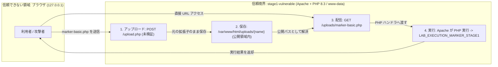
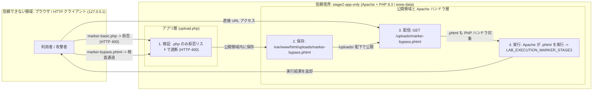
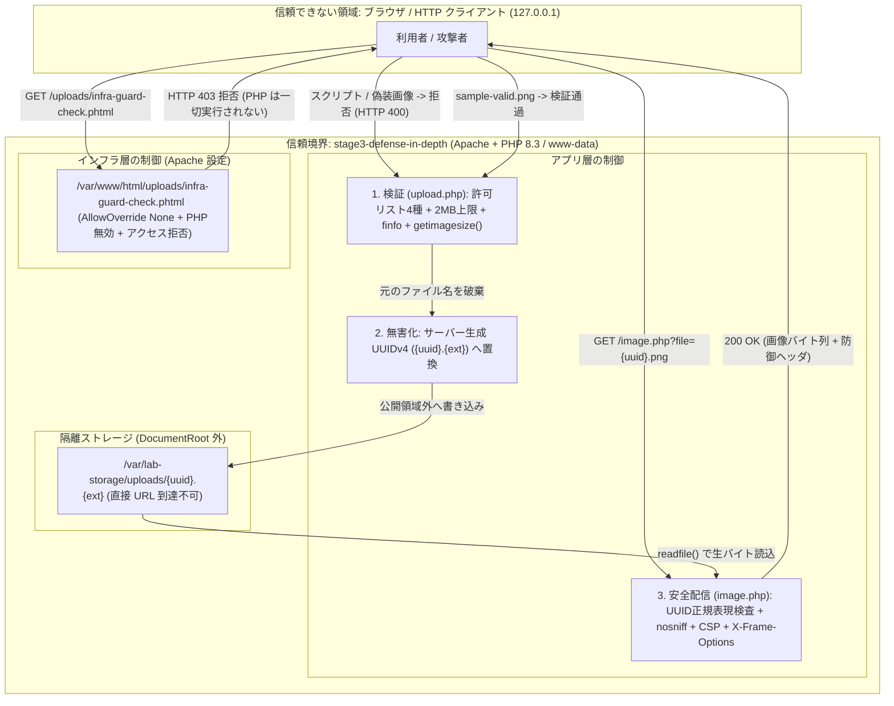

# Lab 01: PHP + Apache ファイルアップロード防御と多層設計

[English](./README.en.md) | [トップページ](../../README.md) | [安全ポリシー](../../SAFETY.md) | [用語集](../../docs/glossary.md) | [ロードマップ](../../docs/roadmap.md)

> [!CAUTION]
> Stage 1（`8081`）と Stage 2（`8082`）は意図的に脆弱なローカル専用環境です。公開サーバや共有ネットワークには絶対に露出させず、[SAFETY.md](../../SAFETY.md) を遵守してください。

## 1. 学習目標

1. **攻撃連鎖の構造化**: 「アップロード → 保存 → 配信 → 実行」の 4 段階が揃ったときに初めてサーバーサイドのコード実行が成立することを説明できる。
2. **クライアント入力の不信原則**: ファイル名、拡張子、リクエストの `Content-Type` ヘッダはいずれも偽装可能な信頼できない入力であることを説明できる。
3. **単層拒否リストの限界**: アプリ層で `.php` を弾いても、Apache が `.phtml` を PHP として実行する設定であれば容易に回避される理由を説明できる。
4. **多層防御の実装**: アプリ層（許可リスト・実ファイル内容検査・`UUIDv4` リネーム・公開領域外保存・専用配信）とインフラ層（`AllowOverride None`・PHP 実行無効化・直接アクセス拒否）を重ねて単一障害点をなくす設計を説明できる。

## 2. クイックスタートと自動検証

```bash
cd labs/01-php-upload-defense
docker compose up --build -d
```

全ステージは Apache + PHP 8.3（内部ポート `8080`、非特権ユーザー `www-data`、`internal: true` 隔離ネットワーク）で動作し、ホストの `127.0.0.1` のみに公開されます。

| ステージ | ローカル URL | 言語切替 | 状態リセット |
| :--- | :--- | :--- | :--- |
| **Stage 1** | `http://127.0.0.1:8081` | `?lang=ja` / `?lang=en` | 画面内リセットボタン（`POST /reset.php`） |
| **Stage 2** | `http://127.0.0.1:8082` | `?lang=ja` / `?lang=en` | 画面内リセットボタン（`POST /reset.php`） |
| **Stage 3** | `http://127.0.0.1:8083` | `?lang=ja` / `?lang=en` | 画面内リセットボタン（`POST /reset.php`） |

### 検証用サンプルファイル（[`samples/README.md`](./samples/README.md)）

すべての検証用スクリプトは外部入力を参照せず、OS コマンド実行関数も含まない固定マーカー出力ファイルです。

| ファイル | 用途 | 各ステージでの結果 |
| :--- | :--- | :--- |
| [`samples/sample-valid.png`](./samples/sample-valid.png) | 正常な PNG 画像 | Stage 1・2・3 すべてで受理・表示される |
| [`samples/marker-basic.php`](./samples/marker-basic.php) | `.php` 実行確認マーカー | Stage 1 で実行（`LAB_EXECUTION_MARKER_STAGE1`）、Stage 2・3 は `HTTP 400` で拒否 |
| [`samples/marker-bypass.phtml`](./samples/marker-bypass.phtml) | `.phtml` 回避確認マーカー | Stage 2 で検査を通過し実行（`LAB_EXECUTION_MARKER_STAGE2`）、Stage 3 は `HTTP 400` で拒否 |

### 自動検証と終了（[`tests/README.md`](./tests/README.md)）

```bash
# 全ステージの挙動・レスポンスヘッダ・静的安全性チェックを実行
docker compose --profile test run --rm verifier

# コンテナの停止・削除
docker compose down
```

## 3. データフロー図と信頼境界の分析

### 3.1 Stage 1 (`127.0.0.1:8081`): 未検証アップロードと公開領域保存

拡張子や内容の検査を行わず、`basename()` のみ適用して `DocumentRoot` 内の `/var/www/html/uploads/{name}` にそのまま保存します。



**突破される理由**:
- 攻撃者が指定した `.php` 拡張子のまま保存される。
- `DocumentRoot` 配下に配置されるため、外部から直接 URL で呼び出せる。
- 保存先ディレクトリで Apache の PHP ハンドラが有効になっており、データではなくコードとして実行される。

### 3.2 Stage 2 (`127.0.0.1:8082`): アプリ単体の拒否リストとハンドラ不一致

アプリ側で `.php` のみを拒否（`HTTP 400`）しますが、保存先は依然として `/var/www/html/uploads/{name}` であり、Apache 側は `.php` と `.phtml` の両方を PHP として処理します。



**突破される理由**:
- **アプリ層とインフラ層の解釈不一致**: アプリは `.php` だけを危険と想定していますが、Apache の `<FilesMatch "\.(php|phtml)$">` は `.phtml` も PHP として実行します。拒否リスト方式はサーバー側が実行し得る全拡張子や `.htaccess` を網羅し続けられず破綻します。
- **クライアント申告 `Content-Type` の偽装可能性**: リクエスト内の `Content-Type: image/png` はクライアントの自己申告値であり、`curl` 等で 1 行で偽装できるため検証根拠になりません。

### 3.3 Stage 3 (`127.0.0.1:8083`): アプリ層とインフラ層の多層防御

4 つのフェーズすべてに独立した防御壁を設け、さらに `/var/www/html/uploads/` に事前配置した検証用ファイル `infra-guard-check.phtml` に対しても Apache 側単体でアクセス拒否と実行無効化を強制しています。



**攻撃連鎖が止まる理由**:
- **アップロード検証**: 拡張子許可リスト（`png`, `jpg`, `jpeg`, `gif`）、2MB 上限、`finfo(FILEINFO_MIME_TYPE)` のマジックバイト検査、`getimagesize()` の画像構造検査をすべて満たすファイルのみ受理します。
- **隔離保存とリネーム**: 元のファイル名を捨てて `UUIDv4.<ext>` に置換し、`DocumentRoot` 外の `/var/lab-storage/uploads/` に保存するため、直接 URL ルートが存在しません。
- **安全な配信制御**: `/image.php?file=<uuid>.<ext>` で厳格な UUID 正規表現を検証したうえでバイト列のみを返し、`X-Content-Type-Options: nosniff`、`Content-Security-Policy: default-src 'none'`、`X-Frame-Options: DENY` を付与します。
- **インフラ層の独立防御**: 万一公開ディレクトリ内にファイルが置かれても、Apache の `AllowOverride None`、PHP エンジン無効化、`-ExecCGI -Indexes`、`Require all denied` により `GET /uploads/infra-guard-check.phtml` は `HTTP 403` で遮断されます。

## 4. 脅威と多層防御の対応表

| フェーズ | 想定される脅威 | Stage 1 | Stage 2 | Stage 3: アプリ層 | Stage 3: インフラ層 |
| :--- | :--- | :--- | :--- | :--- | :--- |
| **アップロード** | `.php` ファイルの送信 (`marker-basic.php`) | 通過・実行 | 拒否 (400) | 許可リストで拒否 (400) | PHP 無効・アクセス拒否 |
| **アップロード** | 代替拡張子による回避 (`marker-bypass.phtml`) | 通過・実行 | バイパス・実行 | 許可リストで拒否 (400) | PHP 無効・アクセス拒否 (403) |
| **アップロード** | `Content-Type` 偽装・拡張子 `.png` 偽装スクリプト | 通過 | `.php` 以外は通過 | `finfo` と `getimagesize()` で拒否 (400) | PHP 解釈対象外 |
| **アップロード** | 大容量ファイルによるリソース圧迫 | 上限なし | 上限なし | 2MB 上限で拒否 (400) | 非特権コンテナ隔離 |
| **保存** | 任意ファイル名・パストラバーサル悪用 | `basename()` のみ | `basename()` のみ | `UUIDv4.<ext>` へ強制置換 | `www-data` 最小書込権限 |
| **保存** | `.htaccess` によるハンドラ設定上書き | 公開領域に保存可 | `.php` 以外のため保存可 | 許可リスト拒否 + 公開領域外保存 | `AllowOverride None` で無効化 |
| **配信** | 保存ファイルへの直接 URL アクセス | `/uploads/<name>` で到達 | `/uploads/<name>` で到達 | 公開領域外のため直接 URL なし | `/uploads` を `HTTP 403` 遮断 |
| **配信** | ブラウザの MIME スニッフィング・スクリプト発火 | 防御ヘッダなし | 防御ヘッダなし | `nosniff` + `CSP: default-src 'none'` + `DENY` | 安全なヘッダ送出 |
| **実行** | Web サーバーでのスクリプト実行 | `mod_php` が実行 | `.phtml` を実行 | `readfile()` でデータとして出力 | PHP エンジン無効・`-ExecCGI` |

## 5. 関連ドキュメント

- **勉強会ハンズオン手順書（60〜90 分・`curl` 偽装演習付き）**: [docs/ja/hands-on-guide.md](./docs/ja/hands-on-guide.md)
- **脅威モデリング・ワークシート（模範解答付き）**: [docs/ja/worksheet.md](./docs/ja/worksheet.md)
- **LT ライブデモ台本（5 分版 / 10 分版）**: [docs/ja/lt-script.md](./docs/ja/lt-script.md)
- **サンプル・自動検証リファレンス**: [samples/README.md](./samples/README.md) | [tests/README.md](./tests/README.md)
- **初学者向け用語集**: [../../docs/glossary.md](../../docs/glossary.md)
- **今後の発展ラボ候補**: [../../docs/roadmap.md](../../docs/roadmap.md)
