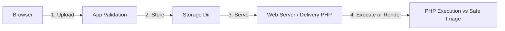

# Hands-On Workshop Guide: Upload-to-Execution Chain & Defense-in-Depth

[日本語](../ja/hands-on-guide.md)

Related Docs: [Lab 01 Overview](../../README.en.md) | [Worksheet](./worksheet.md) | [LT Demo Script](./lt-script.md) | [Sample Files](../../samples/README.en.md) | [Automated Verification](../../tests/README.en.md)

> [!CAUTION]
> For local educational use on `127.0.0.1` only. Never deploy to public servers or shared networks, and use only the harmless files in `samples/` (see [SAFETY.en.md](../../../../SAFETY.en.md)).

## 1. Goals & Prerequisites

Experience the `Upload -> Store -> Serve -> Execute` attack chain and multi-layer defenses using only a browser (60–90 min; 100% offline after initial build).

- **Learning Goals**:
  1. Observe in Stage 1 how unvalidated webroot storage leads to server-side PHP execution.
  2. Observe in Stage 2 how an app-only `.php` denylist is bypassed via `.phtml` due to an App vs. Apache configuration gap.
  3. Verify in Stage 3 how independent App, Storage, Delivery, and Infrastructure controls each break the chain.
- **Prerequisites**: Docker Compose (Windows WSL2 / macOS / Linux) and a modern web browser.



## 2. Recommended Timetables

Keep the [Worksheet](./worksheet.md) open alongside your browser.

### 60-Minute Track (Browser Walkthrough + Worksheet)

| Time | Phase | Activity |
| :--- | :--- | :--- |
| 00:00 - 00:08 | Intro & Safety | Review safety rules, verify running containers |
| 00:08 - 00:20 | Stage 1 Lab | Observe `.php` marker execution on `8081`, update worksheet |
| 00:20 - 00:35 | Stage 2 Lab | Test `.php` block and `.phtml` bypass on `8082`, update worksheet |
| 00:35 - 00:50 | Stage 3 Lab | Verify allowlist, `/image.php` headers, and infra HTTP `403` guard on `8083` |
| 00:50 - 01:00 | Debrief & Stop | Review worksheet answer key, run `docker compose down` |

### 90-Minute Track (Core Lab + Appendices A & B)

| Time | Phase | Activity |
| :--- | :--- | :--- |
| 00:00 - 00:50 | Core Lab | Complete Intro through Stage 3 from the 60-minute track |
| 00:50 - 01:08 | Appendix A: `curl` | Test `Content-Type` and `.png` filename spoofing from CLI |
| 01:08 - 01:22 | Appendix B: Code Diff | Compare PHP code and Apache configs across Stages 1–3; group discussion |
| 01:22 - 01:30 | Wrap-Up & Stop | Review answer key, Q&A, run `docker compose down` |

## 3. Setup & Startup

### Facilitator Check & Safety Briefing
- [ ] Ask participants to pre-build images before arriving so venue Wi-Fi is not saturated.
- [ ] State three mandatory rules before starting: (1) run strictly on `127.0.0.1`, (2) upload only files from `samples/`, and (3) never test unauthorized external systems.

### Start & Verify Containers

```bash
cd labs/01-php-upload-defense
docker compose up --build -d
docker compose --profile test run --rm verifier
```

## 4. Browser Walkthrough Steps

Use the three sample files in `labs/01-php-upload-defense/samples/`: `sample-valid.png`, `marker-basic.php`, and `marker-bypass.phtml`.

### Step 1: Stage 1 Vulnerable Baseline (`http://127.0.0.1:8081/?lang=en`)

- **Action 1-1**: Open Stage 1, confirm the top safety warning banner, and click **Reset**.
  - **Expected Result**: The uploaded files list is cleared.
- **Action 1-2**: Upload `samples/sample-valid.png` and open `/uploads/sample-valid.png`.
  - **Expected Result**: Accepted with HTTP `200` and displayed normally as a PNG image.
- **Action 1-3**: Upload `samples/marker-basic.php` and open `/uploads/marker-basic.php`.
  - **Expected Result**: Outputs `LAB_EXECUTION_MARKER_STAGE1` plus PHP version and user `www-data` — proving Apache executed the uploaded file as PHP on the server.
- **Action 1-4**: Record Stage 1 notes in your [Worksheet](./worksheet.md), then click **Reset**.
  - **Expected Result**: `/uploads/marker-basic.php` is deleted and returns HTTP `404`.

### Step 2: Stage 2 App-Only Denylist Failure (`http://127.0.0.1:8082/?lang=en`)

- **Action 2-1**: Open Stage 2, click **Reset**, and upload `samples/marker-basic.php`.
  - **Expected Result**: Blocked with **HTTP `400`** by the application's `.php` denylist.
- **Action 2-2**: Select `samples/marker-bypass.phtml` in your browser, upload it, and open `/uploads/marker-bypass.phtml`.
  - **Expected Result**: Accepted with **HTTP `200`** and executed on the server, printing `LAB_EXECUTION_MARKER_STAGE2`.
  - **Root Cause**: App code only blocked `.php`, whereas Apache's `<FilesMatch "\.(php|phtml)$">` also executes `.phtml` inside `DocumentRoot`.
- **Action 2-3**: Record Stage 2 notes in your [Worksheet](./worksheet.md) and click **Reset**.
  - **Expected Result**: The uploaded `.phtml` file is removed.

### Step 3: Stage 3 Defense-in-Depth (`http://127.0.0.1:8083/?lang=en`)

- **Action 3-1**: Open Stage 3, click **Reset**, and try uploading `marker-basic.php` and `marker-bypass.phtml`.
  - **Expected Result**: Both are rejected with **HTTP `400`** by the strict image allowlist (`png`, `jpg`, `jpeg`, `gif`).
- **Action 3-2**: Upload `samples/sample-valid.png` and open the resulting link with Browser DevTools (**Network** tab) open.
  - **Expected Result**: Served via `/image.php?file=<UUIDv4>.png` from `/var/lab-storage/uploads/` (outside `DocumentRoot`) with `X-Content-Type-Options: nosniff`, `Content-Security-Policy: default-src 'none'`, and `X-Frame-Options: DENY`.
- **Action 3-3**: Navigate directly to `http://127.0.0.1:8083/uploads/infra-guard-check.phtml`.
  - **Expected Result**: Returns **HTTP `403`** with zero PHP execution (Apache enforces `AllowOverride None`, disables the PHP engine, and denies direct `/uploads` access even if app code ever failed).
- **Action 3-4**: Click **Reset**.
  - **Expected Result**: Your uploaded PNG returns HTTP `404`, while `/uploads/infra-guard-check.phtml` remains protected with HTTP `403`. Complete your [Worksheet](./worksheet.md).

## 5. Teardown & FAQ

Always stop containers at the end of the session:

```bash
cd labs/01-php-upload-defense
docker compose down
```

- **Port `8081`–`8083` already in use**: Stop conflicting local servers and retry; never remove `127.0.0.1:` from `compose.yaml`.
- **`curl` errors in Windows PowerShell**: Always invoke `curl.exe` explicitly to avoid PowerShell's `Invoke-WebRequest` alias.
- **No internet at the venue**: Run `docker compose up --build -d` once ahead of time; all assets work 100% offline.

## Appendix A: `curl` Header & Filename Spoofing Lab

Run from `labs/01-php-upload-defense/`. In Windows PowerShell, use `curl.exe` and keep `-F "..."` double-quoted so `;` is not split.

### A-1. Spoof `Content-Type: image/png` on `.phtml` Against Stage 2
- **bash / zsh**:
  ```bash
  curl -i -F "file=@samples/marker-bypass.phtml;type=image/png" http://127.0.0.1:8082/upload.php
  ```
- **Windows PowerShell**:
  ```powershell
  curl.exe -i -F "file=@samples/marker-bypass.phtml;type=image/png" "http://127.0.0.1:8082/upload.php"
  ```
- **Expected Result**: Accepted with HTTP `200` — client `Content-Type` headers are untrusted (reset Stage 2 afterward).

### A-2. Spoof Both `filename=disguised.png` and `Content-Type: image/png` Against Stage 3
- **bash / zsh**:
  ```bash
  curl -i -F "file=@samples/marker-basic.php;filename=disguised.png;type=image/png" http://127.0.0.1:8083/upload.php
  ```
- **Windows PowerShell**:
  ```powershell
  curl.exe -i -F "file=@samples/marker-basic.php;filename=disguised.png;type=image/png" "http://127.0.0.1:8083/upload.php"
  ```
- **Expected Result**: Rejected with **HTTP `400`** because server-side `finfo` and `getimagesize()` inspect actual file bytes.

### A-3. Inspect Stage 3 Infrastructure Guard Headers
- **bash / zsh**:
  ```bash
  curl -i http://127.0.0.1:8083/uploads/infra-guard-check.phtml
  ```
- **Windows PowerShell**:
  ```powershell
  curl.exe -i "http://127.0.0.1:8083/uploads/infra-guard-check.phtml"
  ```
- **Expected Result**: Returns HTTP `403` with zero PHP execution.

## Appendix B: Code & Config Comparison Challenge

Compare [stage1-vulnerable/](../../stage1-vulnerable/), [stage2-app-only/](../../stage2-app-only/), and [stage3-defense-in-depth/](../../stage3-defense-in-depth/):

1. **`src/upload.php`**: Stage 1 (`basename()` only), Stage 2 (`.php`-only denylist), Stage 3 (2MB cap -> allowlist -> `finfo` -> `getimagesize()` -> `UUIDv4` rename).
2. **Storage & `src/image.php`**: Stages 1–2 write inside `/var/www/html/uploads/`; Stage 3 writes outside `DocumentRoot` to `/var/lab-storage/uploads/` and validates `UUIDv4` regex in `image.php` with `nosniff` + `CSP`.
3. **Apache Config & `Dockerfile`**: Contrast Stage 2's `.phtml` handler mapping against Stage 3's `AllowOverride None`, PHP engine off, and `Require all denied`, plus non-root `USER www-data` across all stages.

### Discussion Prompts
- What extra threats and trade-offs (parser CVEs, CPU cost) come with re-encoding uploaded images via GD or ImageMagick?
- In production (including S3/GCS + CDN setups), where do you enforce `Content-Type`, `nosniff`, and origin separation?
- How can automated checks like `verifier` prevent App vs. Infra configuration drift in CI?
