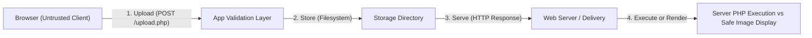

# Hands-On Workshop Guide: From File Upload to Code Execution & Defense-in-Depth (Lab 01)

[日本語](../ja/hands-on-guide.md) | [English](./hands-on-guide.md)

Related Docs: [Lab 01 README](../../README.en.md) | [Threat Modeling Worksheet](./worksheet.md) | [LT Live Demo Script](./lt-script.md) | [Safety Policy](../../../../docs/safety.en.md)

> [!CAUTION]
> **FOR LOCAL EDUCATIONAL USE ONLY - DO NOT DEPLOY PUBLICLY**
> This lab contains intentionally vulnerable stages designed strictly for learning. Run it ONLY on your personal local machine (`127.0.0.1` loopback binding with `internal: true` isolated Docker networking). NEVER deploy these containers to cloud environments, shared servers, or LAN-accessible interfaces, and ONLY upload the harmless sample files provided in `samples/`.

---

## 1. Workshop Overview & Learning Objectives

In this 60–90 minute study-group workshop, participants explore how file upload vulnerabilities escalate across four distinct phases—**`Upload -> Store -> Serve -> Execute`**—and verify how **Defense-in-Depth** breaks that chain using browser-based experiments.

### Learning Objectives
1. **Understand the Full Execution Chain**: Explain why uploading a file alone is not immediate code execution—server-side execution (RCE) requires a combination of storage location, URL exposure, and web server handler interpretation.
2. **Experience Single-Layer Blacklist Failure**: Demonstrate in a standard browser how blocking `.php` in application code still leaves `.phtml` executable when Apache handler mappings disagree with application assumptions.
3. **Verify Defense-in-Depth Controls**: Validate how independent controls across the Application layer (allowlist, magic-byte/image inspection, UUIDv4 rename), Storage layer (outside DocumentRoot), Delivery layer (`/image.php` with strict security headers), and Infrastructure layer (Apache `AllowOverride None`, PHP engine off, HTTP 403 on `/uploads`) each stop the attack chain even if another layer were bypassed.

### Target Audience & Prerequisites
- **Audience**: Web developers, infrastructure/SRE engineers, security students, and study-group participants.
- **Prerequisites**:
  - Docker Desktop (Windows WSL2 / macOS Intel & Apple Silicon) or Docker Engine + Compose plugin (Linux).
  - Any modern web browser with Developer Tools (Chrome, Edge, Firefox, Safari).
  - **100% Offline Ready**: Once container images are built locally, zero internet access is required during the workshop.

---

## 2. Recommended Timetables (60-Minute & 90-Minute Pacing)

Choose between the 60-minute standard track or the 90-minute deep-dive track. Participants should keep the [Threat Modeling Worksheet](./worksheet.md) open alongside their browser.

### A. Standard 60-Minute Track (Browser Walkthrough + Core Worksheet)

| Time | Phase | Activities | Materials |
| :--- | :--- | :--- | :--- |
| 00:00 - 00:10 (10m) | Intro & Safety Briefing | Workshop goals, `Upload -> Store -> Serve -> Execute` overview, safety rules, container check | Sections 3 & 4 |
| 00:10 - 00:22 (12m) | Stage 1 Walkthrough | Observe unrestricted upload and `.php` marker execution; fill in Stage 1 worksheet | `http://127.0.0.1:8081` / Worksheet |
| 00:22 - 00:36 (14m) | Stage 2 Walkthrough | Confirm `.php` block (`HTTP 400`), bypass via `.phtml` in browser, analyze App vs. Apache gap | `http://127.0.0.1:8082` / Worksheet |
| 00:36 - 00:50 (14m) | Stage 3 Walkthrough | Validate multi-layer defenses, inspect `/image.php` headers, test `/uploads` infra guard (`HTTP 403`) | `http://127.0.0.1:8083` / Worksheet |
| 00:50 - 01:00 (10m) | Wrap-Up & Teardown | Review worksheet answer key, share real-world takeaways, run `docker compose down` | Worksheet Answer Key |

### B. Deep-Dive 90-Minute Track (Adds `curl` Spoofing + Code Review Challenge)

| Time | Phase | Activities | Materials |
| :--- | :--- | :--- | :--- |
| 00:00 - 00:10 (10m) | Intro & Safety Briefing | Framing, mandatory safety briefing, run automated verifier check | Sections 3 & 4 |
| 00:10 - 00:25 (15m) | Assets, Trust Boundaries & Stage 1 | Identify assets/trust boundaries on worksheet; complete Stage 1 browser steps | Worksheet Parts 1 & 2 |
| 00:25 - 00:40 (15m) | Stage 2 Walkthrough | `.php` block vs. `.phtml` execution bypass; document the broken assumption | `http://127.0.0.1:8082` / Worksheet |
| 00:40 - 00:55 (15m) | Stage 3 Walkthrough | Browser verification of app allowlist, outside-webroot delivery, and infra failsafe | `http://127.0.0.1:8083` / Worksheet |
| 00:55 - 01:10 (15m) | Appendix A (`curl` Lab) | Spoof `Content-Type: image/png` and `filename=disguised.png` from CLI | Appendix A |
| 01:10 - 01:22 (12m) | Appendix B (Code Inspection) | Compare PHP code & Apache configs across Stages 1–3; group hardening discussion | Appendix B |
| 01:22 - 01:30 (8m) | Debrief & Cleanup | Compare against model answers, Q&A, tear down with `docker compose down` | Worksheet Answer Key |

---

## 3. Facilitator Preparation Checklist & Safety Rules Briefing

### Pre-Workshop Facilitator Checklist
- [ ] Ask participants ahead of time to clone the repo and run `docker compose up --build -d` inside `labs/01-php-upload-defense/` so base images are cached locally before arriving at the venue Wi-Fi.
- [ ] Run the automated verification suite locally and confirm 100% `[PASS]`:
  ```bash
  cd labs/01-php-upload-defense
  docker compose --profile test run --rm verifier
  ```
- [ ] Run the host smoke-test script (`pwsh -File tests/host-smoke.ps1` on Windows or `sh tests/host-smoke.sh` on macOS/Linux) to confirm `127.0.0.1:8081..8083` reachability.
- [ ] Open Stages 1–3 in a browser and confirm both language toggles (`?lang=ja` / `?lang=en`) and the **Reset** button work cleanly.

### Mandatory 3-Minute Safety Briefing (Before Starting)
Read these four ground rules aloud to all participants before running any uploads (see [Safety Policy](../../../../docs/safety.en.md) for full details):

1. **Strict Localhost Isolation**: Run containers exclusively on your own machine bound to `127.0.0.1`. Never deploy to public VMs or shared networks, and never remove `127.0.0.1:` port bindings or `internal: true` from `compose.yaml`.
2. **Harmless Marker Files Only**: Only upload the files in `samples/`. Both `marker-basic.php` and `marker-bypass.phtml` output a fixed marker string and read-only runtime metadata (PHP version, process user, hostname, UTC timestamp) — they read zero user input and invoke zero OS commands. Never write or upload interactive command shells.
3. **Authorized Environments Only**: Never test upload bypass techniques against external websites or systems you do not own or have explicit written authorization to test.
4. **Clean Teardown**: Always run `docker compose down` at the end of the session so vulnerable containers are not left running on your laptop.

---

## 4. Environment Startup & Sample Files

### 4.1 Build and Start Containers

Open a terminal (PowerShell or WSL2 on Windows; Terminal on macOS/Linux), navigate to the Lab 01 directory, and start all stages in detached mode:

```bash
cd labs/01-php-upload-defense
docker compose up --build -d
```

Optionally run the built-in verifier container to confirm every stage is healthy:

```bash
docker compose --profile test run --rm verifier
```

### 4.2 Stage URLs

All stages bind strictly to `127.0.0.1` and support `?lang=en` and `?lang=ja` query parameters.

| Stage | Service Name | URL (English UI) | Architecture Summary |
| :--- | :--- | :--- | :--- |
| **Stage 1** | `stage1-vulnerable` | `http://127.0.0.1:8081/?lang=en` | No validation; stores under DocumentRoot with original filename; executes `.php` |
| **Stage 2** | `stage2-app-only` | `http://127.0.0.1:8082/?lang=en` | App-only `.php` blacklist; Apache still executes `.phtml` inside DocumentRoot |
| **Stage 3** | `stage3-defense-in-depth` | `http://127.0.0.1:8083/?lang=en` | Multi-layer defense across App + Storage + Delivery + Apache Infrastructure |

### 4.3 Sample Files (`labs/01-php-upload-defense/samples/`)

You will select these three files from your browser's file picker during the walkthrough (see [samples/README.md](../../samples/README.md) for details):

| Filename | Type | Purpose & Behavior |
| :--- | :--- | :--- |
| `sample-valid.png` | Valid PNG image | Baseline functional test; accepted and displayed safely across all three stages. |
| `marker-basic.php` | Harmless PHP marker | Stage 1 execution proof; outputs fixed string `LAB_EXECUTION_MARKER_STAGE1` plus PHP version, container user, hostname, and UTC time (zero external input or OS commands). |
| `marker-bypass.phtml` | Harmless PHTML marker | Stage 2 blacklist-bypass proof; outputs fixed string `LAB_EXECUTION_MARKER_STAGE2` plus the same read-only environment metadata. |

### 4.4 The Four-Phase Mental Model

Keep this four-step chain in mind throughout every experiment:



---

## 5. Step-by-Step Browser Walkthrough

Every core step below requires **only your web browser**. Record your observations in the [Threat Modeling Worksheet](./worksheet.md) as you progress.

---

### Step 1: Stage 1 — Vulnerable Baseline (`http://127.0.0.1:8081`)

First, observe how an unvalidated upload turns into server-side code execution.

1. **Open Stage 1 & Reset State**
   - Navigate to `http://127.0.0.1:8081/?lang=en`.
   - Confirm the top safety warning banner (`FOR LOCAL EDUCATIONAL USE ONLY - DO NOT DEPLOY PUBLICLY`) is displayed.
   - Click the **Reset** button (`POST /reset.php`) so you start with a clean upload directory.

2. **Upload a Legitimate Image**
   - Choose `labs/01-php-upload-defense/samples/sample-valid.png` in the upload form and submit.
   - Confirm HTTP `200` acceptance, click the link `/uploads/sample-valid.png`, and verify the PNG renders normally in the browser. Return to Stage 1.

3. **Upload & Trigger `marker-basic.php`**
   - Choose `labs/01-php-upload-defense/samples/marker-basic.php` and click Upload.
   - Because Stage 1 performs neither extension nor content validation, it accepts the file (HTTP `200`) and saves it directly inside DocumentRoot at `/var/www/html/uploads/marker-basic.php`.
   - Click the uploaded file link `/uploads/marker-basic.php`.

4. **Observe Server-Side Execution**
   - The response displays **`LAB_EXECUTION_MARKER_STAGE1`** along with the container's **PHP version**, **process user (`www-data`)**, **container hostname**, and **current UTC time**.
   - If you view the page source in your browser, raw `<?php` tags are nowhere to be seen—Apache handed the uploaded file to the PHP interpreter and executed it on the server.
   - > [!NOTE]
   > Notice that the process runs as `www-data` rather than `root` thanks to container hardening. On a real production server, arbitrary PHP execution as the web user exposes application secrets, databases, and internal network services.

5. **Record Notes & Reset**
   - Fill out the Stage 1 section of your [Worksheet](./worksheet.md).
   - Return to Stage 1, click **Reset**, and verify that revisiting `/uploads/marker-basic.php` now returns HTTP `404`.

---

### Step 2: Stage 2 — App-Only Insufficient Defense (`http://127.0.0.1:8082`)

Next, test a common quick fix: *"Let's block `.php` extensions in our PHP upload script."*

1. **Open Stage 2 & Reset State**
   - Navigate to `http://127.0.0.1:8082/?lang=en` and click **Reset**.

2. **Verify Legitimate Image Upload**
   - Upload `samples/sample-valid.png` and confirm it still succeeds (HTTP `200`).

3. **Confirm `marker-basic.php` Is Blocked**
   - Try uploading `samples/marker-basic.php`.
   - Stage 2 rejects the upload with **HTTP `400`**, explaining that the `.php` extension is blocked by the application check.
   - **Pause & Ask**: *"`marker-basic.php` was blocked. Is our server safe from PHP execution now?"*

4. **Upload `marker-bypass.phtml` Using Only Your Browser**
   - Select `labs/01-php-upload-defense/samples/marker-bypass.phtml` in the file picker and submit—no proxy or CLI tool needed.
   - Because the naive blacklist only checks `strtolower(pathinfo($name, PATHINFO_EXTENSION)) === 'php'`, `.phtml` passes straight through (**HTTP `200`**)!
   - Click the resulting link `/uploads/marker-bypass.phtml`.

5. **Observe Blacklist Bypass Execution**
   - **`LAB_EXECUTION_MARKER_STAGE2`** appears on screen with live server runtime info—server-side PHP execution succeeded again!
   - **Why It Happened (The App vs. Web Server Interpretation Gap)**:
     - **Application Assumption**: *"Only files ending in `.php` execute as PHP."*
     - **Apache Configuration Reality**: Stage 2's Apache config includes `<FilesMatch "\.(php|phtml)$"> SetHandler application/x-httpd-php </FilesMatch>`, so Apache executes both `.php` and `.phtml`.
     - Because Stage 2 still stores uploaded files inside DocumentRoot (`/var/www/html/uploads/`) under their user-supplied extension, missing even a single executable extension in the app check leads immediately to code execution.

6. **Record Notes & Reset**
   - Document the broken assumption in your [Worksheet](./worksheet.md) under Stage 2, then click **Reset**.

---

### Step 3: Stage 3 — Defense-in-Depth (`http://127.0.0.1:8083`)

Stage 3 places independent security controls across every phase of `Upload -> Store -> Serve -> Execute`. Let's verify each layer.

1. **Open Stage 3 & Reset State**
   - Navigate to `http://127.0.0.1:8083/?lang=en` and click **Reset**.

2. **Confirm Strict Allowlist Blocks Both Markers**
   - Upload `samples/marker-basic.php` -> **Blocked (HTTP `400`)**.
   - Upload `samples/marker-bypass.phtml` -> **Blocked (HTTP `400`)**.
   - Instead of guessing dangerous extensions, Stage 3 enforces a strict **allowlist** (`png`, `jpg`, `jpeg`, `gif` only) combined with server-side `finfo(FILEINFO_MIME_TYPE)` and `getimagesize()` inspection on actual file bytes (tested further in Appendix A).

3. **Upload a Valid PNG & Inspect Safe Storage + Delivery**
   - Upload `samples/sample-valid.png` (**HTTP `200`**).
   - Compare the generated URL against Stages 1 and 2:
     - Stages 1 & 2: `/uploads/sample-valid.png`
     - **Stage 3**: `/image.php?file=<UUIDv4>.png` (e.g., `/image.php?file=550e8400-e29b-41d4-a716-446655440000.png`)
   - Notice three independent protections working together:
     1. **UUIDv4 Filename Randomization**: Discards user-controlled filenames completely.
     2. **Outside-DocumentRoot Storage**: Saves files in `/var/lab-storage/uploads/`, completely outside `/var/www/html/`, so Apache has no direct URL route to the stored file.
     3. **Hardened Delivery Endpoint (`/image.php`)**: Open Browser DevTools (`F12` -> **Network** tab), load the `/image.php?file=...` link, and inspect the HTTP response headers:
        - `Content-Type: image/png`
        - `X-Content-Type-Options: nosniff` (prevents browser MIME-type sniffing)
        - `Content-Security-Policy: default-src 'none'` (blocks script/active content execution)
        - `X-Frame-Options: DENY`

4. **Verify the Infrastructure Failsafe (`/uploads/infra-guard-check.phtml`)**
   - Ask the core Defense-in-Depth question: *"What if a future application bug accidentally wrote a `.phtml` file directly into `/var/www/html/uploads/`?"*
   - Stage 3 includes a pre-seeded read-only test fixture at `/var/www/html/uploads/infra-guard-check.phtml` to simulate that exact failure mode.
   - Visit this URL directly in your browser:
     `http://127.0.0.1:8083/uploads/infra-guard-check.phtml`
   - **Observe the Result**:
     - PHP **never** executes (`INFRA_LAYER_FAILED_EXECUTION` never appears), and Apache immediately returns **HTTP `403 Forbidden`**.
     - Stage 3's Apache configuration enforces `AllowOverride None` (ignoring malicious `.htaccess` files), disables PHP execution and `ExecCGI`/`Indexes` on `/var/www/html/uploads`, and enforces `Require all denied`. Even if the app layer failed, the infrastructure layer independently stops execution!

5. **Test Reset & Complete the Worksheet**
   - Click **Reset** (`POST /reset.php`) on Stage 3.
   - Confirm your uploaded `/image.php?file=<UUIDv4>.png` now returns HTTP `404`, while `http://127.0.0.1:8083/uploads/infra-guard-check.phtml` continues returning HTTP `403`.
   - Complete Part 3 of the [Worksheet](./worksheet.md) and compare your notes with the collapsible Answer Key!

---

## 6. Cleanup & Teardown

When finished with the workshop, always stop and remove the local containers so vulnerable stages do not remain running:

```bash
cd labs/01-php-upload-defense
docker compose down
```

To also remove the locally built images and volumes when completely done:

```bash
docker compose down --rmi local --volumes
```

---

## 7. Troubleshooting FAQ

- **Q. `docker compose up` fails with `bind: address already in use` on ports `8081`–`8083`**
  - Stop any local dev server occupying `8081`, `8082`, or `8083` and retry. Never remove the `127.0.0.1:` prefix in `compose.yaml`.
- **Q. Running `curl` in Windows PowerShell throws parameter errors**
  - In Windows PowerShell 5.1, `curl` is an alias for `Invoke-WebRequest`. Always invoke **`curl.exe`** explicitly (see Appendix A).
- **Q. Can we run the workshop without venue internet access?**
  - Yes. Once `docker compose up --build -d` has completed once, all HTML/CSS/PHP assets are self-contained with zero external CDN dependencies.

---

## Appendix A (Optional / Advanced): `curl` Header & Filename Spoofing Lab

Browsers automatically set part `Content-Type` headers based on file extensions, but an attacker crafting raw HTTP requests controls both `filename` and `Content-Type`.

Run all commands below from inside `labs/01-php-upload-defense/`.

> [!IMPORTANT]
> **Note for Windows PowerShell Users**
> In Windows PowerShell, `curl` may alias `Invoke-WebRequest` instead of the real curl binary. Always type **`curl.exe`** explicitly, and wrap the entire `-F "..."` argument in double quotes so PowerShell does not treat the semicolon `;` in `;type=image/png` as a command separator!

### Experiment A-1: Spoof `Content-Type: image/png` When Uploading `.phtml` to Stage 2

Test whether checking `$_FILES['file']['type'] === 'image/png'` would have protected Stage 2:

**macOS / Linux / WSL2 / Git Bash (`bash` / `zsh`)**:
```bash
curl -i -F "file=@samples/marker-bypass.phtml;type=image/png" http://127.0.0.1:8082/upload.php
```

**Windows PowerShell (`curl.exe`)**:
```powershell
curl.exe -i -F "file=@samples/marker-bypass.phtml;type=image/png" "http://127.0.0.1:8082/upload.php"
```

- **Result**: Accepted with **HTTP `200`**. The multipart `Content-Type` header is completely client-controlled and untrusted. Reset afterward via `curl -X POST http://127.0.0.1:8082/reset.php` (or `curl.exe -X POST "http://127.0.0.1:8082/reset.php"`).

### Experiment A-2: Spoof Both `filename=disguised.png` and `Content-Type: image/png` Against Stage 3

Send the PHP marker bytes (`samples/marker-basic.php`) while claiming both a `.png` filename and `image/png` MIME type:

**macOS / Linux / WSL2 / Git Bash (`bash` / `zsh`)**:
```bash
curl -i -F "file=@samples/marker-basic.php;filename=disguised.png;type=image/png" http://127.0.0.1:8083/upload.php
```

**Windows PowerShell (`curl.exe`)**:
```powershell
curl.exe -i -F "file=@samples/marker-basic.php;filename=disguised.png;type=image/png" "http://127.0.0.1:8083/upload.php"
```

- **Result**: **Rejected with HTTP `400`**. Even though `.png` passes the extension allowlist and the request claims `Content-Type: image/png`, Stage 3 inspects the uploaded file's actual bytes on the server using `finfo(FILEINFO_MIME_TYPE)` and `getimagesize()`, catching the disguise immediately.

### Experiment A-3: Inspect Stage 3's Infrastructure Guard via CLI

**macOS / Linux / WSL2 / Git Bash (`bash` / `zsh`)**:
```bash
curl -i http://127.0.0.1:8083/uploads/infra-guard-check.phtml
```

**Windows PowerShell (`curl.exe`)**:
```powershell
curl.exe -i "http://127.0.0.1:8083/uploads/infra-guard-check.phtml"
```

- **Result**: Returns **HTTP `403 Forbidden`** with zero PHP evaluation.

---

## Appendix B (Optional / Advanced): Code & Config Inspection Challenge

For 90-minute workshops or self-paced study, open the three stage directories side by side in your editor:

- [stage1-vulnerable/](../../stage1-vulnerable/)
- [stage2-app-only/](../../stage2-app-only/)
- [stage3-defense-in-depth/](../../stage3-defense-in-depth/)

### Guided Comparison Points
1. **Upload Validation (`upload.php`)**
   - Stage 1: Uses only `basename()` before `move_uploaded_file()`.
   - Stage 2: Uses `strtolower(pathinfo($name, PATHINFO_EXTENSION)) === 'php'`—spot how every non-`.php` extension slips past.
   - Stage 3: Trace the exact order of checks: file size limit (2MB) -> strict extension allowlist (`png`, `jpg`, `jpeg`, `gif`) -> `finfo(FILEINFO_MIME_TYPE)` -> `getimagesize()` -> UUIDv4 filename generation.
2. **Storage Location & Delivery (`upload.php` & `image.php`)**
   - Stages 1 & 2: Write directly into `/var/www/html/uploads/` (inside DocumentRoot).
   - Stage 3: Writes into `/var/lab-storage/uploads/` (outside DocumentRoot) and serves files strictly via `image.php` after validating the UUIDv4 regex (`/^[0-9a-f]{8}-[0-9a-f]{4}-4[0-9a-f]{3}-[89ab][0-9a-f]{3}-[0-9a-f]{12}\.(png|jpg|jpeg|gif)$/`) and attaching `X-Content-Type-Options: nosniff` + `Content-Security-Policy: default-src 'none'`.
3. **Apache Configuration & Container Hardening**
   - Compare Stage 2's `<FilesMatch "\.(php|phtml)$">` handler mapping against Stage 3's `AllowOverride None`, PHP engine disablement, `Options -ExecCGI -Indexes`, and `Require all denied` on `/var/www/html/uploads`.
   - Check each `Dockerfile` to see how Apache listens on unprivileged port `8080` and runs as non-root `USER www-data`.

### Group Discussion Prompts
1. **Image Re-encoding Trade-offs**: *"If we added full image re-encoding (decoding pixels and writing a brand-new PNG/JPEG via GD or ImageMagick) to Stage 3, what extra threats (e.g., polyglot payloads or EXIF metadata) would it neutralize, and what new risks (image library parser CVEs, memory/CPU DoS) would we need to manage?"*
2. **Production Architecture Mapping**: *"In your team's production apps, do uploads land on local disks or object storage (e.g., S3/GCS with presigned URLs and separate CDN domains)? Which Stage 3 principles still apply there (e.g., `Content-Type` locking, `nosniff`, separate origin domain so cookies aren't shared)?"*
3. **Preventing Configuration Drift in CI**: *"How can application developers and infrastructure/SRE engineers prevent Stage 2-style mismatches over time using automated regression checks like `tests/verify.php`?"*
