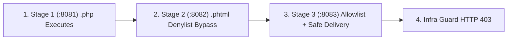

# LT Live Demo Script: 5-Min & 10-Min Versions

[日本語](../ja/lt-script.md)

Related Docs: [Hands-On Guide](./hands-on-guide.md) | [Worksheet](./worksheet.md) | [Lab 01 Overview](../../README.en.md)

> [!CAUTION]
> Run live demos strictly on your own laptop bound to `127.0.0.1`, tell the audience the lab is isolated with harmless fixed-output markers, and run `docker compose down` afterward (see [SAFETY.en.md](../../../../SAFETY.en.md)).

## 1. 5-Minutes-Before-Stage Checklist

- [ ] Build, start, and verify containers ahead of time (runs 100% offline afterward):
  ```bash
  cd labs/01-php-upload-defense
  docker compose up --build -d
  docker compose --profile test run --rm verifier
  ```
- [ ] Click **Reset** (`POST /reset.php`) on all three stages so every file list starts empty.
- [ ] Turn on OS Do Not Disturb and zoom your browser to **150%–175%**.
- [ ] Pre-open tabs in order (and pre-point the file picker to `labs/01-php-upload-defense/samples/`):
  1. Tab 1: `http://127.0.0.1:8081/?lang=en` (Stage 1)
  2. Tab 2: `http://127.0.0.1:8082/?lang=en` (Stage 2)
  3. Tab 3: `http://127.0.0.1:8083/?lang=en` (Stage 3)
  4. Tab 4 (or bookmark): `http://127.0.0.1:8083/uploads/infra-guard-check.phtml`



## 2. 5-Minute Pacing Cheat Sheet (Browser Only)

| Time | Screen Action | Key Points |
| :--- | :--- | :--- |
| `00:00 - 00:40` | Show Tab 1 (`8081`) safety banner | - Frame why blocking `.php` alone fails and how multi-layer defense stops execution<br>- Note `127.0.0.1` offline isolation and harmless fixed-string markers |
| `00:40 - 01:40` | Tab 1: Upload `marker-basic.php` -> open `/uploads/marker-basic.php` | - Point out `LAB_EXECUTION_MARKER_STAGE1` and PHP runtime info proving server-side execution<br>- Highlight the 3 required conditions: no check, `DocumentRoot` storage, active PHP handler |
| `01:40 - 03:00` | Tab 2 (`8082`): Upload `marker-basic.php` (`400`) -> upload `marker-bypass.phtml` (`200`) -> open link | - `.php` is rejected (`HTTP 400`), yet `.phtml` uploads from the browser and prints `LAB_EXECUTION_MARKER_STAGE2`<br>- Root cause: App denylist vs. Apache `<FilesMatch "\.(php|phtml)$">` interpretation gap |
| `03:00 - 04:20` | Tab 3 (`8083`): Upload `.phtml` (`400`) -> upload `sample-valid.png` -> open `/image.php?file=...` -> open Tab 4 | - Allowlist + byte check reject `.phtml`; PNG is stored outside `DocumentRoot` as `UUIDv4` and served via `/image.php`<br>- `/uploads/infra-guard-check.phtml` returns `HTTP 403` (Apache failsafe blocks execution even if app code failed) |
| `04:20 - 05:00` | Show summary slide | - Close with the 3 takeaway bullets breaking `Upload -> Store -> Serve -> Execute` at every layer |

## 3. 10-Minute Pacing Cheat Sheet (Adds `curl` Spoofing & Headers)

For a 10-minute slot, keep one zoomed terminal open in `labs/01-php-upload-defense/`.

| Time | Screen Action | Key Points |
| :--- | :--- | :--- |
| `00:00 - 01:20` | Show lifecycle diagram & Tab 1 | - Introduce `Upload -> Store -> Serve -> Execute` as an App-to-Infra trust boundary problem<br>- State local-only isolation and harmless marker rules |
| `01:20 - 02:50` | Tab 1 (`8081`): `sample-valid.png` -> `marker-basic.php` execution -> click **Reset** | - Contrast normal PNG rendering against server-side PHP execution; show instant cleanup via **Reset** |
| `02:50 - 04:50` | Tab 2 (`8082`): `marker-basic.php` (`400`) -> `marker-bypass.phtml` (`200` + execution) | - Show how missing a single handler extension in a denylist leaves webroot uploads directly executable |
| `04:50 - 06:30` | Tab 3 (`8083`): Upload `sample-valid.png` -> inspect `/image.php` in DevTools Network tab | - Highlight `UUIDv4` rename and `/var/lab-storage/uploads/` outside-webroot isolation<br>- Point out `X-Content-Type-Options: nosniff` and `Content-Security-Policy: default-src 'none'` |
| `06:30 - 08:00` | Terminal: Send disguised `.png` + `image/png` payload to Stage 3 (commands below) | - Show **HTTP `400`** block: server-side `finfo` and `getimagesize()` inspect real bytes rather than client claims |
| `08:00 - 09:10` | Open Tab 4 (`HTTP 403`) -> mention `verifier` command | - Demonstrate Apache `AllowOverride None` + PHP engine off failsafe<br>- Highlight `docker compose --profile test run --rm verifier` for catching config drift in CI |
| `09:10 - 10:00` | Show summary slide | - Present the 4-layer Defense-in-Depth checklist and share repository link |

### CLI Spoofing Command for the 10-Minute Demo
- **bash / zsh**:
  ```bash
  curl -i -F "file=@samples/marker-basic.php;filename=disguised.png;type=image/png" http://127.0.0.1:8083/upload.php
  ```
- **Windows PowerShell**:
  ```powershell
  curl.exe -i -F "file=@samples/marker-basic.php;filename=disguised.png;type=image/png" "http://127.0.0.1:8083/upload.php"
  ```

## 4. Fallback Plan

- **Cut to under 3 minutes**: Summarize Stage 1 in one sentence and show only Tab 2 (`.phtml` bypass) vs. Tabs 3–4 (`/image.php` + `/uploads/infra-guard-check.phtml` returning `HTTP 403`).
- **Leftover rehearsal files**: Click **Reset** in the UI to wipe uploaded files immediately while preserving `infra-guard-check.phtml`.
- **Docker failure backup**: Keep 4 backup screenshots in hidden slides (Stage 1 execution, Stage 2 `.phtml` bypass, Stage 3 `/image.php` headers, Stage 3 `HTTP 403`). Run `docker compose down` after leaving the stage.

## 5. Slide Takeaway Bullets (3 Key Points)

- **Never rely on single-layer denylists**: Blocking `.php` in application code fails whenever web server handler mappings (`.phtml`, etc.) disagree.
- **Break `Upload -> Store -> Serve -> Execute` at every boundary**: Combine strict allowlists + byte checks, outside-`DocumentRoot` `UUIDv4` storage, `nosniff` + `CSP` delivery, and Apache PHP disablement + `HTTP 403` on `/uploads`.
- **Verify App + Infra together in CI**: Run automated E2E checks (`verifier`) so configuration drift never reopens an execution path.
