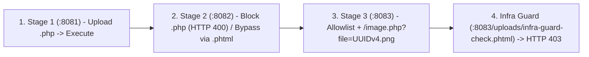

# Lightning Talk (LT) Live Demo Script: 5-Min & 10-Min Versions (Lab 01)

[日本語](../ja/lt-script.md) | [English](./lt-script.md)

Related Docs: [Hands-On Guide](./hands-on-guide.md) | [Threat Modeling Worksheet](./worksheet.md) | [Lab 01 README](../../README.en.md) | [Safety Policy](../../../../docs/safety.en.md)

> [!CAUTION]
> **Live Demo Safety Rules**
> Always run this live demo strictly on your own presenter laptop (`127.0.0.1` loopback binding with `internal: true` network isolation). Explicitly state to your audience that the demo runs inside an isolated local lab using harmless fixed-output markers, and run `docker compose down` once your talk ends.

---

## 1. Pre-Talk Speaker Checklist (5 Minutes Before Going On Stage)

Most live demo hiccups come from venue Wi-Fi issues, tiny font sizes, or leftover files from rehearsal. Run through this checklist in the green room:

- [ ] **Verify Offline Container Readiness**: Confirm all containers are built and healthy with zero internet dependency:
  ```bash
  cd labs/01-php-upload-defense
  docker compose up --build -d
  docker compose --profile test run --rm verifier
  ```
- [ ] **Reset All Three Stages**: Click the **Reset** button (`POST /reset.php`) in the UI on Stages 1, 2, and 3 so every uploaded-files list starts clean.
- [ ] **Browser Zoom & Tab Setup**:
  - Zoom your browser to **150%–175%** so back-row attendees can easily read URLs and status banners.
  - Enable OS **Do Not Disturb / Focus Mode**.
  - Pre-open tabs in exact demo order (use `?lang=en` for English talks or `?lang=ja` for Japanese talks):
    1. Tab 1 (Stage 1): `http://127.0.0.1:8081/?lang=en`
    2. Tab 2 (Stage 2): `http://127.0.0.1:8082/?lang=en`
    3. Tab 3 (Stage 3): `http://127.0.0.1:8083/?lang=en`
    4. Bookmark (or Tab 4 ready): `http://127.0.0.1:8083/uploads/infra-guard-check.phtml`
- [ ] **Pre-Point the File Picker**:
  - Open the file dialog once during rehearsal and navigate to `labs/01-php-upload-defense/samples/` so clicking "Choose File" on stage opens straight to `sample-valid.png`, `marker-basic.php`, and `marker-bypass.phtml`.

---

## 2. 5-Minute Lightning Talk Script (Crisp Browser-Only Flow)

**Concept**: Zero terminal typing on stage—pure browser tabs and file uploads showing *Execution -> Blacklist Bypass -> Multi-Layer Defense* in under five minutes.



### Minute-by-Minute Script & Screen Cues (5-Min Version)

#### `00:00 - 00:45` (45s) | Hook & Safety Framing
- **[Screen Cue]**: Show title slide or **Tab 1 (`http://127.0.0.1:8081/?lang=en`)** highlighting the top safety banner.
- **[Speaker Script]**:
  > "Have you ever seen a pull request fix a file-upload bug by blocking `.php` extensions and calling it a day? Today, in five minutes, we'll watch why single-layer upload fixes break—and how Defense-in-Depth stops code execution across every layer.
  > Quick safety note: everything running here is bound strictly to `127.0.0.1` on an isolated offline Docker network, and our test files only print fixed harmless strings."

#### `00:45 - 01:45` (60s) | Demo 1: Stage 1 — Unrestricted Upload to Execution (`8081`)
- **[Screen Cue]**:
  1. On **Tab 1 (`8081`)**, select `samples/marker-basic.php` and click Upload (`HTTP 200`).
  2. Click the uploaded link `/uploads/marker-basic.php`.
  3. Highlight **`LAB_EXECUTION_MARKER_STAGE1`**, PHP version, and container user `www-data`.
- **[Speaker Script]**:
  > "Here is Stage 1—our vulnerable baseline. I upload `marker-basic.php`, click the link `/uploads/marker-basic.php`, and boom: `LAB_EXECUTION_MARKER_STAGE1` plus live PHP runtime info. Apache didn't serve source text—it executed our file on the server.
  > Notice it took an entire chain to happen: no upload check, saving directly inside DocumentRoot with our chosen filename, and Apache executing PHP in that folder."

#### `01:45 - 03:00` (75s) | Demo 2: Stage 2 — Why App-Only Blacklists Fail (`8082`)
- **[Screen Cue]**:
  1. Switch to **Tab 2 (`8082`)**, upload `samples/marker-basic.php` -> show **HTTP `400` Blocked** message.
  2. Go back, select `samples/marker-bypass.phtml` right from the browser, and submit -> **HTTP `200` Accepted**!
  3. Click `/uploads/marker-bypass.phtml` -> highlight **`LAB_EXECUTION_MARKER_STAGE2`**.
- **[Speaker Script]**:
  > "So the developer rushes out a hotfix in Stage 2: block `.php`! Let's test `marker-basic.php`—rejected with HTTP 400. Ship it, right?
  > Not so fast. Using nothing but my browser, I pick `marker-bypass.phtml` and click Upload... HTTP 200! I click the link, and `LAB_EXECUTION_MARKER_STAGE2` executes as PHP on the server!
  > What failed? An assumption gap between app and infra. The PHP developer checked for `.php`, while Apache's `<FilesMatch>` configuration also executes `.phtml`. Because files still land inside DocumentRoot under user extensions, missing a single extension means instant code execution."

#### `03:00 - 04:20` (80s) | Demo 3: Stage 3 — Defense-in-Depth & Infra Failsafe (`8083`)
- **[Screen Cue]**:
  1. Switch to **Tab 3 (`8083`)**, upload `samples/marker-bypass.phtml` -> show **HTTP `400` Blocked**.
  2. Upload `samples/sample-valid.png` -> click `/image.php?file=<UUIDv4>.png` to display the PNG.
  3. Open `http://127.0.0.1:8083/uploads/infra-guard-check.phtml` -> show **HTTP `403 Forbidden`**.
- **[Speaker Script]**:
  > "Now look at Stage 3: Defense-in-Depth.
  > Layer 1: Instead of a blacklist, the app uses a strict image allowlist plus `finfo` and `getimagesize()` byte inspection—both `.php` and `.phtml` get rejected immediately.
  > Layers 2 & 3: When I upload a real PNG, look at the URL: `/image.php?file=<UUID>.png`. Our filename is discarded for a random UUIDv4, the file is stored outside DocumentRoot in `/var/lab-storage/uploads/`, and `/image.php` serves it with `X-Content-Type-Options: nosniff` and `Content-Security-Policy: default-src 'none'`.
  > Layer 4—my favorite check: what if a future app bug wrote a `.phtml` file into `/uploads/` anyway? Let's hit our pre-seeded `/uploads/infra-guard-check.phtml`... HTTP 403 Forbidden! Apache disables `.htaccess`, turns off the PHP engine, and denies direct access."

#### `04:20 - 05:00` (40s) | Wrap-Up & Key Takeaways
- **[Screen Cue]**: Switch to summary slide.
- **[Speaker Script]**:
  > "The takeaway is simple: never bet server security on a single extension check. Break the `Upload -> Store -> Serve -> Execute` chain at every boundary—allowlist and inspect bytes on upload, store outside webroot with UUID names, serve with `nosniff` and `CSP`, and disable script execution in your web server config. The full lab runs locally in one `docker compose up` command—give it a try! Thank you!"

---

## 3. Extended 10-Minute Talk Script (Adds `curl` Spoofing & Header Inspection)

For a 10-minute slot (engineering brown-bag, meetup talk, or team training kickoff), expand the 5-minute flow with **live `curl` MIME/extension spoofing** and **DevTools security header inspection**.

### Extra Pre-Talk Setup (10-Min Version)
- Keep one zoomed terminal window open inside `labs/01-php-upload-defense/`.
- Pre-stage the spoofing command in shell history for your OS:
  - **macOS / Linux / WSL2 (`bash` / `zsh`)**:
    ```bash
    curl -i -F "file=@samples/marker-basic.php;filename=disguised.png;type=image/png" http://127.0.0.1:8083/upload.php
    ```
  - **Windows PowerShell (explicit `curl.exe`)**:
    ```powershell
    curl.exe -i -F "file=@samples/marker-basic.php;filename=disguised.png;type=image/png" "http://127.0.0.1:8083/upload.php"
    ```

### Minute-by-Minute Pacing (10-Min Version)

| Time | Segment | Key Demo Actions & Talking Points |
| :--- | :--- | :--- |
| `00:00 - 01:30` | 1. Framing the 4 Phases | Introduce the `Upload -> Store -> Serve -> Execute` chain; explain why file uploads straddle the boundary between application code and web server config; state local-only safety rules. |
| `01:30 - 03:00` | 2. Stage 1 Live Demo (`8081`) | Upload `sample-valid.png` first, then `marker-basic.php` (`LAB_EXECUTION_MARKER_STAGE1`). Demonstrate the **Reset** button (`POST /reset.php`) cleaning up `/uploads/marker-basic.php`. |
| `03:00 - 05:00` | 3. Stage 2 Live Demo (`8082`) | Show `marker-basic.php` blocked (`HTTP 400`), ask the audience *"Are we safe?"*, then upload `marker-bypass.phtml` in browser (`LAB_EXECUTION_MARKER_STAGE2`). Contrast `upload.php` vs Apache `<FilesMatch "\.(php|phtml)$">`. |
| `05:00 - 06:45` | 4. Stage 3 Browser & DevTools (`8083`) | Confirm `.php`/`.phtml` rejection (`HTTP 400`); upload `sample-valid.png`; open Browser DevTools (**Network** tab) on `/image.php?file=<UUIDv4>.png` to show `X-Content-Type-Options: nosniff` and `Content-Security-Policy: default-src 'none'`. |
| `06:45 - 08:00` | 5. CLI Disguise Attack (`curl`) | Switch to terminal and send `samples/marker-basic.php` with forged `filename=disguised.png` + `Content-Type: image/png` to Stage 3. Show **HTTP `400`** rejection via `finfo` + `getimagesize()`. |
| `08:00 - 09:00` | 6. Infra Guard & CI Verification | Hit `/uploads/infra-guard-check.phtml` (**HTTP `403`**), then highlight `docker compose --profile test run --rm verifier` as an example of catching app/infra drift automatically in CI. |
| `09:00 - 10:00` | 7. Closing Takeaways | Present the 4-layer Defense-in-Depth checklist and share repo link. |

---

## 4. Live Demo Fallback Plan (If Time Is Tight or Tech Glitches Happen)

Always keep a contingency plan ready:

1. **Ultra-Compressed 3-Minute Mode (Previous Speaker Ran Late)**
   - Summarize Stage 1 verbally in one sentence (*"Without validation, `.php` obviously executes"*), jump straight to **Tab 2 (`8082`) `.phtml` bypass**, and immediately contrast with **Tab 3 (`8083`) `/image.php` + `/uploads/infra-guard-check.phtml` (`HTTP 403`)**. You still deliver the entire core lesson in 150 seconds.
2. **Dirty State Recovery**
   - If rehearsal uploads are still visible on screen, click the UI **Reset** button (`POST /reset.php`)—it wipes user uploads in milliseconds while preserving Stage 3's `infra-guard-check.phtml` fixture.
3. **Backup Screenshot Deck (Zero-Docker Emergency)**
   - Keep 4 hidden backup slides at the end of your deck just in case laptop virtualization misbehaves at the podium:
     - Slide B1: Stage 1 `LAB_EXECUTION_MARKER_STAGE1` output
     - Slide B2: Stage 2 `marker-basic.php` (`HTTP 400`) vs `marker-bypass.phtml` (`LAB_EXECUTION_MARKER_STAGE2`)
     - Slide B3: Stage 3 `/image.php?file=<UUIDv4>.png` DevTools headers (`nosniff`, `CSP`)
     - Slide B4: Stage 3 `/uploads/infra-guard-check.phtml` returning `HTTP 403 Forbidden`
4. **Post-Talk Teardown**
   - Before closing your laptop after leaving the stage, run `docker compose down` inside `labs/01-php-upload-defense/`.

---

## 5. Copy-Paste Slide Bullet Points (Key Takeaways)

Drop these bullets straight onto your closing slide:

### Closing Summary Slide Bullets
- **Single-Layer Blacklists Break**: Blocking `.php` in app code fails whenever web server handler mappings (`.phtml`, etc.) disagree with developer assumptions.
- **Break the Chain Across `Upload -> Store -> Serve -> Execute`**:
  - **Upload**: Strict extension allowlist + server-side byte inspection (`finfo` + `getimagesize()`)
  - **Store**: Outside DocumentRoot + server-generated UUIDv4 filenames
  - **Serve**: Dedicated delivery endpoint + `X-Content-Type-Options: nosniff` & `Content-Security-Policy: default-src 'none'`
  - **Execute**: `AllowOverride None` + PHP engine disabled & direct `/uploads` access denied (`HTTP 403`)
- **Test App + Infra Together in CI**: Use automated E2E security checks (`verifier`) so configuration drift never reopens the execution path.
