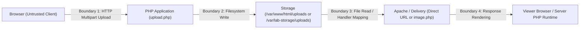

# Threat Modeling Worksheet: Upload -> Store -> Serve -> Execute (Lab 01)

[日本語](../ja/worksheet.md) | [English](./worksheet.md)

Related Docs: [Hands-On Guide](./hands-on-guide.md) | [Lab 01 README](../../README.en.md) | [LT Live Demo Script](./lt-script.md) | [Safety Policy](../../../../docs/safety.en.md)

> [!NOTE]
> **How to Use This Worksheet**
> Fill in the `[       ]` blanks in your own words as you step through Stages 1, 2, and 3 in the [Hands-On Workshop Guide](./hands-on-guide.md). A collapsible **Model Answer & Facilitator Key** (`
`) is included at the bottom of this document.

---

## Part 1: Identifying Assets & Trust Boundaries

Review the data flow across the file upload lifecycle and identify what crosses each trust boundary.

### 1-1. What Assets Are We Protecting? (List 2–3 core assets)
- Asset 1: `[                                                                 ]`
- Asset 2: `[                                                                 ]`
- Asset 3: `[                                                                 ]`

### 1-2. Which Client-Supplied Inputs Cross Boundary 1 Untrusted?

| Client Input Field | Can an Attacker Forge It? (Yes / No) | How Could It Be Manipulated? (Notes) |
| :--- | :--- | :--- |
| Filename (e.g., `avatar.png`) | `[ Yes / No ]` | `[                                           ]` |
| File Extension (e.g., `.php`, `.phtml`) | `[ Yes / No ]` | `[                                           ]` |
| Multipart `Content-Type` Header | `[ Yes / No ]` | `[                                           ]` |
| Raw File Bytes (Body Content) | `[ Yes / No ]` | `[                                           ]` |

---

## Part 2: Stage-by-Stage Attack Path Tracing

As you test each stage in your browser, trace which phases of `Upload -> Store -> Serve -> Execute` succeeded and which layer stopped the chain.

---

### 2-1. Stage 1: Vulnerable Baseline (`http://127.0.0.1:8081`)

#### Observation Log
| Test File | Upload Result (HTTP Status) | Stored Path / Filename | Behavior When Requested (Rendered vs. Executed) |
| :--- | :--- | :--- | :--- |
| `sample-valid.png` | `HTTP [     ]` | `[                           ]` | `[                                 ]` |
| `marker-basic.php` | `HTTP [     ]` | `[                           ]` | `[                                 ]` |

#### Stage 1 Analysis Question
**Q1. Why did `marker-basic.php` execute on the server as PHP code instead of being rejected or returned as inert bytes? What went wrong across all four phases?**
- Upload: `[                                                               ]`
- Store: `[                                                                ]`
- Serve / Execute: `[                                                      ]`

---

### 2-2. Stage 2: App-Only Insufficient Defense (`http://127.0.0.1:8082`)

#### Observation Log
| Test File | Upload Result (HTTP Status) | Why Accepted or Rejected? | Behavior When Requested |
| :--- | :--- | :--- | :--- |
| `marker-basic.php` | `HTTP [     ]` | `[                           ]` | `[                                 ]` |
| `marker-bypass.phtml` | `HTTP [     ]` | `[                           ]` | `[                                 ]` |

#### Stage 2 Analysis Question
**Q2. Which assumption failed in Stage 2? How did the application developer's mental model diverge from Apache's actual configuration?**
- Developer's Assumption: `[                                               ]`
- Apache's Actual Configuration: `[                                        ]`
- Why Blacklists Fail Structurally: `[                                     ]`

---

### 2-3. Stage 3: Defense-in-Depth (`http://127.0.0.1:8083`)

#### Observation Log
| Verification Check | HTTP Status | Observed Security Control |
| :--- | :--- | :--- |
| Upload `marker-basic.php` | `HTTP [     ]` | `[                                           ]` |
| Upload `marker-bypass.phtml` | `HTTP [     ]` | `[                                           ]` |
| Upload `sample-valid.png` & inspect URL | `HTTP [     ]` | Delivery URL format: `[                      ]` |
| Inspect `/image.php` HTTP response headers | `HTTP [     ]` | Security headers seen: `[                    ]` |
| Direct `GET /uploads/infra-guard-check.phtml` | `HTTP [     ]` | Did PHP execute? `[                          ]` |

#### Stage 3 Analysis Question
**Q3. Suppose a future bug in Stage 3's PHP validation accidentally allowed a `.phtml` file past the upload check. Which independent downstream layers still break the execution chain?**
1. Storage Layer: `[                                                       ]`
2. Delivery Layer: `[                                                      ]`
3. Infrastructure Layer (Apache): `[                                       ]`

---

## Part 3: Defense-in-Depth Design Matrix (Fill-In Table)

Map the threats, single-layer pitfalls, and Stage 3 mitigations across each phase of `Upload -> Store -> Serve -> Execute`.

| Lifecycle Phase | Primary Threat / Attack Vector | Why Single-Layer Defense Failed (Stages 1 & 2) | Stage 3 Concrete Mitigation(s) | Responsible Layer (App / Storage / Delivery / Infra) |
| :--- | :--- | :--- | :--- | :--- |
| **1. Upload** (Validation) | Executable extensions (`.php`, `.phtml`) or disguised scripts with spoofed `Content-Type` / `.png` extension | `.php`-only blacklist missed `.phtml`; client headers are trivially forged | `[                                           ]` | `[               ]` |
| **2. Store** (Location & Naming) | Storing files under webroot with attacker-chosen filenames/extensions | Saved directly to `/var/www/html/uploads/<name>`, making it directly URL-addressable | `[                                           ]` | `[               ]` |
| **3. Serve** (Delivery & Headers) | Browser MIME sniffing or active content / XSS rendering | Direct static serving without hardened response headers | `[                                           ]` | `[               ]` |
| **4. Execute** (Server & Infra Guard) | `.htaccess` override or server-side script execution inside web directories | PHP handler remained active inside DocumentRoot `/uploads/` | `[                                           ]` | `[               ]` |

---

## Part 4: Real-World Takeaway Reflection

Write down one concrete check you want to bring back to your own codebase or infrastructure review tomorrow:
- **Action item for my team's upload architecture**:
  `[                                                                       ]`

---

## Model Answers & Facilitator Key (Click to Expand)

<strong>Click to expand the Model Answer & Facilitator Key</strong>

### Part 1 Model Answers

#### 1-1. Core Assets to Protect
- **Asset 1: Server Code Execution Integrity (PHP Runtime & Container Process)** — Preventing arbitrary server-side code execution.
- **Asset 2: Server Filesystem, Application Secrets & Internal Network Context** — Protecting other uploaded files, app configuration, and internal services accessible to the web user.
- **Asset 3: Other Users' Browsers (Origin Integrity)** — Preventing uploaded files from executing client-side scripts (Stored XSS) in victims' browsers.

#### 1-2. Untrusted Client Inputs Crossing Boundary 1
| Client Input Field | Forgeable? | How Could It Be Manipulated? |
| :--- | :--- | :--- |
| Filename | **Yes** | Attackers control the raw filename string (path characters, double extensions, misleading names; `basename()` strips directories but preserves the extension). |
| File Extension | **Yes** | Attackers can switch `.php` to `.phtml`, `.phar`, `.php5`, or disguise scripts with `.png`. |
| Multipart `Content-Type` Header | **Yes** | Trivially spoofed in one CLI command (`curl -F "file=@...;type=image/png"`); `$_FILES['file']['type']` is purely client-asserted. |
| Raw File Bytes | **Yes** | Attackers can send arbitrary PHP tags (`<?php ... ?>`) or malformed/polyglot content regardless of filename or header claims. |

---

### Part 2 Model Answers

#### 2-1. Stage 1 (`8081`)
- **`sample-valid.png`**: HTTP `200` / `/var/www/html/uploads/sample-valid.png` / Rendered normally as a PNG image.
- **`marker-basic.php`**: HTTP `200` / `/var/www/html/uploads/marker-basic.php` / **Executed on the server as PHP, outputting `LAB_EXECUTION_MARKER_STAGE1`**.
- **Q1 Explanation**:
  1. **Upload**: Zero extension allowlisting or server-side content validation.
  2. **Store**: Saved directly inside Apache's DocumentRoot (`/var/www/html/uploads/`) under its original `.php` extension.
  3. **Serve / Execute**: Directly reachable via `/uploads/marker-basic.php` in a directory where Apache's PHP interpreter handler was active, turning an HTTP `GET` into code execution.

#### 2-2. Stage 2 (`8082`)
- **`marker-basic.php`**: HTTP `400` / Blocked by the application's `.php` extension check / Never stored.
- **`marker-bypass.phtml`**: HTTP `200` / Accepted because extension `!== 'php'` / **Executed on the server by Apache as PHP, outputting `LAB_EXECUTION_MARKER_STAGE2`**.
- **Q2 Explanation**:
  - **Developer's Assumption**: *"Only `.php` files are executed by PHP, so blocking `.php` in `upload.php` stops code execution."*
  - **Apache's Actual Configuration**: `<FilesMatch "\.(php|phtml)$"> SetHandler application/x-httpd-php </FilesMatch>` instructed Apache to pass both `.php` and `.phtml` to PHP.
  - **Why Blacklists Fail Structurally**: Execution behavior depends on web server handlers, modules, and OS quirks. Maintaining a complete list of every dangerous extension across stack updates is brittle—any gap between app validation and server handler configuration creates an instant RCE path when files live inside DocumentRoot.

#### 2-3. Stage 3 (`8083`)
- **`marker-basic.php` & `marker-bypass.phtml`**: Both rejected with **HTTP `400`** (blocked by strict extension allowlist).
- **`sample-valid.png`**: Accepted with **HTTP `200`** / Served via `/image.php?file=<UUIDv4>.png` (original filename discarded).
- **`/image.php` Headers**: HTTP `200` with `X-Content-Type-Options: nosniff`, `Content-Security-Policy: default-src 'none'`, `X-Frame-Options: DENY`, and explicit `Content-Type: image/png`.
- **`GET /uploads/infra-guard-check.phtml`**: Returns **HTTP `403 Forbidden`** (`INFRA_LAYER_FAILED_EXECUTION` never appears; PHP never executes).
- **Q3 Explanation (Independent Downstream Layers)**:
  1. **Storage Layer**: Files are written outside DocumentRoot in `/var/lab-storage/uploads/` with randomized UUIDv4 filenames, eliminating direct URL routing.
  2. **Delivery Layer**: `/image.php` enforces a strict UUIDv4 + allowed-image-extension regex and streams raw bytes (never `include`/`require`) with `nosniff` and restrictive `CSP`.
  3. **Infrastructure Layer (Apache)**: `AllowOverride None` prevents `.htaccess` overrides, while `/var/www/html/uploads` disables the PHP engine, disables `ExecCGI`/`Indexes`, and enforces `Require all denied` (HTTP `403`).

---

### Part 3 Model Answers (Completed Defense-in-Depth Matrix)

| Lifecycle Phase | Primary Threat / Attack Vector | Why Single-Layer Defense Failed (Stages 1 & 2) | Stage 3 Concrete Mitigation(s) | Responsible Layer |
| :--- | :--- | :--- | :--- | :--- |
| **1. Upload** (Validation) | Alternate executable extensions (`.phtml`) or PHP bytes disguised as `.png` + `image/png` | `.php` blacklist missed `.phtml`; client `Content-Type` is untrusted | Strict extension **allowlist** (`png`, `jpg`, `jpeg`, `gif`), 2MB size cap, server-side `finfo(FILEINFO_MIME_TYPE)` + `getimagesize()` byte inspection | **App** |
| **2. Store** (Location & Naming) | Direct URL exposure under webroot, attacker-chosen filenames | Stored at `/var/www/html/uploads/<name>` inside DocumentRoot | Store **outside DocumentRoot** (`/var/lab-storage/uploads/`) + rename to server-generated **UUIDv4** (`<uuid>.<ext>`) | **Storage / App** |
| **3. Serve** (Delivery & Headers) | Browser MIME sniffing, active script rendering | Direct static serving without restrictive security headers | Controlled delivery via `/image.php` (UUIDv4 regex check) + `X-Content-Type-Options: nosniff`, `Content-Security-Policy: default-src 'none'`, `X-Frame-Options: DENY` | **Delivery** |
| **4. Execute** (Server & Infra Guard) | `.htaccess` handler injection, accidental upload directory PHP execution | PHP handler enabled inside webroot `/uploads/` | Apache `AllowOverride None`, **PHP engine off** on `/var/www/html/uploads`, `Options -ExecCGI -Indexes`, `Require all denied` (HTTP `403`), non-root `www-data` container user | **Infra** |

