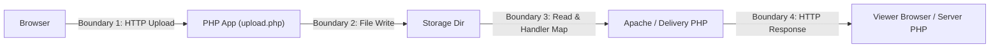

# Threat Modeling Worksheet

[日本語](../ja/worksheet.md)

Related Docs: [Hands-On Guide](./hands-on-guide.md) | [Lab 01 Overview](../../README.en.md) | [LT Demo Script](./lt-script.md)

> [!CAUTION]
> For local educational use on `127.0.0.1` only. Never deploy to public servers or shared networks, and use only the harmless files in `samples/` (see [SAFETY.en.md](../../../../SAFETY.en.md)).

Fill in the blank table cells as you work through the [Hands-On Guide](./hands-on-guide.md). Check the collapsible answer key at the bottom when done.

## 1. Assets & Trust Boundaries

### 1-1. List Three Core Assets to Protect

| # | Asset | Impact if Compromised |
| :--- | :--- | :--- |
| 1 | | |
| 2 | | |
| 3 | | |

### 1-2. Can Client Inputs Crossing Boundary 1 Be Trusted?

| Input Field | Forgeable? | Example Attacker Manipulation |
| :--- | :--- | :--- |
| Filename | | |
| File Extension | | |
| `Content-Type` Header | | |
| Raw File Bytes | | |

## 2. Stage-by-Stage Behavior & Root Cause

### 2-1. Stage 1 (`http://127.0.0.1:8081`) & Stage 2 (`http://127.0.0.1:8082`)

| Stage / Test File | HTTP Status | Behavior When Requested | Why Accepted or Blocked? |
| :--- | :--- | :--- | :--- |
| Stage 1: `sample-valid.png` | | | |
| Stage 1: `marker-basic.php` | | | |
| Stage 2: `marker-basic.php` | | | |
| Stage 2: `marker-bypass.phtml` | | | |

- **Q1 (Stage 1)**: Which three conditions combined to turn an uploaded file into server-side PHP execution?
- **Q2 (Stage 2)**: How did the developer's assumption differ from Apache's actual handler configuration?

### 2-2. Stage 3 (`http://127.0.0.1:8083`)

| Check | HTTP Status | Security Control Observed |
| :--- | :--- | :--- |
| Upload `marker-basic.php` & `marker-bypass.phtml` | | |
| Delivery URL format for `sample-valid.png` | | |
| Response headers on `/image.php` | | |
| Direct `GET /uploads/infra-guard-check.phtml` | | |

- **Q3 (Stage 3)**: If a future app bug let a `.phtml` file slip past upload validation, which downstream layers still prevent execution?

## 3. Defense-in-Depth Matrix

| Phase | Threat / Vector | Single-Layer Failure (Stages 1 & 2) | Stage 3 Mitigation(s) | Layer |
| :--- | :--- | :--- | :--- | :--- |
| **Upload** | Alternate extensions (`.phtml`) or disguised scripts | `.php` denylist bypassed; client headers forged | | |
| **Store** | Direct URL routing under webroot; attacker filenames | Stored inside `DocumentRoot` with original name | | |
| **Serve** | Browser MIME sniffing or script execution | Direct static serving without security headers | | |
| **Execute** | `.htaccess` override or webroot PHP execution | PHP handler active on `/uploads/` | | |

## 4. Takeaway for Your Team

| One upload design or server config item to verify in my own project |
| :--- |
| |

---

<strong>Click to expand Model Answers & Facilitator Key</strong>

### 1. Assets & Trust Boundaries
- **Core Assets**:
  1. **Server execution integrity**: Preventing arbitrary code execution in the PHP runtime.
  2. **Server data & internal network context**: Protecting config secrets, user files, and internal services.
  3. **Viewer browser origin**: Preventing Stored XSS when other users view uploaded files.
- **Client Inputs**: Filename, extension, `Content-Type`, and file bytes are **all forgeable** (trivially modified via `curl`) and must never be trusted directly.

### 2. Stage-by-Stage Behavior & Root Cause
- **Stage 1**: `sample-valid.png` -> `200` (renders PNG); `marker-basic.php` -> `200` (executes PHP, outputs `LAB_EXECUTION_MARKER_STAGE1`).
  - **Q1**: (1) No upload validation, (2) stored inside `DocumentRoot` (`/var/www/html/uploads/`) with `.php` extension, and (3) Apache PHP handler enabled on that directory.
- **Stage 2**: `marker-basic.php` -> `400` (blocked); `marker-bypass.phtml` -> `200` (executes PHP, outputs `LAB_EXECUTION_MARKER_STAGE2`).
  - **Q2**: App code assumed only `.php` executes, whereas Apache's `<FilesMatch "\.(php|phtml)$">` maps both `.php` and `.phtml` to PHP.
- **Stage 3**: `.php` / `.phtml` -> `400` (blocked); `sample-valid.png` -> `200` via `/image.php?file=<UUIDv4>.png` (`nosniff`, `CSP`, `X-Frame-Options: DENY`); `/uploads/infra-guard-check.phtml` -> **`403`** (never executes).
  - **Q3**: (1) Outside-`DocumentRoot` storage (`/var/lab-storage/uploads/`) with `UUIDv4` rename, (2) `/image.php` regex check + raw byte streaming (never `include`), and (3) Apache `AllowOverride None`, PHP engine off, and `Require all denied` on `/var/www/html/uploads`.

### 3. Completed Defense-in-Depth Matrix

| Phase | Threat / Vector | Single-Layer Failure (Stages 1 & 2) | Stage 3 Mitigation(s) | Layer |
| :--- | :--- | :--- | :--- | :--- |
| **Upload** | Alternate extensions (`.phtml`) or disguised scripts | `.php` denylist bypassed; client headers forged | Strict image **allowlist** (`png`, `jpg`, `jpeg`, `gif`), 2MB cap, server-side `finfo` + `getimagesize()` check | App |
| **Store** | Direct URL routing under webroot; attacker filenames | Stored inside `DocumentRoot` with original name | Store outside `DocumentRoot` (`/var/lab-storage/uploads/`) + server-generated `UUIDv4` filename | Storage |
| **Serve** | Browser MIME sniffing or script execution | Direct static serving without security headers | `/image.php` `UUIDv4` regex validation + `X-Content-Type-Options: nosniff`, `CSP`, `X-Frame-Options: DENY` | Delivery |
| **Execute** | `.htaccess` override or webroot PHP execution | PHP handler active on `/uploads/` | `AllowOverride None`, PHP engine off on `/var/www/html/uploads`, `Options -ExecCGI -Indexes`, `Require all denied` (`403`), non-root `www-data` | Infra |

