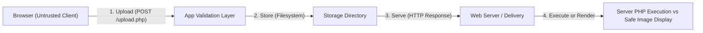

# ハンズオン手順書：ファイルアップロードからコード実行までの攻撃連鎖と多層防御（Lab 01）

[日本語](./hands-on-guide.md) | [English](../en/hands-on-guide.md)

関連ドキュメント：[Lab 01 README](../../README.ja.md) | [脅威モデリング・ワークシート](./worksheet.md) | [LTデモ台本](./lt-script.md) | [安全ポリシー](../../../../docs/safety.ja.md)

> [!CAUTION]
> **ローカル学習専用・公開サーバへのデプロイ厳禁**
> 本ラボは意図的に脆弱なステージを含む教育用環境です。必ず個人のローカルPC上（`127.0.0.1` バインド・内部隔離ネットワーク `internal: true`）でのみ起動し、クラウド環境・共有サーバ・LAN内公開IPへのデプロイやポート転送は絶対に行わないでください。また、検証には必ず同梱の無害なマーカーファイル（`samples/` 配下）のみを使用してください。

---

## 1. ワークショップ概要と到達目標

本ハンズオン（所要時間：60〜90分）では、Webアプリケーションのファイルアップロード機能を題材に、**`Upload -> Store -> Serve -> Execute`（受信 -> 保存 -> 配信 -> 実行）** の4段階で発生する信頼境界の破綻と、それを防ぐ**多層防御（Defense-in-Depth）**の設計をブラウザ操作中心で体験します。

### 到達目標
1. **攻撃連鎖の構造理解**：ファイルがアップロードされただけで即座に侵害されるのではなく、「保存場所」「配信経路」「Webサーバの実行解釈」が揃ったときに初めてサーバーサイド実行（RCE）が成立することを説明できる。
2. **単層防御（ブラックリスト）の限界体験**：アプリ側で `.php` だけを弾いても、Apache側のハンドラ設定（`.phtml` 等）との認識ギャップによってブラウザ操作だけで容易にバイパスされることを確認できる。
3. **多層防御の検証**：アプリ層（許可リスト・実バイナリ検証・UUIDv4リネーム）＋ストレージ層（DocumentRoot外隔離）＋配信層（専用エンドポイントとセキュリティヘッダ）＋インフラ層（Apache設定による直接アクセス遮断・PHPエンジン無効化）が、それぞれ独立して攻撃連鎖を断ち切る仕組みを検証できる。

### 対象者と前提環境
- **対象者**：Web開発者、インフラ／SREエンジニア、セキュリティ初学者〜中級者、勉強会参加者
- **必要な環境**：
  - Docker Desktop（Windows WSL2 / macOS Intel & Apple Silicon）または Docker Engine + Compose プラグイン（Linux）
  - Webブラウザ（Chrome / Edge / Firefox / Safari 等、開発者ツールが使えるもの）
  - **オフライン対応**：初回イメージビルド完了後は、外部インターネット接続なしで100%動作します。

---

## 2. 推奨タイムテーブル（60分コース／90分コース）

勉強会の枠に合わせて、以下の2パターンの進行を推奨します。参加者は手元で [脅威モデリング・ワークシート](./worksheet.md) を開きながら進めてください。

### A. 標準60分コース（ブラウザ完結＋ワークシート整理）

| 時間配分 | フェーズ | 内容 | 使用資料 |
| :--- | :--- | :--- | :--- |
| 00:00 - 00:10 (10分) | 導入・安全ルール確認 | ラボの目的、`Upload -> Store -> Serve -> Execute` の概要、安全ルールの共有、コンテナ起動確認 | 本手順書 セクション3・4 |
| 00:10 - 00:22 (12分) | Stage 1 演習 | 無防備なアップロードと `.php` マーカー実行の観察、ワークシート記入 | `http://127.0.0.1:8081` / ワークシート |
| 00:22 - 00:36 (14分) | Stage 2 演習 | `.php` 拒否の確認と `.phtml` によるブラックリスト回避実験、アプリとApacheの解釈ギャップ考察 | `http://127.0.0.1:8082` / ワークシート |
| 00:36 - 00:50 (14分) | Stage 3 演習 | 多層防御の動作検証、`/image.php` のヘッダ確認、インフラ層ガード（HTTP 403）の確認 | `http://127.0.0.1:8083` / ワークシート |
| 00:50 - 01:00 (10分) | ふりかえり・片付け | ワークシート解答例の答え合わせ、実務への持ち帰りポイント共有、`docker compose down` | ワークシート解答例 |

### B. 深掘り90分コース（`curl` 偽装実験＋コード比較ディスカッション付き）

| 時間配分 | フェーズ | 内容 | 使用資料 |
| :--- | :--- | :--- | :--- |
| 00:00 - 00:10 (10分) | 導入・安全ルール確認 | 趣旨説明、安全ルール確認、環境ヘルスチェック実行 | 本手順書 セクション3・4 |
| 00:10 - 00:25 (15分) | Stage 1 & 資産・境界整理 | 資産と信頼境界の洗い出し、Stage 1 のブラウザ演習 | ワークシート セクション1・2 |
| 00:25 - 00:40 (15分) | Stage 2 演習 | `.php` ブロックと `.phtml` バイパス実験、原因の言語化 | `http://127.0.0.1:8082` / ワークシート |
| 00:40 - 00:55 (15分) | Stage 3 演習 | 多層防御のブラウザ検証とインフラ層フェイルセーフ確認 | `http://127.0.0.1:8083` / ワークシート |
| 00:55 - 01:10 (15分) | 発展演習 A（`curl`） | `Content-Type: image/png` 偽装とファイル名偽装のコマンド検証 | 付録A |
| 01:10 - 01:22 (12分) | 発展演習 B（コード比較） | 3ステージのPHP実装・Apache設定差分の読み解きとグループ討議 | 付録B |
| 01:22 - 01:30 (8分) | まとめ・環境停止 | 解答例確認、質疑応答、`docker compose down` によるクリーンアップ | ワークシート解答例 |

---

## 3. ファシリテーター事前準備チェックリストと安全ブリーフィング

### 開催前チェックリスト（ファシリテーター用）
- [ ] 参加者へ事前にリポジトリのクローンと `labs/01-php-upload-defense/` での初回ビルド（`docker compose up --build -d`）を案内しておく（会場Wi-Fiの帯域逼迫を防ぐため）。
- [ ] 自動検証スイートが全項目パスすることを手元で確認しておく：
  ```bash
  cd labs/01-php-upload-defense
  docker compose --profile test run --rm verifier
  ```
- [ ] ホスト側からの疎通確認スクリプト（Windowsなら `pwsh -File tests/host-smoke.ps1`、macOS/Linuxなら `sh tests/host-smoke.sh`）が成功することを確認する。
- [ ] 3つのステージ（`8081`, `8082`, `8083`）の画面を開き、言語切替（`?lang=ja` / `?lang=en`）と **Reset** ボタンが正常に機能することを確認する。

### 開始時の安全ルール・ブリーフィング（必須・3分）
演習を始める前に、参加者全員に以下の4点を必ず口頭で共有してください（詳細は [安全ポリシー](../../../../docs/safety.ja.md) 参照）。

1. **完全ローカル限定**：公開サーバや社内共有環境で動かさず、各自のPCの `127.0.0.1` のみで実行すること。`compose.yaml` のポート設定（`127.0.0.1:8081:8080` 等）や `internal: true` を書き換えないこと。
2. **無害な同梱マーカーのみを使用**：`samples/marker-basic.php` と `samples/marker-bypass.phtml` は、固定文字列と読み取り専用の環境情報（PHPバージョン・実行ユーザ・ホスト名・UTC時刻）のみを出力し、外部入力やOSコマンドを一切受け付けない安全な検証用ファイルです。Webシェル等の危険なペイロードを自作して投入しないこと。
3. **許可なき外部テストの禁止**：本ラボで学んだ手法を、自身が管理権限を持たない外部Webサイトや第三者のシステムに対して絶対に試さないこと。
4. **終了時の停止**：勉強会終了後は必ず `docker compose down` でコンテナを停止・削除すること。

---

## 4. 環境起動とサンプルファイルの確認

### 4.1 コンテナのビルドと起動

ターミナル（Windowsの場合は PowerShell または WSL2 ターミナル、macOS/Linuxの場合は標準ターミナル）を開き、ラボディレクトリへ移動して起動します。

```bash
cd labs/01-php-upload-defense
docker compose up --build -d
```

起動後、自動検証コンテナを実行して全ステージが正常に立ち上がっているか確認できます（任意ですが推奨）：

```bash
docker compose --profile test run --rm verifier
```

### 4.2 ステージ一覧とアクセスURL

すべてのステージはホストのループバックアドレス（`127.0.0.1`）のみにバインドされており、URLクエリ `?lang=ja` / `?lang=en` で表示言語を切り替えられます。

| ステージ | コンテナ名 | URL（日本語UI） | 特徴 |
| :--- | :--- | :--- | :--- |
| **Stage 1** | `stage1-vulnerable` | `http://127.0.0.1:8081/?lang=ja` | 検証なし・DocumentRoot配下へ元の名前で保存・PHP実行可能 |
| **Stage 2** | `stage2-app-only` | `http://127.0.0.1:8082/?lang=ja` | アプリ層で `.php` のみ拒否（ブラックリスト）・Apacheは `.phtml` もPHP実行 |
| **Stage 3** | `stage3-defense-in-depth` | `http://127.0.0.1:8083/?lang=ja` | アプリ層＋ストレージ層＋配信層＋インフラ層の多層防御 |

### 4.3 使用するサンプルファイル（`labs/01-php-upload-defense/samples/`）

ブラウザのファイル選択ダイアログから、以下の3ファイルを使用します（解説は [samples/README.md](../../samples/README.md) も参照）。

| ファイル名 | 種別 | 用途と動作 |
| :--- | :--- | :--- |
| `sample-valid.png` | 正常なPNG画像 | 正常系テスト用。全ステージでアップロード・表示が成功することを確認する。 |
| `marker-basic.php` | 無害なPHPマーカー | Stage 1 実行確認用。実行されると固定マーカー `LAB_EXECUTION_MARKER_STAGE1` とPHPバージョン・実行ユーザ・ホスト名・UTC時刻のみを表示する（外部入力・OSコマンド実行なし）。 |
| `marker-bypass.phtml` | 無害なPHTMLマーカー | Stage 2 バイパス確認用。実行されると固定マーカー `LAB_EXECUTION_MARKER_STAGE2` と同じ読み取り専用環境情報を表示する。 |

### 4.4 意識する4つのフェーズ

演習中は常に「今どのフェーズの境界を観察しているか」を意識しましょう。



---

## 5. ブラウザ完結ステップバイステップ演習

ここからはWebブラウザだけで進めます。手元に [脅威モデリング・ワークシート](./worksheet.md) を用意し、観察結果をメモしながら進めましょう。

---

### Step 1：Stage 1 — 無防備なベースラインの観察（`http://127.0.0.1:8081`）

まずは防御が一切ない場合、なぜアップロード機能からサーバーサイド実行に至るのかを確認します。

1. **画面を開く・初期化する**
   - ブラウザで `http://127.0.0.1:8081/?lang=ja` を開きます。
   - 画面上部に「ローカル学習専用・公開サーバへのデプロイ厳禁」の警告バナーが表示されていることを確認します。
   - 念のため画面内の **Reset** ボタン（`POST /reset.php`）を押し、アップロード済みファイルを空の状態にします。

2. **正常な画像をアップロードする**
   - ファイル選択欄で `labs/01-php-upload-defense/samples/sample-valid.png` を選び、アップロードを実行します。
   - アップロード成功画面（HTTP `200`）が表示されたら、生成されたリンク（`/uploads/sample-valid.png`）をクリックします。
   - ブラウザ上にPNG画像が正常に表示されることを確認し、元の画面へ戻ります。

3. **`marker-basic.php` をアップロードしてアクセスする**
   - 次に `labs/01-php-upload-defense/samples/marker-basic.php` を選択してアップロードします。
   - Stage 1 には拡張子チェックも中身検証もないため、そのまま HTTP `200` で受理され、DocumentRoot直下の `/var/www/html/uploads/marker-basic.php` に元のファイル名で保存されます。
   - 表示されたリンク `/uploads/marker-basic.php` をクリックします。

4. **実行結果を観察する**
   - 画面に **`LAB_EXECUTION_MARKER_STAGE1`** という文字列とともに、コンテナ内の **PHPバージョン**、**実行ユーザ（`www-data`）**、**ホスト名**、**現在時刻（UTC）** が表示されます。
   - ブラウザの「ページのソースを表示」を確認しても、`<?php` というソースコードは残っておらず、**サーバー上のPHPエンジンでコードが実行された結果のHTML/テキスト**が返ってきていることがわかります。
   - > [!NOTE]
   > ここで実行ユーザが `root` ではなく `www-data` になっているのは、コンテナ自体に非root実行の安全策が施されているためです。もし実務の本番サーバで無制限なコードが置かれれば、Webサーバ権限で読み書きできる全データや内部ネットワークへの足がかりになります。

5. **ワークシート記入とリセット**
   - [ワークシート](./worksheet.md) の Stage 1 欄に「なぜ実行まで到達したか」を記入します。
   - Stage 1 のトップ画面に戻り、**Reset** ボタンを押します。`/uploads/marker-basic.php` に再度アクセスすると HTTP `404` になり、清掃されたことを確認できます。

---

### Step 2：Stage 2 — アプリ単層防御（ブラックリスト）の限界と回避（`http://127.0.0.1:8082`）

開発現場でありがちな「`.php` が危険なら、アプリ側で拡張子 `.php` を禁止しよう」という単層修正がどうなるかを検証します。

1. **画面を開く・初期化する**
   - ブラウザで `http://127.0.0.1:8082/?lang=ja` を開き、**Reset** ボタンを押します。

2. **正常な画像の確認**
   - `samples/sample-valid.png` をアップロードし、HTTP `200` で正常に受理・表示されることを確認します。

3. **`marker-basic.php` がブロックされることを確認する**
   - Stage 1 で実行できてしまった `samples/marker-basic.php` をアップロードしてみます。
   - 今度は **HTTP `400`（拒否）** となり、「`.php` 拡張子は禁止されている」旨のエラーメッセージが表示されます。
   - **ここで少し考えてみましょう**：`.php` のアップロードは確実に拒否されました。これでサーバーは安全になったでしょうか？

4. **`marker-bypass.phtml` をブラウザからアップロードする**
   - ファイル選択欄から `labs/01-php-upload-defense/samples/marker-bypass.phtml` を選び、そのままブラウザでアップロードします（特別なツールやプロキシは不要です）。
   - アプリ側のブラックリストは `ext === 'php'` しか見ていないため、拡張子 `.phtml` は素通りし、**HTTP `200`（成功）** になります！
   - 保存されたリンク `/uploads/marker-bypass.phtml` をクリックします。

5. **バイパスによるコード実行を観察する**
   - 画面に **`LAB_EXECUTION_MARKER_STAGE2`** とコンテナの環境情報が出力されます。再びサーバー上でPHPとして実行されてしまいました。
   - **なぜ起きたのか（信頼境界と解釈の不一致）**：
     - **アプリ層（PHPコード）の思い込み**：「PHPスクリプトの拡張子は `.php` だけだ」
     - **インフラ層（Apache設定）の現実**：`<FilesMatch "\.(php|phtml)$">` により、`.php` だけでなく `.phtml` もPHPハンドラ（`application/x-httpd-php`）に渡して実行する設定になっている。
     - さらに保存先が引き続き DocumentRoot 内（`/var/www/html/uploads/`）であり、元の拡張子のまま直接URLアクセスできる構造が変わっていないため、ブラックリストを1つすり抜けた瞬間に即座にコード実行へ直結しました。

6. **ワークシート記入とリセット**
   - [ワークシート](./worksheet.md) の Stage 2 欄に「どの前提が崩れたか」を記入し、**Reset** ボタンで初期状態に戻します。

---

### Step 3：Stage 3 — 多層防御（Defense-in-Depth）の検証（`http://127.0.0.1:8083`）

Stage 3 では、どこか1つの対策に頼るのではなく、`Upload -> Store -> Serve -> Execute` の各段階に独立した防御壁を設けています。順番に検証しましょう。

1. **画面を開く・初期化する**
   - ブラウザで `http://127.0.0.1:8083/?lang=ja` を開き、**Reset** ボタンを押します。

2. **危険な拡張子がすべて許可リストで弾かれることを確認する**
   - `samples/marker-basic.php` をアップロード -> **HTTP `400` で拒否**。
   - `samples/marker-bypass.phtml` をアップロード -> **HTTP `400` で拒否**。
   - Stage 3 のアプリ層は「危険なものを列挙するブラックリスト」ではなく、「`.png`, `.jpg`, `.jpeg`, `.gif` の4種類だけを許可する**許可リスト（Allowlist）**」を採用しているため、`.phtml` や `.phar`、`.php5` など未知の実行可能拡張子もまとめて拒否されます。
   - さらにサーバー側で `finfo(FILEINFO_MIME_TYPE)` と `getimagesize()` による実バイナリ検証を行っているため、中身がPHPのまま拡張子だけ `.png` に変えた偽装ファイルも弾かれます（付録Aで実験できます）。

3. **正常な画像をアップロードし、「保存」と「配信」の変化を観察する**
   - `samples/sample-valid.png` をアップロードします（HTTP `200`）。
   - 生成された画像のリンクURLに注目してください：
     - Stage 1 / 2：`/uploads/sample-valid.png`
     - **Stage 3**：`/image.php?file=<UUIDv4>.png`（例：`/image.php?file=550e8400-e29b-41d4-a716-446655440000.png` のようなランダム形式）
   - ここで起きている3つの重要な防御を確認しましょう：
     1. **ファイル名の無害化（UUIDv4リネーム）**：利用者が送ったファイル名を使わず、サーバー側で生成したUUIDv4に置き換えています。
     2. **DocumentRoot外への隔離保存**：実ファイルは `/var/www/html/` の外にある `/var/lab-storage/uploads/` に保存されるため、Apacheが直接URLとしてファイルを実行する経路自体が存在しません。
     3. **セキュリティヘッダ付きの安全な配信**：ブラウザの開発者ツール（F12 -> **Network** タブ）を開いた状態で `/image.php?file=...` を読み込み、レスポンスヘッダを確認してください。
        - `Content-Type: image/png`
        - `X-Content-Type-Options: nosniff`（ブラウザによるMIMEスニッフィング防止）
        - `Content-Security-Policy: default-src 'none'`（万一HTML/SVG相当として開かれてもスクリプト実行を禁止）
        - `X-Frame-Options: DENY`

4. **インフラ層のフェイルセーフ検証（`/uploads/infra-guard-check.phtml`）**
   - 多層防御の真価は「**もし将来、アプリ層のコード改修ミスで `/var/www/html/uploads/` に `.phtml` が置かれてしまったらどうなるか？**」を考えることにあります。
   - Stage 3 には、この「万が一アプリ層が突破された状態」を模擬するため、あらかじめ `/var/www/html/uploads/infra-guard-check.phtml` という検証用フィクスチャが配置されています。
   - ブラウザのアドレスバーに以下のURLを入力してアクセスしてください：
     `http://127.0.0.1:8083/uploads/infra-guard-check.phtml`
   - **結果の確認**：
     - PHPは実行されず（`INFRA_LAYER_FAILED_EXECUTION` という文字列は絶対に出ず）、**HTTP `403 Forbidden`** が返ります。
     - Stage 3 の Apache 設定では、`AllowOverride None`（`.htaccess` による設定上書き禁止）に加え、`/var/www/html/uploads` ディレクトリに対してPHPエンジンの無効化、`Options -ExecCGI -Indexes`、および `Require all denied` が設定されているため、インフラ層単体でも実行と直接配信を確実に阻止します。

5. **リセット動作の確認とワークシート完成**
   - Stage 3 の画面に戻り **Reset** ボタンを押します。
   - 先ほどアップロードした `/image.php?file=<UUIDv4>.png` が HTTP `404` になって削除された一方、`http://127.0.0.1:8083/uploads/infra-guard-check.phtml` は引き続き HTTP `403` で保護され続けていることを確認します。
   - [ワークシート](./worksheet.md) の多層防御マトリクスを完成させ、末尾の折りたたみ解答例と照らし合わせましょう！

---

## 6. 片付け（クリーンアップ手順）

演習がすべて終了したら、ローカルマシン上に脆弱なステージを起動したままにしないよう、必ずコンテナを停止・削除します。

```bash
cd labs/01-php-upload-defense
docker compose down
```

ビルドしたローカルイメージも含めて完全に削除したい場合は、以下を実行します：

```bash
docker compose down --rmi local --volumes
```

---

## 7. トラブルシューティング FAQ

- **Q. `docker compose up` 時にポート `8081`〜`8083` が使用中（bind: address already in use）と出る**
  - ローカルで別の開発サーバが `8081`〜`8083` を使用していないか確認し、停止してから再実行してください。安全のため、`compose.yaml` の `127.0.0.1:` プレフィックスは削除しないでください。
- **Q. Windows の PowerShell で `curl` コマンドを打つとエラーになる**
  - Windows PowerShell 5.1 では `curl` が `Invoke-WebRequest` のエイリアスになっています。必ず拡張子付きの **`curl.exe`** を使用してください（詳細は付録A参照）。
- **Q. 会場にインターネット接続がないが動かせるか？**
  - はい。事前に `docker compose up --build -d` を一度実行してイメージがローカルキャッシュにあれば、外部CDNや外部フォントを一切参照しないため、完全オフラインで動作します。

---

## 付録A（発展演習）：`curl` による `Content-Type` 偽装・ファイル名偽装の検証

ブラウザはファイル選択時に拡張子から自動的に `Content-Type` ヘッダ（例：`image/png` 等）を付与しますが、攻撃者はHTTPリクエストを直接送信することで、`Content-Type` ヘッダやファイル名を自由に偽装できます。

コマンドを実行する際は、`labs/01-php-upload-defense` ディレクトリに移動してから実行してください。

> [!IMPORTANT]
> **Windows PowerShell をご利用の方へ**
> PowerShell では `curl` が `Invoke-WebRequest` コマンドレットへのエイリアスになっている場合があり、そのまま `curl -F ...` と打つとエラーになります。必ず **`curl.exe`** と明示して実行してください。また、`;type=image/png` に含まれるセミコロン `;` がPowerShellの文区切りとして解釈されないよう、`-F "..."` 全体を必ずダブルクォーテーションで囲んでください。

### 実験A-1：Stage 2 に対して `Content-Type: image/png` を偽装して `.phtml` を送る

「もし Stage 2 が `$_FILES['file']['type'] === 'image/png'` をチェックしていたら防げたか？」を確認します。

**macOS / Linux / WSL2 / Git Bash (`bash` / `zsh`)**:
```bash
curl -i -F "file=@samples/marker-bypass.phtml;type=image/png" http://127.0.0.1:8082/upload.php
```

**Windows PowerShell (`curl.exe`)**:
```powershell
curl.exe -i -F "file=@samples/marker-bypass.phtml;type=image/png" "http://127.0.0.1:8082/upload.php"
```

- **観察結果**：HTTP `200` で受理されます。リクエストヘッダ上の `Content-Type` はクライアントの自己申告値に過ぎないため、信頼境界の検証には使えません。実験後は `curl -X POST http://127.0.0.1:8082/reset.php`（PowerShellなら `curl.exe -X POST "http://127.0.0.1:8082/reset.php"`）でリセットしておきましょう。

### 実験A-2：Stage 3 に対してファイル名（`disguised.png`）も `Content-Type: image/png` も両方偽装してPHPマーカーを送る

拡張子許可リスト（`.png`）をすり抜けるため、中身は `samples/marker-basic.php` のまま、ファイル名を `disguised.png`、`Content-Type` を `image/png` に偽装して Stage 3 に送信します。

**macOS / Linux / WSL2 / Git Bash (`bash` / `zsh`)**:
```bash
curl -i -F "file=@samples/marker-basic.php;filename=disguised.png;type=image/png" http://127.0.0.1:8083/upload.php
```

**Windows PowerShell (`curl.exe`)**:
```powershell
curl.exe -i -F "file=@samples/marker-basic.php;filename=disguised.png;type=image/png" "http://127.0.0.1:8083/upload.php"
```

- **観察結果**：**HTTP `400` で確実に拒否**されます。Stage 3 はクライアントから送られた `Content-Type` や拡張子だけを信じるのではなく、サーバー上の実ファイルバイト列に対して `finfo(FILEINFO_MIME_TYPE)` と `getimagesize()` を実行してPNG構造でないことを検出するためです。

### 実験A-3：Stage 3 のインフラ層ガードをHTTPレスポンスヘッダごと確認する

**macOS / Linux / WSL2 / Git Bash (`bash` / `zsh`)**:
```bash
curl -i http://127.0.0.1:8083/uploads/infra-guard-check.phtml
```

**Windows PowerShell (`curl.exe`)**:
```powershell
curl.exe -i "http://127.0.0.1:8083/uploads/infra-guard-check.phtml"
```

- **観察結果**：HTTP `403 Forbidden` が返り、PHPコードが一切評価されていないことをコマンドラインからも確認できます。

---

## 付録B（発展演習）：ソースコード＆インフラ設定の比較リーディング課題

時間に余裕がある90分コースや自習時は、エディタで以下の3ディレクトリを開き、実装と設定の差分を比較してみましょう。

- [stage1-vulnerable/](../../stage1-vulnerable/)
- [stage2-app-only/](../../stage2-app-only/)
- [stage3-defense-in-depth/](../../stage3-defense-in-depth/)

### 比較チェックポイント
1. **入力検証の違い（`upload.php`）**
   - Stage 1：`basename()` のみでそのまま `move_uploaded_file()` している箇所を確認する。
   - Stage 2：`strtolower(pathinfo($name, PATHINFO_EXTENSION)) === 'php'` のブラックリスト判定が、なぜ他の拡張子に対して無力なのかを確認する。
   - Stage 3：拡張子許可リスト、`finfo`、`getimagesize()`、ファイルサイズ上限（2MB）、UUIDv4生成がどの順序で実装されているかを確認する。
2. **保存先と配信経路の違い（`upload.php` / `image.php`）**
   - Stage 1 & 2：`/var/www/html/uploads/`（DocumentRoot内）に保存している点。
   - Stage 3：`/var/lab-storage/uploads/`（DocumentRoot外）に保存し、`image.php` で正規表現（UUIDv4形式＋許可拡張子）を検証したうえで `X-Content-Type-Options: nosniff` と `Content-Security-Policy: default-src 'none'` を付与して配信している点。
3. **Apache設定・Dockerfileの違い**
   - Stage 2 の Apache 設定で `.phtml` がPHPハンドラに紐付けられている箇所と、Stage 3 の Apache 設定で `AllowOverride None`・PHPエンジン無効化・`Require all denied` が設定されている箇所を見比べる。
   - 全ステージの `Dockerfile` で、コンテナが `USER www-data`（非root）かつ内部ポート `8080` で動作するよう設計されている点を確認する。

### グループディスカッション用の問い
1. **「もし Stage 3 で画像の再エンコード（GDやImageMagickによるピクセル再生成）を追加するとしたら、どんなメリットと新たな注意点（ライブラリ自体の脆弱性やCPU負荷など）が生まれるか？」**
2. **「自分たちの普段のプロダクトでは、アップロードファイルをどこ（ローカルディスク vs S3等のオブジェクトストレージ＋CDN）に保存し、どの層でContent-Typeや実行防止を担保しているか？」**
3. **「開発チーム（アプリ担当）とSRE/インフラチームの間で、Stage 2 のような『設定の思い込みギャップ』を防ぐには、どんなテスト（例：`verify.php` のようなE2Eセキュリティ回帰テスト）をCIに組み込むとよいか？」**
