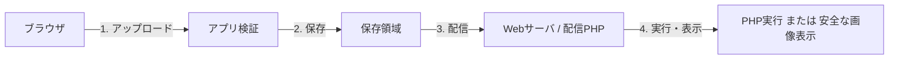

# ハンズオン手順書：アップロードから実行までの攻撃連鎖と多層防御

[English](../en/hands-on-guide.md)

関連資料：[Lab 01 概要](../../README.md) | [ワークシート](./worksheet.md) | [LT実演台本](./lt-script.md) | [サンプル解説](../../samples/README.md) | [自動検証](../../tests/README.md)

> [!CAUTION]
> 本ラボは `127.0.0.1` 限定のローカル学習用環境です。公開サーバや共有ネットワークへ絶対にデプロイせず、同梱の無害なサンプルのみを使用してください（詳細: [SAFETY.md](../../../../SAFETY.md)）。

## 1. ゴールと前提環境

ブラウザ操作だけで「アップロード → 保存 → 配信 → 実行」の攻撃連鎖と多層防御を体験します（60〜90分・初回ビルド後は完全オフライン動作）。

- **到達目標**：
  1. Stage 1 で無検証のファイル保存がサーバー側PHP実行に至る条件を確認する。
  2. Stage 2 でアプリの `.php` 拒否リストが `.phtml` で突破される「アプリとApacheの解釈ギャップ」を確認する。
  3. Stage 3 でアプリ・ストレージ・配信・インフラの4層がそれぞれ独立して連鎖を断つ仕組みを確認する。
- **必要なもの**：Docker Compose 環境（Windows WSL2 / macOS / Linux）、Webブラウザ。



## 2. タイムテーブル目安

手元で [ワークシート](./worksheet.md) を開きながら進めます。

### 60分コース（ブラウザ演習＋ワークシート）

| 時間 | フェーズ | 内容 |
| :--- | :--- | :--- |
| 00:00 - 00:08 | 導入・安全確認 | 安全ルール共有、コンテナ起動確認 |
| 00:08 - 00:20 | Stage 1 演習 | `8081` で `.php` マーカー実行を確認、ワークシート記入 |
| 00:20 - 00:35 | Stage 2 演習 | `8082` で `.php` 拒否と `.phtml` 回避を確認、ワークシート記入 |
| 00:35 - 00:50 | Stage 3 演習 | `8083` で許可リスト・`/image.php`・インフラ層遮断を確認 |
| 00:50 - 01:00 | ふりかえり・停止 | 解答例の確認、`docker compose down` |

### 90分コース（上記＋付録A・B）

| 時間 | フェーズ | 内容 |
| :--- | :--- | :--- |
| 00:00 - 00:50 | 基本演習 | 60分コースの導入〜Stage 3 演習を実施 |
| 00:50 - 01:08 | 付録A：`curl` 検証 | `Content-Type`・拡張子偽装リクエストの送信実験 |
| 01:08 - 01:22 | 付録B：コード比較 | 3ステージのPHP実装・Apache設定の差分確認と討議 |
| 01:22 - 01:30 | まとめ・停止 | 解答例の確認、質疑応答、`docker compose down` |

## 3. 事前準備と起動

### ファシリテーター確認事項と安全ルール
- [ ] 会場Wi-Fi負荷を避けるため、参加者へ事前のイメージビルドを案内済みであること。
- [ ] 開始前に3つのルールを共有すること：① `127.0.0.1` ローカル限定で動かす、② `samples/` 以外のペイロードを投入しない、③ 許可のない外部サイトで試さない。

### 起動と動作確認

```bash
cd labs/01-php-upload-defense
docker compose up --build -d
docker compose --profile test run --rm verifier
```

## 4. ブラウザ演習ステップ

使用するサンプルは `labs/01-php-upload-defense/samples/` 配下の `sample-valid.png`、`marker-basic.php`、`marker-bypass.phtml` の3つです。

### Step 1：Stage 1 脆弱なベースライン（`http://127.0.0.1:8081/?lang=ja`）

- **操作 1-1**：Stage 1 を開き、画面上部の警告バナーを確認して**リセット**ボタンを押す。
  - **確認ポイント**：アップロード一覧が空の初期状態になる。
- **操作 1-2**：`samples/sample-valid.png` をアップロードし、生成された `/uploads/sample-valid.png` を開く。
  - **確認ポイント**：HTTP `200` で受理され、PNG画像として正常に表示される。
- **操作 1-3**：`samples/marker-basic.php` をアップロードし、生成された `/uploads/marker-basic.php` を開く。
  - **確認ポイント**：`LAB_EXECUTION_MARKER_STAGE1` とPHPバージョン・実行ユーザ `www-data` 等が表示される（ソース表示ではなくサーバー上でPHPが実行された証拠）。
- **操作 1-4**：[ワークシート](./worksheet.md) の Stage 1 欄を記録し、画面に戻って**リセット**ボタンを押す。
  - **確認ポイント**：`/uploads/marker-basic.php` が HTTP `404` になり削除される。

### Step 2：Stage 2 アプリ単層防御の限界（`http://127.0.0.1:8082/?lang=ja`）

- **操作 2-1**：Stage 2 を開いて**リセット**ボタンを押し、`samples/marker-basic.php` をアップロードする。
  - **確認ポイント**：アプリの `.php` 拒否リストにより **HTTP `400`** でブロックされる。
- **操作 2-2**：ブラウザからそのまま `samples/marker-bypass.phtml` を選択してアップロードし、`/uploads/marker-bypass.phtml` を開く。
  - **確認ポイント**：**HTTP `200`** で通過し、`LAB_EXECUTION_MARKER_STAGE2` がサーバー上でPHP実行される。
  - **原因**：アプリは拡張子 `.php` のみを弾いたが、Apache設定 `<FilesMatch "\.(php|phtml)$">` は `DocumentRoot` 内の `.phtml` もPHPとして実行するため。
- **操作 2-3**：[ワークシート](./worksheet.md) の Stage 2 欄を記録し、**リセット**ボタンを押す。
  - **確認ポイント**：アップロードした `.phtml` ファイルが削除される。

### Step 3：Stage 3 多層防御の確認（`http://127.0.0.1:8083/?lang=ja`）

- **操作 3-1**：Stage 3 を開いて**リセット**ボタンを押し、`marker-basic.php` と `marker-bypass.phtml` を順にアップロードする。
  - **確認ポイント**：画像4種（`png`, `jpg`, `jpeg`, `gif`）のみの**許可リスト**により、両方とも **HTTP `400`** で拒否される。
- **操作 3-2**：`samples/sample-valid.png` をアップロードし、開発者ツールのネットワークタブを開いた状態で生成リンクを開く。
  - **確認ポイント**：URLが `/image.php?file=<UUIDv4>.png` 形式（元の名前を破棄し `DocumentRoot` 外の `/var/lab-storage/uploads/` に隔離）になり、レスポンスに `X-Content-Type-Options: nosniff`・`Content-Security-Policy: default-src 'none'`・`X-Frame-Options: DENY` が付与される。
- **操作 3-3**：ブラウザで `http://127.0.0.1:8083/uploads/infra-guard-check.phtml` に直接アクセスする。
  - **確認ポイント**：PHPは一切実行されず **HTTP `403`** が返る（Apache側の `AllowOverride None`・PHPエンジン無効化・`Require all denied` により、万一アプリ層が突破されてもインフラ層が単独で阻止する）。
- **操作 3-4**：**リセット**ボタンを押す。
  - **確認ポイント**：アップロード画像は削除（HTTP `404`）され、`/uploads/infra-guard-check.phtml` の HTTP `403` 保護は維持される。[ワークシート](./worksheet.md) を完成させる。

## 5. 片付けとよくある質問

演習終了後は必ずコンテナを停止します。

```bash
cd labs/01-php-upload-defense
docker compose down
```

- **ポート `8081`〜`8083` が競合する**：ローカルの別プロセスを停止してから再起動してください（`127.0.0.1:` 指定は外さないこと）。
- **PowerShell で `curl` が動かない**：Windows PowerShell の `curl` エイリアスを避けるため、必ず `curl.exe` を使ってください。
- **オフライン会場で動かしたい**：事前に一度 `docker compose up --build -d` を済ませておけば、外部通信なしで動作します。

## 付録A：`curl` によるヘッダ・ファイル名偽装実験

`labs/01-php-upload-defense` ディレクトリで実行します。PowerShell では必ず `curl.exe` を指定し、`;` を含む `-F "..."` 引数全体をダブルクォーテーションで囲んでください。

### A-1. Stage 2 へ `Content-Type: image/png` を偽装して `.phtml` を送信
- **bash / zsh**:
  ```bash
  curl -i -F "file=@samples/marker-bypass.phtml;type=image/png" http://127.0.0.1:8082/upload.php
  ```
- **Windows PowerShell**:
  ```powershell
  curl.exe -i -F "file=@samples/marker-bypass.phtml;type=image/png" "http://127.0.0.1:8082/upload.php"
  ```
- **確認ポイント**：HTTP `200` で通過する。リクエストの `Content-Type` はクライアントの自己申告値であり信用できない（確認後は Stage 2 をリセットすること）。

### A-2. Stage 3 へ拡張子 `.png` と `Content-Type: image/png` を両方偽装してPHPマーカーを送信
- **bash / zsh**:
  ```bash
  curl -i -F "file=@samples/marker-basic.php;filename=disguised.png;type=image/png" http://127.0.0.1:8083/upload.php
  ```
- **Windows PowerShell**:
  ```powershell
  curl.exe -i -F "file=@samples/marker-basic.php;filename=disguised.png;type=image/png" "http://127.0.0.1:8083/upload.php"
  ```
- **確認ポイント**：サーバー側の実バイト検証（`finfo` と `getimagesize()`）により **HTTP `400`** で拒否される。

### A-3. Stage 3 のインフラ層ガードをレスポンスヘッダごと確認
- **bash / zsh**:
  ```bash
  curl -i http://127.0.0.1:8083/uploads/infra-guard-check.phtml
  ```
- **Windows PowerShell**:
  ```powershell
  curl.exe -i "http://127.0.0.1:8083/uploads/infra-guard-check.phtml"
  ```
- **確認ポイント**：HTTP `403` が返り、PHPコードが評価されない。

## 付録B：コード・設定の比較ポイント

[stage1-vulnerable/](../../stage1-vulnerable/)、[stage2-app-only/](../../stage2-app-only/)、[stage3-defense-in-depth/](../../stage3-defense-in-depth/) を開き、以下の差分を確認します。

1. **`src/upload.php`**：Stage 1（`basename()` のみ）、Stage 2（`.php` のみの拒否リスト）、Stage 3（サイズ上限2MB → 許可リスト → `finfo` → `getimagesize()` → `UUIDv4` 生成）。
2. **保存先と `src/image.php`**：Stage 1・2 は `/var/www/html/uploads/` 直置き。Stage 3 は `/var/lab-storage/uploads/` に隔離し、`image.php` で `UUIDv4` 正規表現を検証して `nosniff`・`CSP` を付与。
3. **Apache設定と `Dockerfile`**：Stage 2 の `.phtml` ハンドラ設定と、Stage 3 の `AllowOverride None`・PHPエンジン無効化・`Require all denied`、および全ステージ共通の非root `USER www-data` 実行を比較する。

### 討議テーマ
- 画像の再エンコード（GD等でのピクセル再生成）を追加する場合の利点と注意点（パーサ脆弱性・CPU負荷）は何か？
- 自社プロダクト（オブジェクトストレージ＋CDN構成を含む）では、どの層で `Content-Type` 固定とスクリプト実行防止を担保しているか？
- アプリとインフラの設定ギャップを防ぐため、`verifier` のような自動検証をどうCIに組み込むべきか？
