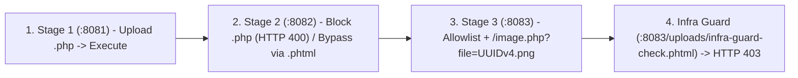

# LT（ライトニングトーク）実演デモ台本：5分版＆10分版（Lab 01）

[日本語](./lt-script.md) | [English](../en/lt-script.md)

関連ドキュメント：[ハンズオン手順書](./hands-on-guide.md) | [脅威モデリング・ワークシート](./worksheet.md) | [Lab 01 README](../../README.ja.md) | [安全ポリシー](../../../../docs/safety.ja.md)

> [!CAUTION]
> **登壇・実演時の安全ルール**
> ライブデモは必ず登壇者自身のローカルPC上（`127.0.0.1` バインド・内部隔離ネットワーク `internal: true`）で実行し、聴衆にも「ローカル隔離環境かつ無害な固定出力マーカーを使用していること」を一言明示してください。終了後は `docker compose down` で停止します。

---

## 1. 登壇直前チェックリスト（会場控え室・5分前）

ライブデモの失敗原因の9割は「Wi-Fi不調」「文字が小さくて見えない」「前回リハーサルのゴミファイル残り」です。登壇前に以下を順番に潰しておきましょう。

- [ ] **オフライン起動確認**：会場Wi-Fiに頼らずコンテナが起動していることを確認する
  ```bash
  cd labs/01-php-upload-defense
  docker compose up --build -d
  docker compose --profile test run --rm verifier
  ```
- [ ] **全ステージの事前リセット**：3つのステージすべてで画面内の **Reset** ボタン（`POST /reset.php`）を押し、アップロード一覧が空であることを確認する（`verifier` 実行後も念のため目視確認）。
- [ ] **ブラウザのタブ準備と拡大率設定**：
  - プロジェクター投影用にブラウザのズーム倍率を **150%〜175%** に設定する。
  - OSの通知（おやすみモード／集中モード）をONにする。
  - 以下の順番でブラウザのタブを並べておく（日本語発表なら `?lang=ja`、英語発表なら `?lang=en` で統一）：
    1. Tab 1（Stage 1）：`http://127.0.0.1:8081/?lang=ja`
    2. Tab 2（Stage 2）：`http://127.0.0.1:8082/?lang=ja`
    3. Tab 3（Stage 3）：`http://127.0.0.1:8083/?lang=ja`
    4. ブックマークバー（またはTab 4に待機）：`http://127.0.0.1:8083/uploads/infra-guard-check.phtml`
- [ ] **ファイル選択ダイアログの初期フォルダ固定**：
  - リハーサル時に一度 `labs/01-php-upload-defense/samples/` フォルダを開いておき、本番でファイル選択ボタンを押した瞬間に `sample-valid.png`、`marker-basic.php`、`marker-bypass.phtml` の3つがすぐ選べる状態にしておく。

---

## 2. 5分版 LT台本（ブラウザ完結・王道ライブデモ構成）

**コンセプト**：ターミナル操作を一切挟まず、ブラウザのタブ切り替えとファイル選択だけで「実行成立 -> ブラックリスト突破 -> 多層防御」をテンポよく見せる構成です。



### タイムライン＆スピーカー台本（5分版）

#### `00:00 - 00:45`（45秒）｜導入：なぜ「拡張子チェックだけ」では危ないのか？
- **【画面操作】**：タイトルスライド（または Tab 1 `http://127.0.0.1:8081/?lang=ja` の上部バナーを見せる）
- **【トーク例】**：
  > 「今日は『ファイルアップロード脆弱性って、`.php` さえ弾けば直るんでしょ？』というよくある思い込みが、なぜ崩れるのか、そしてどう多層防御で守るかを3つのステージで実演します。
  > なお、これからお見せする環境はすべて `127.0.0.1` 限定・外部通信遮断のローカル学習用Dockerコンテナで、アップロードするファイルも固定文字列だけを出す完全に無害なマーカーです。」

#### `00:45 - 01:45`（60秒）｜実演1：Stage 1 — 無防備だと何が起きるか（`8081`）
- **【画面操作】**：
  1. **Tab 1（`8081`）** で `samples/marker-basic.php` を選択し、アップロードボタンを押す（HTTP `200`）。
  2. 生成されたリンク `/uploads/marker-basic.php` をクリックする。
  3. 画面に出た `LAB_EXECUTION_MARKER_STAGE1` とPHPバージョン・実行ユーザ `www-data` をハイライトする。
- **【トーク例】**：
  > 「まず無防備な Stage 1 です。`marker-basic.php` をアップロードしてリンクを開くと……`LAB_EXECUTION_MARKER_STAGE1` とサーバーのPHPバージョンが出ました。PHPソースが表示されるのではなく、サーバー上でプログラムとして実行されています。
  > 理由は3つが同時に揃ったからです。『検証せず受け取った』『公開ディレクトリ配下に元の名前で保存した』『Apacheがその場所でPHPを実行した』。この連鎖に注目してください。」

#### `01:45 - 03:00`（75秒）｜実演2：Stage 2 — アプリ単層のブラックリスト回避（`8082`）
- **【画面操作】**：
  1. **Tab 2（`8082`）** に切り替え、`samples/marker-basic.php` をアップロード -> **HTTP `400` エラー画面**を見せる。
  2. 戻って今度は `samples/marker-bypass.phtml` を選び、ブラウザからそのままアップロード -> **HTTP `200` 成功**！
  3. `/uploads/marker-bypass.phtml` をクリックし、`LAB_EXECUTION_MARKER_STAGE2` を見せる。
- **【トーク例】**：
  > 「そこで急いで直したのが Stage 2 です。アプリ側で `.php` を禁止しました。実際 `marker-basic.php` を投げると HTTP 400 で弾かれます。一見直ったように見えますよね？
  > では特別なツールは一切使わず、ブラウザから `marker-bypass.phtml` を選んでアップロードしてみます……通ってしまいました！リンクを開くと `LAB_EXECUTION_MARKER_STAGE2`、またPHPとして実行されています。
  > なぜでしょう？ アプリ開発者は『PHPは `.php` だけ』と思っていましたが、インフラ側のApache設定では `.phtml` もPHPハンドラに紐付いていたからです。公開ディレクトリに直接保存したままブラックリストに頼ると、アプリとWebサーバのわずかな解釈のズレが即、コード実行に直結します。」

#### `03:00 - 04:20`（80秒）｜実演3：Stage 3 — 多層防御とインフラ層フェイルセーフ（`8083`）
- **【画面操作】**：
  1. **Tab 3（`8083`）** に切り替え、`samples/marker-bypass.phtml` をアップロード -> **HTTP `400` で拒否**されるのを見せる。
  2. 戻って `samples/sample-valid.png` をアップロード -> リンク `/image.php?file=<UUIDv4>.png` をクリックして画像を表示する。
  3. アドレスバー（またはブックマーク）から `http://127.0.0.1:8083/uploads/infra-guard-check.phtml` を開き、**HTTP `403 Forbidden`** を見せる。
- **【トーク例】**：
  > 「ではどう守るか。Stage 3 が多層防御です。
  > 第1の壁として、拡張子は画像4種の**許可リスト**＋サーバー側での実バイナリ検証なので、`.phtml` は入り口で弾かれます。
  > 第2・第3の壁として、正常なPNGを上げるとURLが `/image.php?file=<UUID>.png` に変わります。元のファイル名は捨て、実体はDocumentRootの外（`/var/lab-storage/uploads/`）に隔離したうえで、`nosniff` と `CSP` ヘッダ付きで安全に配信しています。
  > さらに第4の壁！『もし将来アプリのバグで `/uploads/` に `.phtml` が置かれたら？』を試すため、あらかじめ置いてある `infra-guard-check.phtml` を叩くと……HTTP 403！Apache側でもPHPエンジン無効化とアクセス拒否をかけているため、万一アプリ層が破られても実行されません。」

#### `04:20 - 05:00`（40秒）｜まとめスライド：持ち帰りメッセージ
- **【画面操作】**：まとめスライドへ切り替え
- **【トーク例】**：
  > 「まとめです。ファイルアップロードは『入口の検証』だけでは守れません。`Upload -> Store -> Serve -> Execute` の4段階で、①許可リストと実バイト検証、②公開ディレクトリ外へのUUID保存、③`nosniff`・`CSP` 付き配信、④Webサーバ側のスクリプト実行無効化を重ねてください。ローカルで今日すぐ試せるハンズオンなので、ぜひ動かしてみてください。ありがとうございました！」

---

## 3. 10分版 拡張デモ台本（`curl` 偽装＆ヘッダ検証入り）

10分枠（勉強会のメイン枠や社内セキュリティ研修の導入）では、5分版の流れに加えて**「クライアント申告ヘッダ・拡張子偽装の `curl` 実演」**と**「DevToolsでのセキュリティヘッダ確認」**を入れると説得力が一段と増します。

### 事前追加準備（10分版のみ）
- ターミナルを1枚開き、文字サイズを大きくして `labs/01-php-upload-defense/` に移動しておく。
- OSに合わせて以下のワンライナーを履歴（またはメモ帳）に用意しておく：
  - **macOS / Linux / WSL2 (`bash` / `zsh`)**:
    ```bash
    curl -i -F "file=@samples/marker-basic.php;filename=disguised.png;type=image/png" http://127.0.0.1:8083/upload.php
    ```
  - **Windows PowerShell (`curl.exe` 必須)**:
    ```powershell
    curl.exe -i -F "file=@samples/marker-basic.php;filename=disguised.png;type=image/png" "http://127.0.0.1:8083/upload.php"
    ```

### タイムライン＆追加パート進行（10分版）

| 時間目安 | パート | 実演・解説のポイント |
| :--- | :--- | :--- |
| `00:00 - 01:30` | 1. 問題提起と4段階モデル | `Upload -> Store -> Serve -> Execute` の図を提示し、「アップロード機能はアプリとインフラの境界線が最も曖昧になりやすい機能」と位置づける。安全ルールも明示。 |
| `01:30 - 03:00` | 2. Stage 1 実演（`8081`） | `sample-valid.png`（正常系）を見せた後、`marker-basic.php` で `LAB_EXECUTION_MARKER_STAGE1` を実演。最後に **Reset** ボタン（`POST /reset.php`）で掃除できる仕組みも見せる。 |
| `03:00 - 05:00` | 3. Stage 2 実演（`8082`） | `marker-basic.php` が HTTP `400` で止まることを見せた後、会場に「これで安心でしょうか？」と問いかけ、`marker-bypass.phtml` で突破（`LAB_EXECUTION_MARKER_STAGE2`）。Apache の `<FilesMatch "\.(php|phtml)$">` との認識ギャップを解説。 |
| `05:00 - 06:45` | 4. Stage 3 ブラウザ実演（`8083`） | `.php` / `.phtml` の HTTP `400` 拒否を確認後、`sample-valid.png` をアップロード。ブラウザの開発者ツール（Networkタブ）を開き、`/image.php?file=<UUIDv4>.png` のレスポンスヘッダに `X-Content-Type-Options: nosniff` と `Content-Security-Policy: default-src 'none'` が付いていることを実演。 |
| `06:45 - 08:00` | 5. ターミナル実演（偽装攻撃の遮断） | ターミナルに切り替え、中身が `marker-basic.php` なのに `filename=disguised.png` かつ `Content-Type: image/png` に偽装した `curl`（Windowsは `curl.exe`）を Stage 3 に送信。`finfo` と `getimagesize()` により **HTTP `400`** で弾かれる瞬間を見せる。 |
| `08:00 - 09:00` | 6. インフラ層ガード＆自動テスト紹介 | `/uploads/infra-guard-check.phtml` の **HTTP `403`**（`AllowOverride None`＋PHP無効化）を見せ、さらに `docker compose --profile test run --rm verifier` で「防御設定の退行（デグレ）をCIで自動テストできる」ことを紹介。 |
| `09:00 - 10:00` | 7. まとめスライド | 4層の設計チェックリストを提示して締めくくる。 |

---

## 4. トラブル時のフォールバック計画（時間押し・機材トラブル対策）

ライブデモでは必ず「プランB」を持っておきましょう。

1. **前の登壇者が押して持ち時間が3分しかなくなった場合（超短縮ルート）**
   - Stage 1 の実演を口頭10秒（「無防備なら当然 `.php` が動きます」）でスキップし、いきなり **Tab 2（Stage 2 `8082`）の `.phtml` バイパス** -> **Tab 3（Stage 3 `8083`）の `/image.php` ＆ `infra-guard-check.phtml`（HTTP 403）** の2画面比較だけに絞ると、2分半で核心を伝えきれます。
2. **前の操作のファイルが残っていて画面が紛らわしい場合**
   - 慌てず各ステージ画面の **Reset** ボタンを1クリックすれば、即座に初期状態（`.gitkeep` と Stage 3 の `infra-guard-check.phtml` のみ残した状態）へ復帰します。
3. **プロジェクター接続後にDockerエンジンが不調になった場合**
   - 念のためスライド末尾（バックアップスライド）に以下の4枚のスクリーンショットを貼っておくと無敵です：
     - ① Stage 1：`LAB_EXECUTION_MARKER_STAGE1` 実行画面
     - ② Stage 2：`marker-basic.php` の HTTP 400 と、`marker-bypass.phtml` の `LAB_EXECUTION_MARKER_STAGE2` 実行画面
     - ③ Stage 3：`/image.php?file=<UUIDv4>.png` のレスポンスヘッダ（`nosniff`, `CSP`）
     - ④ Stage 3：`/uploads/infra-guard-check.phtml` の HTTP 403 画面
4. **登壇終了後の片付け**
   - 降壇後、PCを閉じる前に `docker compose down` を実行してコンテナを停止します。

---

## 5. スライド転記用・キーメッセージ箇条書き

発表スライドの「まとめページ」にそのままコピー＆ペーストして使える要点リストです。

### 日本語スライド用（結論3ポイント）
- **単層のブラックリストは破綻する**：アプリの `.php` 拒否だけでは、Webサーバ側のハンドラ設定（`.phtml` 等）との解釈ギャップを防げない。
- **`Upload -> Store -> Serve -> Execute` の全段階で連鎖を断つ**：
  - **Upload**：許可リスト（Allowlist）＋サーバー側実バイト検証（`finfo` / `getimagesize()`）
  - **Store**：DocumentRoot外への隔離保存 ＋ UUIDv4リネーム
  - **Serve**：専用配信エンドポイント ＋ `X-Content-Type-Options: nosniff` ＆ `CSP`
  - **Execute**：`AllowOverride None` ＋ アップロード領域でのPHP実行無効化・直接アクセス拒否（HTTP 403）
- **「アプリとインフラの前提一致」を自動テストで守る**：E2E検証スクリプトで設定ドリフトを継続的に検知しよう。
