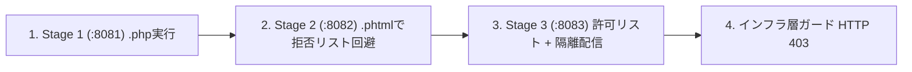

# LT実演デモ台本：5分版・10分版

[English](../en/lt-script.md)

関連資料：[ハンズオン手順書](./hands-on-guide.md) | [ワークシート](./worksheet.md) | [Lab 01 概要](../../README.md)

> [!CAUTION]
> 実演は必ず登壇者PCの `127.0.0.1` 隔離環境で行い、聴衆にも「ローカル専用環境・無害な固定出力マーカー使用」を明示してください（詳細: [SAFETY.md](../../../../SAFETY.md)）。

## 1. 登壇5分前の準備チェックリスト

- [ ] コンテナ起動と自動検証を完了しておく（以降は完全オフラインで動作）：
  ```bash
  cd labs/01-php-upload-defense
  docker compose up --build -d
  docker compose --profile test run --rm verifier
  ```
- [ ] 全ステージ画面で**リセット**ボタン（`POST /reset.php`）を押し、アップロード一覧を空にする。
- [ ] OSの通知をオフにし、ブラウザ拡大率を **150%〜175%** に設定する。
- [ ] 以下の順でブラウザタブを開いておく（ファイル選択ダイアログも `samples/` を初期表示にしておく）：
  1. Tab 1：`http://127.0.0.1:8081/?lang=ja`（Stage 1）
  2. Tab 2：`http://127.0.0.1:8082/?lang=ja`（Stage 2）
  3. Tab 3：`http://127.0.0.1:8083/?lang=ja`（Stage 3）
  4. Tab 4（またはブックマーク）：`http://127.0.0.1:8083/uploads/infra-guard-check.phtml`



## 2. 5分版 進行チートシート（ブラウザ完結）

| 時間 | 画面操作 | 伝える要点 |
| :--- | :--- | :--- |
| `00:00 - 00:40` | Tab 1（`8081`）の上部警告バナーを表示 | ・「`.php` さえ弾けば安全」という単層対策がなぜ崩れるかを実演する<br>・`127.0.0.1` 隔離環境と無害な固定文字列マーカーを使っている旨を共有 |
| `00:40 - 01:40` | Tab 1 で `marker-basic.php` を送信 → `/uploads/marker-basic.php` を開く | ・`LAB_EXECUTION_MARKER_STAGE1` とPHPバージョンが出力され、サーバー側で実行されたことを確認<br>・「無検証」「`DocumentRoot` 内保存」「PHPハンドラ有効」の3条件が揃うと実行に至る |
| `01:40 - 03:00` | Tab 2（`8082`）で `marker-basic.php` 送信（`400`）→ `marker-bypass.phtml` 送信（`200`）→ リンクを開く | ・`.php` は HTTP `400` で止まるが、ブラウザから `.phtml` を選ぶだけで通過し `LAB_EXECUTION_MARKER_STAGE2` が実行される<br>・アプリの拒否リストと Apache の `<FilesMatch "\.(php|phtml)$">` 設定の解釈ギャップが原因 |
| `03:00 - 04:20` | Tab 3（`8083`）で `.phtml` 送信（`400`）→ `sample-valid.png` 送信 → `/image.php?file=...` 表示 → Tab 4 を開く | ・許可リストと実バイト検証で `.phtml` を拒否し、画像は `DocumentRoot` 外に `UUIDv4` で隔離して `/image.php` から配信<br>・`/uploads/infra-guard-check.phtml` も HTTP `403` で遮断（アプリ層に万一バグが出てもインフラ層が阻止） |
| `04:20 - 05:00` | まとめスライドを表示 | ・「アップロード → 保存 → 配信 → 実行」の各層で独立して連鎖を断つ重要性を3点で締める |

## 3. 10分版 進行チートシート（`curl` 偽装・ヘッダ確認追加）

10分枠では、ターミナルを1枚用意して `labs/01-php-upload-defense/` を開いておきます。

| 時間 | 画面操作 | 伝える要点 |
| :--- | :--- | :--- |
| `00:00 - 01:20` | 構成図スライド・Tab 1 表示 | ・アップロード機能はアプリとインフラの境界が最も曖昧になりやすい領域であることを提示<br>・ローカル隔離環境と無害マーカーの安全前提を共有 |
| `01:20 - 02:50` | Tab 1（`8081`）：`sample-valid.png` → `marker-basic.php` 実行 → **リセット**押下 | ・正常な画像表示と `.php` サーバー実行を対比し、**リセット**で即座に清掃できる構成を見せる |
| `02:50 - 04:50` | Tab 2（`8082`）：`marker-basic.php`（`400`）→ `marker-bypass.phtml`（`200`・実行） | ・拒否リスト方式はミドルウェア側の実行可能拡張子を1つでも漏らすと即座に突破されることを実演 |
| `04:50 - 06:30` | Tab 3（`8083`）：`sample-valid.png` 送信 → 開発者ツールで `/image.php` のヘッダ表示 | ・`UUIDv4` リネームと `/var/lab-storage/uploads/` への隔離保存を確認<br>・`X-Content-Type-Options: nosniff` と `Content-Security-Policy: default-src 'none'` を実演 |
| `06:30 - 08:00` | ターミナルから Stage 3 へ偽装リクエスト送信（下記コマンド） | ・拡張子 `.png` かつ `Content-Type: image/png` に偽装しても、`finfo` と `getimagesize()` が実バイト列を検査して HTTP `400` で弾くことを示す |
| `08:00 - 09:10` | Tab 4（HTTP `403`）表示 → `verifier` コマンド紹介 | ・Apache の `AllowOverride None` とPHP無効化によるフェイルセーフを確認<br>・`docker compose --profile test run --rm verifier` で設定の退行をCI検知できると紹介 |
| `09:10 - 10:00` | まとめスライドを表示 | ・持ち帰り用の4層チェックリストを提示して終了 |

### 10分版で使用する偽装送信コマンド
- **bash / zsh**:
  ```bash
  curl -i -F "file=@samples/marker-basic.php;filename=disguised.png;type=image/png" http://127.0.0.1:8083/upload.php
  ```
- **Windows PowerShell**:
  ```powershell
  curl.exe -i -F "file=@samples/marker-basic.php;filename=disguised.png;type=image/png" "http://127.0.0.1:8083/upload.php"
  ```

## 4. 時間押し・トラブル時の切り替え手順

- **持ち時間が3分未満に減った場合**：Stage 1 を口頭1文で省略し、Tab 2（`.phtml` 回避）と Tab 3・4（`/image.php` と `infra-guard-check.phtml` の HTTP `403`）の比較のみに絞る。
- **リハーサル時のファイルが残っていた場合**：画面内の**リセット**ボタンを押せば即座に初期状態へ戻る（`infra-guard-check.phtml` は保持される）。
- **Docker不調への備え**：① Stage 1 実行画面、② Stage 2 `.phtml` 実行画面、③ Stage 3 `/image.php` ヘッダ、④ Stage 3 HTTP `403` のスクリーンショット4枚を予備スライドに入れておく。降壇後は `docker compose down` で停止する。

## 5. スライド転記用まとめ（3ポイント）

- **単層の拒否リストに頼らない**：アプリの `.php` 除外だけでは、Webサーバ側のハンドラ設定（`.phtml` 等）とのズレを防げない。
- **「アップロード → 保存 → 配信 → 実行」の全層で連鎖を断つ**：許可リスト＋実バイト検証、`DocumentRoot` 外への `UUIDv4` 保存、`nosniff`・`CSP` 付与、Webサーバ側のPHP無効化と直接アクセス拒否を重ねる。
- **アプリとインフラの前提一致を自動検証する**：`verifier` のようなE2Eテストで設定変更による抜け道を継続的に防ぐ。
