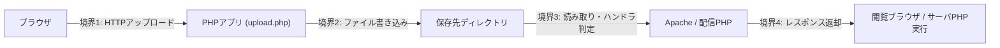

# 脅威モデリング・ワークシート

[English](../en/worksheet.md)

関連資料：[ハンズオン手順書](./hands-on-guide.md) | [Lab 01 概要](../../README.md) | [LT実演台本](./lt-script.md)

> [!CAUTION]
> 本ラボは `127.0.0.1` 限定のローカル学習用環境です。公開サーバや共有ネットワークへ絶対にデプロイせず、同梱の無害なサンプルのみを使用してください（詳細: [SAFETY.md](../../../../SAFETY.md)）。

[ハンズオン手順書](./hands-on-guide.md) を進めながら空欄セルを埋めてください。末尾に折りたたみ式の解答例があります。

## 1. 守るべき資産と信頼境界

### 1-1. 守るべき資産を3つ挙げてください

| 番号 | 守るべき資産 | 侵害された場合の影響 |
| :--- | :--- | :--- |
| 1 | | |
| 2 | | |
| 3 | | |

### 1-2. 境界1を通過するクライアント入力はそのまま信用できますか？

| 入力項目 | 偽装の可否 | 攻撃者による操作例 |
| :--- | :--- | :--- |
| ファイル名 | | |
| 拡張子 | | |
| `Content-Type` ヘッダ | | |
| ファイル本体のバイト列 | | |

## 2. ステージ別の挙動と原因確認

### 2-1. Stage 1（`http://127.0.0.1:8081`）と Stage 2（`http://127.0.0.1:8082`）

| ステージ / 試行ファイル | HTTP結果 | アクセス時の挙動 | 通過または拒否された理由 |
| :--- | :--- | :--- | :--- |
| Stage 1: `sample-valid.png` | | | |
| Stage 1: `marker-basic.php` | | | |
| Stage 2: `marker-basic.php` | | | |
| Stage 2: `marker-bypass.phtml` | | | |

- **問い1（Stage 1）**：アップロードされたファイルがサーバー側でPHP実行されるまでに揃ってしまった3つの条件は何ですか？
- **問い2（Stage 2）**：アプリ開発者の「思い込み」と、Apache側の「実際の設定」はどう食い違っていましたか？

### 2-2. Stage 3（`http://127.0.0.1:8083`）

| 確認項目 | HTTP結果 | 観察できた防御の仕組み |
| :--- | :--- | :--- |
| `marker-basic.php` / `marker-bypass.phtml` の送信 | | |
| `sample-valid.png` の配信URL形式 | | |
| `/image.php` のレスポンスヘッダ | | |
| `/uploads/infra-guard-check.phtml` への直接アクセス | | |

- **問い3（Stage 3）**：万一アプリの改修ミスで `.phtml` が検証をすり抜けた場合でも、後続のどの層が実行を阻止しますか？

## 3. 多層防御の整理表

| フェーズ | 想定される脅威 | 単層防御の失敗例（Stage 1 / 2） | Stage 3 の具体的な対策 | 担当層 |
| :--- | :--- | :--- | :--- | :--- |
| **アップロード** | 代替拡張子（`.phtml`）や画像偽装スクリプトの投入 | `.php` 拒否リストのすり抜け、ヘッダ偽装 | | |
| **保存** | 公開領域への直接配置、攻撃者指定ファイル名の悪用 | `DocumentRoot` 内に元の名前で保存 | | |
| **配信** | ブラウザのMIME推測やスクリプト発火 | 直接配信・防御ヘッダなし | | |
| **実行制御** | `.htaccess` 上書きや公開領域でのPHP実行 | `uploads` 内でPHPハンドラが有効 | | |

## 4. 実務への持ち帰りメモ

| 自分の関わるシステムで明日確認したい設計・設定項目 |
| :--- |
| |

---

<strong>解答例・ファシリテーター解説を表示する</strong>

### 1. 守るべき資産と信頼境界
- **守るべき資産**：
  1. **サーバーのコード実行整合性**：任意のスクリプトを実行されないこと。
  2. **サーバー内のデータと内部通信経路**：機密設定、他利用者のファイル、内部ネットワーク。
  3. **閲覧者のブラウザ環境**：配信ファイル経由でスクリプトが実行されないこと。
- **クライアント入力**：ファイル名・拡張子・`Content-Type`・バイト列は**すべて偽装可能**（`curl` 等で任意の値に書き換えられるため一切信用しない）。

### 2. ステージ別の挙動と原因
- **Stage 1**：`sample-valid.png` は `200`（画像表示）、`marker-basic.php` は `200`（PHP実行・`LAB_EXECUTION_MARKER_STAGE1` 出力）。
  - **問い1**：「無検証での受理」「`DocumentRoot` 内（`/var/www/html/uploads/`）への `.php` 名保存」「その場所でのApache PHPハンドラ有効化」の3条件が揃ったため。
- **Stage 2**：`marker-basic.php` は `400`（拒否）、`marker-bypass.phtml` は `200`（PHP実行・`LAB_EXECUTION_MARKER_STAGE2` 出力）。
  - **問い2**：開発者は「PHPは `.php` だけ」と思い込んで拒否リストを作ったが、Apacheは `<FilesMatch "\.(php|phtml)$">` で `.phtml` もPHP実行する設定だった。
- **Stage 3**：`.php` / `.phtml` は `400`（拒否）、`sample-valid.png` は `/image.php?file=<UUIDv4>.png` で配信（`nosniff`・`CSP`・`X-Frame-Options: DENY` 付与）、`/uploads/infra-guard-check.phtml` は **`403`**（PHP不実行）。
  - **問い3**：① `DocumentRoot` 外（`/var/lab-storage/uploads/`）への `UUIDv4` 保存、② `/image.php` の正規表現検証とストリーム配信（`include` 不使用）、③ Apacheの `AllowOverride None`・PHPエンジン無効化・`Require all denied` がそれぞれ独立して阻止する。

### 3. 多層防御の整理表（完成版）

| フェーズ | 想定される脅威 | 単層防御の失敗例（Stage 1 / 2） | Stage 3 の具体的な対策 | 担当層 |
| :--- | :--- | :--- | :--- | :--- |
| **アップロード** | 代替拡張子（`.phtml`）や画像偽装スクリプトの投入 | `.php` 拒否リストのすり抜け、ヘッダ偽装 | 画像4種の**許可リスト**、2MB上限、`finfo` と `getimagesize()` による実バイト検証 | アプリ層 |
| **保存** | 公開領域への直接配置、攻撃者指定ファイル名の悪用 | `DocumentRoot` 内に元の名前で保存 | `DocumentRoot` 外（`/var/lab-storage/uploads/`）への隔離保存、`UUIDv4` リネーム | ストレージ層 |
| **配信** | ブラウザのMIME推測やスクリプト発火 | 直接配信・防御ヘッダなし | `/image.php` での `UUIDv4` 正規表現検証、`X-Content-Type-Options: nosniff`、`CSP`、`X-Frame-Options: DENY` | 配信層 |
| **実行制御** | `.htaccess` 上書きや公開領域でのPHP実行 | `uploads` 内でPHPハンドラが有効 | `AllowOverride None`、`/var/www/html/uploads` のPHP無効化・`Options -ExecCGI -Indexes`・`Require all denied`（`403`）、非root `www-data` 実行 | インフラ層 |

