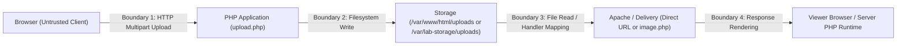

# 脅威モデリング・ワークシート：Upload -> Store -> Serve -> Execute（Lab 01）

[日本語](./worksheet.md) | [English](../en/worksheet.md)

関連ドキュメント：[ハンズオン手順書](./hands-on-guide.md) | [Lab 01 README](../../README.ja.md) | [LTデモ台本](./lt-script.md) | [安全ポリシー](../../../../docs/safety.ja.md)

> [!NOTE]
> **このワークシートの使い方**
> [ハンズオン手順書](./hands-on-guide.md) に沿って Stage 1 -> Stage 2 -> Stage 3 を操作しながら、`[ 記入欄 ]` を自分の言葉で埋めていきましょう。ページ最下部には折りたたみ形式（`
`）で**模範解答・ファシリテーター解説**を収録しています。

---

## Part 1：守るべき資産（Assets）と信頼境界（Trust Boundaries）の整理

ファイルアップロード機能のデータフロー図を確認し、境界をまたぐデータを整理しましょう。

### 1-1. 守るべき資産（Assets）は何ですか？（2〜3個挙げてみましょう）
- 資産1：`[                                                                 ]`
- 資産2：`[                                                                 ]`
- 資産3：`[                                                                 ]`

### 1-2. クライアントから送信される情報のうち、「絶対にそのまま信用してはいけない入力」は何ですか？

| 入力項目 | 攻撃者が偽装・操作できるか？（Yes / No） | どのように偽装されるか（メモ） |
| :--- | :--- | :--- |
| ファイル名（例：`avatar.png`） | `[ Yes / No ]` | `[                                           ]` |
| ファイル拡張子（例：`.php`, `.phtml`） | `[ Yes / No ]` | `[                                           ]` |
| リクエストの `Content-Type` ヘッダ | `[ Yes / No ]` | `[                                           ]` |
| ファイルの中身（バイト列） | `[ Yes / No ]` | `[                                           ]` |

---

## Part 2：ステージ別・攻撃経路トレース（Attack Path Tracing）

各ステージをブラウザで操作し、`Upload -> Store -> Serve -> Execute` のどこが通過し、どこで止まったかを記録しましょう。

---

### 2-1. Stage 1：脆弱なベースライン（`http://127.0.0.1:8081`）

#### 観察ログ
| 試行ファイル | Upload結果（HTTPステータス） | 保存先パス・ファイル名 | アクセス時の挙動（表示 or PHP実行） |
| :--- | :--- | :--- | :--- |
| `sample-valid.png` | `HTTP [     ]` | `[                           ]` | `[                                 ]` |
| `marker-basic.php` | `HTTP [     ]` | `[                           ]` | `[                                 ]` |

#### 考察（Stage 1）
**Q1. `marker-basic.php` が単なるテキスト表示ではなく「サーバー上でPHPコードとして実行」されたのは、4段階（Upload / Store / Serve / Execute）でそれぞれどの条件が揃ってしまったからですか？**
- Upload：`[                                                               ]`
- Store：`[                                                                ]`
- Serve / Execute：`[                                                      ]`

---

### 2-2. Stage 2：アプリ単層防御の失敗（`http://127.0.0.1:8082`）

#### 観察ログ
| 試行ファイル | Upload結果（HTTPステータス） | 通過／拒否の理由 | アクセス時の挙動 |
| :--- | :--- | :--- | :--- |
| `marker-basic.php` | `HTTP [     ]` | `[                           ]` | `[                                 ]` |
| `marker-bypass.phtml` | `HTTP [     ]` | `[                           ]` | `[                                 ]` |

#### 考察クエスチョン（Stage 2）
**Q2. Stage 2 の開発者はどんな「前提（思い込み）」を置いていましたか？ そして Apache 側のどの設定と食い違っていましたか？**
- アプリ開発者の思い込み：`[                                               ]`
- Apache側の実際の設定：`[                                                 ]`
- なぜブラックリスト方式は危険か：`[                                       ]`

---

### 2-3. Stage 3：多層防御（Defense-in-Depth）（`http://127.0.0.1:8083`）

#### 観察ログ
| 確認項目 | 結果（HTTPステータス） | 観察できた防御の仕組み |
| :--- | :--- | :--- |
| `marker-basic.php` のアップロード | `HTTP [     ]` | `[                                           ]` |
| `marker-bypass.phtml` のアップロード | `HTTP [     ]` | `[                                           ]` |
| `sample-valid.png` のアップロード＆配信URL | `HTTP [     ]` | 配信URL形式：`[                              ]` |
| `/image.php` のレスポンスヘッダ確認 | `HTTP [     ]` | 付与されていたヘッダ：`[                     ]` |
| `/uploads/infra-guard-check.phtml` 直接アクセス | `HTTP [     ]` | PHP実行の有無：`[                            ]` |

#### 考察クエスチョン（Stage 3）
**Q3. Stage 3 では、万が一アプリ層のコード改修ミスで `.phtml` ファイルがアップロードチェックをすり抜けたとしても、後続のどの独立した層がコード実行を阻止しますか？（複数挙げてみましょう）**
1. ストレージ層：`[                                                        ]`
2. 配信層：`[                                                              ]`
3. インフラ層（Apache設定）：`[                                            ]`

---

## Part 3：多層防御（Defense-in-Depth）設計マトリクス【穴埋め表】

`Upload -> Store -> Serve -> Execute` の各フェーズに対して、Stage 3 が実装している対策を整理しましょう。

| フェーズ | 想定される脅威・攻撃手法 | 単層防御の失敗例（Stage 1 / 2） | Stage 3 の具体的な防御策 | 担当レイヤ（App / Storage / Delivery / Infra） |
| :--- | :--- | :--- | :--- | :--- |
| **1. Upload**（受信・検証） | 危険な拡張子（`.php`, `.phtml`）や、`Content-Type` / 拡張子を偽装したスクリプトの投入 | `.php` のみのブラックリストでは `.phtml` 等を取りこぼす；リクエストヘッダは偽装可能 | `[                                           ]` | `[               ]` |
| **2. Store**（保存・命名） | 攻撃者が指定したファイル名・拡張子のまま公開ディレクトリ配下に配置される | `/var/www/html/uploads/<元の名前>` に保存したため、URLから直接到達可能になった | `[                                           ]` | `[               ]` |
| **3. Serve**（配信・ヘッダ） | ブラウザによるMIMEスニッフィングや、HTML/スクリプトとしての解釈・XSS | Webサーバ任せの直接配信で、防御ヘッダが明示されていない | `[                                           ]` | `[               ]` |
| **4. Execute**（実行制御・インフラ） | `.htaccess` の上書きや、公開ディレクトリ内スクリプトのサーバーサイド実行 | DocumentRoot内でPHPハンドラが有効なままだった | `[                                           ]` | `[               ]` |

---

## Part 4：実務への持ち帰りメモ（ふりかえり）

自分が普段関わっているシステム（または今後設計するWebアプリ）に当てはめて1つメモを残しましょう：
- **明日からの設計・レビューで確認したいこと**：
  `[                                                                       ]`

---

## 模範解答・ファシリテーター解説（クリックで展開）

<strong>ここをクリックして模範解答と解説を表示する</strong>

### Part 1 解答例

#### 1-1. 守るべき資産（Assets）
- **資産1：サーバーのコード実行整合性（PHPランタイム／コンテナプロセス）** — 任意のコードを実行されないこと。
- **資産2：サーバー内のファイルシステムと機密情報** — 他ユーザのアップロードデータ、設定ファイル、内部ネットワークへの到達経路。
- **資産3：ファイルを閲覧する他ユーザのブラウザ環境** — 配信されたファイル経由で Stored XSS 等が発火しないこと。

#### 1-2. 信用してはいけないクライアント入力
| 入力項目 | 偽装可能か | どのように偽装されるか |
| :--- | :--- | :--- |
| ファイル名 | **Yes** | パストラバーサル文字（`../`）や特殊文字、二重拡張子などを自由に指定できる（`basename()` だけでは拡張子は残る）。 |
| ファイル拡張子 | **Yes** | `.php` がダメなら `.phtml`, `.phar`, `.php5` 等に変える、あるいは画像拡張子 `.png` に偽装できる。 |
| `Content-Type` ヘッダ | **Yes** | `curl -F "file=@...;type=image/png"` 等で1行で任意のMIMEタイプに書き換え可能（`$_FILES['file']['type']` は自己申告値）。 |
| ファイルの中身 | **Yes** | 画像ファイルの拡張子をつけつつ中身に `<?php ... ?>` を含める等、任意のバイト列を送信できる。 |

---

### Part 2 解答例

#### 2-1. Stage 1（`8081`）
- **`sample-valid.png`**：HTTP `200` / `/var/www/html/uploads/sample-valid.png` / PNG画像として正常表示。
- **`marker-basic.php`**：HTTP `200` / `/var/www/html/uploads/marker-basic.php` / **PHPとして実行され `LAB_EXECUTION_MARKER_STAGE1` が出力される**。
- **Q1 解説**：
  1. **Upload**：拡張子・実ファイル内容の検証がゼロだった。
  2. **Store**：Apache の DocumentRoot 内（`/var/www/html/uploads/`）に、攻撃者が指定した `.php` 拡張子のまま保存した。
  3. **Serve / Execute**：外部から `/uploads/marker-basic.php` へ直接HTTPリクエストでき、かつそのディレクトリで Apache の PHP ハンドラが有効だったため、ファイル表示ではなく「プログラム実行」が起きた。

#### 2-2. Stage 2（`8082`）
- **`marker-basic.php`**：HTTP `400` / アプリの `.php` ブラックリストにより拒否 / 保存されない。
- **`marker-bypass.phtml`**：HTTP `200` / 拡張子が `php` ではないためブラックリストを通過 / **Apache側でPHPとして実行され `LAB_EXECUTION_MARKER_STAGE2` が出力される**。
- **Q2 解説**：
  - **開発者の思い込み**：「PHPとして動く拡張子は `.php` だけだから、`.php` さえ弾けば安全だ」という単層・ブラックリスト思考。
  - **Apache側の実際の設定**：`<FilesMatch "\.(php|phtml)$"> SetHandler application/x-httpd-php </FilesMatch>` により、`.phtml` もPHPインタープリタへ渡す設定になっていた。
  - **ブラックリストが危険な理由**：Webサーバ・OS・ミドルウェアのバージョンや設定変更によって実行対象となる拡張子（`.phtml`, `.pht`, `.phar` 等）や挙動が増減するため、「危険なものを漏れなく列挙し続ける」ことは構造的に破綻しやすい。

#### 2-3. Stage 3（`8083`）
- **`marker-basic.php` / `marker-bypass.phtml`**：ともに HTTP `400`（許可リスト外のため拒否）。
- **`sample-valid.png`**：HTTP `200` / 配信URLは `/image.php?file=<UUIDv4>.png` 形式（元のファイル名は破棄）。
- **`/image.php` レスポンスヘッダ**：HTTP `200` / `X-Content-Type-Options: nosniff`, `Content-Security-Policy: default-src 'none'`, `X-Frame-Options: DENY`, 正確な `Content-Type: image/png`。
- **`/uploads/infra-guard-check.phtml`**：**HTTP `403 Forbidden`**（`INFRA_LAYER_FAILED_EXECUTION` は出力されず、PHP実行は完全に阻止される）。
- **Q3 解説（独立した防御層）**：
  1. **ストレージ層**：保存先が DocumentRoot 外の `/var/lab-storage/uploads/` であり、かつ UUIDv4 にリネームされるため、直接URLを叩いて実行する経路がない。
  2. **配信層**：`/image.php` は厳格な正規表現（UUIDv4＋画像拡張子のみ）に合致するファイルだけをバイトストリームとして返し（`include`/`require` しない）、`nosniff` と `CSP` を強制する。
  3. **インフラ層（Apache設定）**：`AllowOverride None` で `.htaccess` 悪用を封じ、万一 `/var/www/html/uploads/` にファイルが置かれても PHP エンジン無効化＋`Options -ExecCGI -Indexes`＋`Require all denied`（HTTP 403）で実行と直接アクセスを遮断する。

---

### Part 3 解答例（完成版・多層防御設計マトリクス）

| フェーズ | 想定される脅威・攻撃手法 | 単層防御の失敗例（Stage 1 / 2） | Stage 3 の具体的な防御策 | 担当レイヤ |
| :--- | :--- | :--- | :--- | :--- |
| **1. Upload**（受信・検証） | 代替拡張子（`.phtml`）や、`Content-Type`・拡張子を偽装したスクリプト投入 | `.php` ブラックリストのすり抜け、クライアント申告ヘッダの誤信 | 厳格な拡張子**許可リスト**（`png`, `jpg`, `jpeg`, `gif`）、サイズ上限（2MB）、サーバー側での `finfo(FILEINFO_MIME_TYPE)` ＋ `getimagesize()` 実バイト検証 | **App** |
| **2. Store**（保存・命名） | 公開ディレクトリ配下へのスクリプト配置、ファイル名悪用 | `/var/www/html/uploads/<元の名前>` への直接保存 | **DocumentRoot外**（`/var/lab-storage/uploads/`）への隔離保存、**UUIDv4** による完全ランダムリネーム | **Storage / App** |
| **3. Serve**（配信・ヘッダ） | MIMEスニッフィング、ブラウザ上でのスクリプト発火 | 直接ファイル配信、セキュリティヘッダ欠如 | `/image.php` によるUUIDv4正規表現チェック付きストリーム配信、`X-Content-Type-Options: nosniff`、`Content-Security-Policy: default-src 'none'`、`X-Frame-Options: DENY` | **Delivery** |
| **4. Execute**（実行制御・インフラ） | `.htaccess` によるハンドラ有効化、配置ミス時のPHP実行 | DocumentRoot内で `.php` / `.phtml` ハンドラが有効 | `AllowOverride None`、`/var/www/html/uploads` での **PHPエンジン無効化**、`Options -ExecCGI -Indexes`、`Require all denied`（HTTP 403）、非root（`www-data`）実行 | **Infra** |

