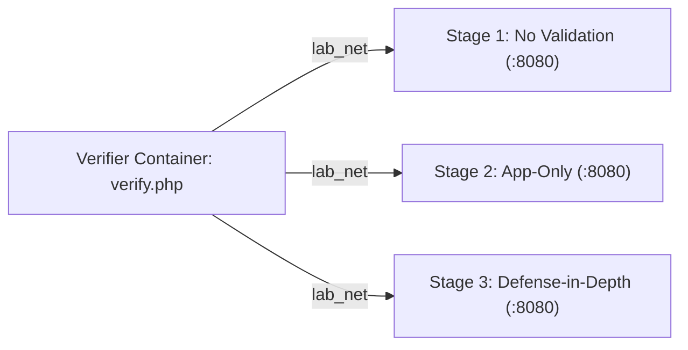

[日本語](./README.md)

# Lab 01 Automated Verification Suite

> [!CAUTION]
> For local educational use in an isolated environment only. Never deploy to public servers or shared networks; see [SAFETY.en.md](../../../SAFETY.en.md).

`verify.php` is a zero-dependency PHP 8.3 end-to-end verification script. No host PHP or `curl` installation is required; the `verifier` container validates all three stages inside the isolated `lab_net` network.

## Architecture



## Quickstart

Run all commands from the `labs/01-php-upload-defense` directory:

```bash
cd labs/01-php-upload-defense
docker compose up --build -d
docker compose --profile test run --rm verifier
```

Stop the containers afterward with `docker compose down`. Target URLs can also be overridden via `STAGE1_URL`, `STAGE2_URL`, and `STAGE3_URL`.

## Verified Checks

`verify.php` exits with status `0` only when 100% of checks pass, printing `[FAIL]` and exiting `1` on any failure:

- **UI & Offline Integrity (Stages 1–3)**: `GET /?lang=ja` and `GET /?lang=en` (`FOR LOCAL EDUCATIONAL USE ONLY`) return HTTP `200` with local-only safety banners and zero external CDN, font, script, or stylesheet URLs.
- **Static Safety Scan**: Confirms all three files in `samples/` exist and uses PHP's tokenizer to ensure zero forbidden superglobals or execution primitives (`system`, `exec`, `eval`, etc.) in marker payloads and stage sources.
- **Stage 1**: Verifies `sample-valid.png` upload and PNG delivery, `marker-basic.php` upload and PHP execution (`LAB_EXECUTION_MARKER_STAGE1`), and `POST /reset.php` cleanup (HTTP `404`).
- **Stage 2**: Verifies `marker-basic.php` is blocked (HTTP `400`), `marker-bypass.phtml` bypasses the `.php` denylist and executes (`LAB_EXECUTION_MARKER_STAGE2`), and `POST /reset.php` removes it.
- **Stage 3**: Verifies `.php`, `.phtml`, and disguised `evil.png` uploads are rejected (HTTP `400`), valid `sample-valid.png` is renamed to `UUIDv4` and served via `/image.php` with `X-Content-Type-Options: nosniff` and `Content-Security-Policy`, and `/uploads/infra-guard-check.phtml` enforces HTTP `403` before and after reset.

## Related Docs

- [Lab 01 Overview & Threat Model](../README.en.md)
- [Sample Test Files](../samples/README.en.md)
