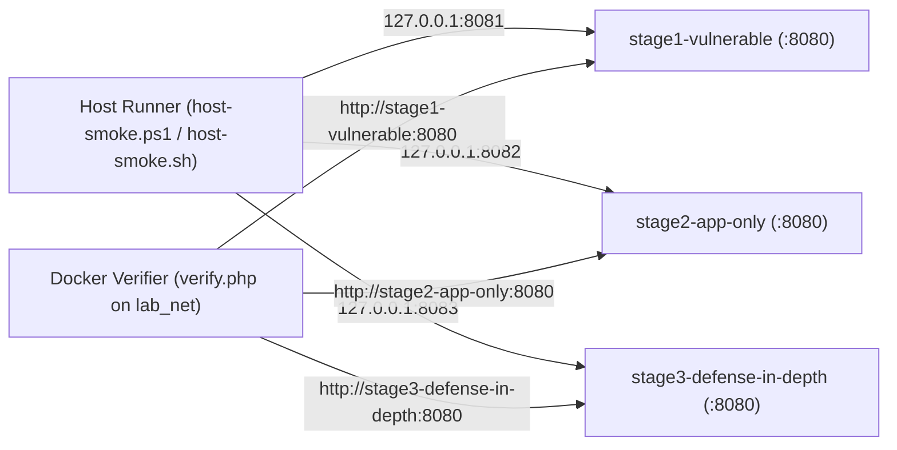

# Lab 01 自動検証スイート / Lab 01 Automated Verification Suite

[日本語](#ja) | [English](#en)

---

<a id="ja"></a>

## 日本語ガイド (Japanese)

`labs/01-php-upload-defense/tests/` には、Lab 01 の全3ステージの挙動・多層防御・安全性ガードレールを自動検証するためのスクリプト一式が含まれています。

### 収録ファイル一覧

| ファイル | 実行場所 | 役割 |
| --- | --- | --- |
| `verify.php` | Docker 内部 (`verifier` コンテナ) またはホスト PHP 8.3+ | 標準 PHP ストリームのみ（外部拡張依存ゼロ）で動作する完全な E2E 検証・静的安全性スキャン |
| `host-smoke.ps1` | ホスト OS (PowerShell 7 `pwsh` / Windows PowerShell 5.1) | ホスト側の `http://127.0.0.1:8081`〜`8083` に対するスモークテスト |
| `host-smoke.sh` | ホスト OS (Linux / macOS / WSL / Git Bash の POSIX `sh` + `curl`) | ホスト側の `http://127.0.0.1:8081`〜`8083` に対する POSIX シェルスモークテスト |

### 検証アーキテクチャ



### クイックスタート（実行手順）

すべてのコマンドは `labs/01-php-upload-defense` ディレクトリから実行します。

#### 1. コンテナの起動

```bash
cd labs/01-php-upload-defense
docker compose up --build -d
```

#### 2. コンテナ内 E2E 自動検証の実行（推奨・OS非依存）

ホスト環境に PHP や `curl` がインストールされていなくても、Docker Compose の `test` プロファイルだけで全項目の検証が完結します。

```bash
docker compose --profile test run --rm verifier
```

#### 3. ホスト側ループバック (`127.0.0.1:8081`〜`8083`) スモークテストの実行

Windows PowerShell / PowerShell 7 (`pwsh`) の場合:

```powershell
pwsh -File tests/host-smoke.ps1
```

Linux / macOS / WSL / Git Bash の場合:

```bash
sh tests/host-smoke.sh
```

ホストにインストールされた PHP から直接 `verify.php` を実行する場合は、環境変数 `STAGE1_URL`、`STAGE2_URL`、`STAGE3_URL` でターゲット URL を上書きできます。

```bash
STAGE1_URL=http://127.0.0.1:8081 \
STAGE2_URL=http://127.0.0.1:8082 \
STAGE3_URL=http://127.0.0.1:8083 \
php tests/verify.php
```

#### 4. 環境の停止

```bash
docker compose down
```

### 検証項目チェックリスト

すべての項目が成功した場合のみ終了コード `0` を返し、1つでも失敗した場合は `[FAIL]` サマリを表示して非ゼロ終了コードを返します。

1. **日英バイリンガル UI・安全警告バナー・完全オフライン検証（全3ステージ）**
   - `GET /?lang=ja` が HTTP `200` を返し、`ローカル学習専用` を含むこと。
   - `GET /?lang=en` が HTTP `200` を返し、`FOR LOCAL EDUCATIONAL USE ONLY` を含むこと。
   - HTML/CSS 内に外部 CDN・外部フォント・外部スクリプト URL が一切含まれないこと。
2. **サンプルファイルおよびステージソースの静的安全性スキャン (`verify.php`)**
   - `samples/sample-valid.png`、`samples/marker-basic.php`、`samples/marker-bypass.phtml` が存在し、`sample-valid.png` が正しい PNG シグネチャを持つこと。
   - PHP トークナイザ解析により、`marker-basic.php` と `marker-bypass.phtml` に外部入力スーパーグローバル（`$_GET`, `$_POST`, `$_REQUEST`, `$_COOKIE`, `$_FILES`）や危険な実行関数（`system`, `exec`, `passthru`, `shell_exec`, `popen`, `proc_open`, `eval`, `assert`、バッククォート演算子）が一切含まれないこと。
3. **Stage 1 (`stage1-vulnerable`, `127.0.0.1:8081`) の検証**
   - `POST /reset.php` による初期化、`POST /upload.php` への `sample-valid.png` アップロードと `/uploads/sample-valid.png` の PNG バイト配信。
   - `marker-basic.php` のアップロード成功（HTTP `200`）および `GET /uploads/marker-basic.php` での PHP 実行（`LAB_EXECUTION_MARKER_STAGE1` が出力され、生の `<?php` が残らないこと）。
   - `POST /reset.php` 実行後に `/uploads/marker-basic.php` が削除され HTTP `404` となること。
4. **Stage 2 (`stage2-app-only`, `127.0.0.1:8082`) の検証**
   - `marker-basic.php` のアップロードがアプリの `.php` ブラックリストで拒否されること（HTTP `400`）。
   - `marker-bypass.phtml` のアップロードが通過し（HTTP `200`）、`GET /uploads/marker-bypass.phtml` で PHP として実行されること（`LAB_EXECUTION_MARKER_STAGE2` が出力されること）。
   - `POST /reset.php` 実行後に `/uploads/marker-bypass.phtml` が削除され HTTP `404` となること。
5. **Stage 3 (`stage3-defense-in-depth`, `127.0.0.1:8083`) の検証**
   - `marker-basic.php`、`marker-bypass.phtml`、および拡張子・`Content-Type: image/png` を偽装した PHP ファイル（`evil.png`）がすべて HTTP `400` で拒否されること。
   - 正規の `sample-valid.png` が HTTP `200` で受理され、元のファイル名を含まない UUIDv4 名（`/image.php?file=<uuid>.png`）として公開ディレクトリ外から安全に配信されること。
   - `GET /image.php?file=<uuid>.png` が HTTP `200`・正しい PNG バイト列・`X-Content-Type-Options: nosniff`・`Content-Security-Policy` ヘッダを返すこと。
   - インフラ層の防御確認として、`GET /uploads/infra-guard-check.phtml` が HTTP `403` で遮断され、`INFRA_LAYER_FAILED_EXECUTION` が決して出力されないこと。
   - `POST /reset.php` 実行後、アップロードした `<uuid>.png` は HTTP `404` になりつつ、`/uploads/infra-guard-check.phtml` の HTTP `403` ガードは維持されること。

---

<a id="en"></a>

## English Guide

`labs/01-php-upload-defense/tests/` provides the automated verification suite for all three stages of Lab 01 (Stage 1, Stage 2, and Stage 3), covering upload-to-execution behavior, defense-in-depth controls, and local-only safety guardrails.

### Included Files

| File | Execution Context | Purpose |
| --- | --- | --- |
| `verify.php` | Inside Docker (`verifier` container) or host PHP 8.3+ | Zero-dependency PHP E2E test runner (pure PHP stream contexts) plus static PHP tokenizer safety scanner |
| `host-smoke.ps1` | Host OS (PowerShell 7 `pwsh` / Windows PowerShell 5.1) | Host-side loopback smoke test targeting `http://127.0.0.1:8081`–`8083` |
| `host-smoke.sh` | Host OS (Linux / macOS / WSL / Git Bash POSIX `sh` + `curl`) | Host-side POSIX shell smoke test targeting `http://127.0.0.1:8081`–`8083` |

### Verification Architecture


### Quickstart

Run all commands from the `labs/01-php-upload-defense` directory.

#### 1. Start the Lab Containers

```bash
cd labs/01-php-upload-defense
docker compose up --build -d
```

#### 2. Run Containerized E2E Verification (Recommended, OS-Independent)

This runs inside the isolated `lab_net` network without requiring PHP or `curl` on your host machine:

```bash
docker compose --profile test run --rm verifier
```

#### 3. Run Host Loopback (`127.0.0.1:8081`–`8083`) Smoke Tests

On Windows PowerShell or PowerShell 7 (`pwsh`):

```powershell
pwsh -File tests/host-smoke.ps1
```

On Linux, macOS, WSL, or Git Bash:

```bash
sh tests/host-smoke.sh
```

You can also run `verify.php` directly from host PHP by overriding `STAGE1_URL`, `STAGE2_URL`, and `STAGE3_URL`:

```bash
STAGE1_URL=http://127.0.0.1:8081 \
STAGE2_URL=http://127.0.0.1:8082 \
STAGE3_URL=http://127.0.0.1:8083 \
php tests/verify.php
```

#### 4. Stop the Lab Containers

```bash
docker compose down
```

### What Is Verified

Each runner exits with status `0` if and only if 100% of assertions pass, printing `[PASS]` / `[FAIL]` lines and exiting non-zero on any failure:

1. **Bilingual UI, Safety Banners & Offline Asset Integrity (Stages 1, 2, 3)**
   - `GET /?lang=ja` returns HTTP `200` and includes `ローカル学習専用`.
   - `GET /?lang=en` returns HTTP `200` and includes `FOR LOCAL EDUCATIONAL USE ONLY`.
   - Zero external `http://` or `https://` CDN, font, script, or stylesheet URLs appear in HTML/CSS.
2. **Static Safety Scan of Sample Payloads & Stage Sources (`verify.php`)**
   - Confirms `samples/sample-valid.png`, `samples/marker-basic.php`, and `samples/marker-bypass.phtml` exist and `sample-valid.png` begins with valid PNG magic bytes.
   - Uses PHP's tokenizer to verify `marker-basic.php` and `marker-bypass.phtml` contain zero forbidden superglobals (`$_GET`, `$_POST`, `$_REQUEST`, `$_COOKIE`, `$_FILES`) and zero forbidden execution primitives (`system`, `exec`, `passthru`, `shell_exec`, `popen`, `proc_open`, `eval`, `assert`, or backticks).
3. **Stage 1 (`stage1-vulnerable`, `127.0.0.1:8081`)**
   - `POST /reset.php` succeeds; uploading `sample-valid.png` (`POST /upload.php`) returns HTTP `200` and `/uploads/sample-valid.png` serves valid PNG bytes.
   - Uploading `marker-basic.php` returns HTTP `200` and `GET /uploads/marker-basic.php` executes PHP (`LAB_EXECUTION_MARKER_STAGE1` present, raw `<?php` absent).
   - `POST /reset.php` removes `/uploads/marker-basic.php` (`GET /uploads/marker-basic.php` returns HTTP `404`).
4. **Stage 2 (`stage2-app-only`, `127.0.0.1:8082`)**
   - Uploading `marker-basic.php` is blocked by the naive `.php` blacklist (HTTP `400`).
   - Uploading `marker-bypass.phtml` succeeds (HTTP `200`) and `GET /uploads/marker-bypass.phtml` executes PHP (`LAB_EXECUTION_MARKER_STAGE2` present, raw `<?php` absent).
   - `POST /reset.php` removes `/uploads/marker-bypass.phtml` (`GET /uploads/marker-bypass.phtml` returns HTTP `404`).
5. **Stage 3 (`stage3-defense-in-depth`, `127.0.0.1:8083`)**
   - Rejects `marker-basic.php`, `marker-bypass.phtml`, and disguised/spoofed `evil.png` (`Content-Type: image/png` with PHP body) with HTTP `400`.
   - Accepts valid `sample-valid.png` (HTTP `200`), renames it to a random UUIDv4 (`/image.php?file=<uuid>.png` without `sample-valid`), and serves it from outside `DocumentRoot` with `X-Content-Type-Options: nosniff`, `Content-Security-Policy`, and valid PNG magic bytes.
   - Verifies infrastructure guard: `GET /uploads/infra-guard-check.phtml` returns HTTP `403` and never outputs `INFRA_LAYER_FAILED_EXECUTION`.
   - `POST /reset.php` removes the uploaded `<uuid>.png` (HTTP `404`) while keeping `/uploads/infra-guard-check.phtml` enforced at HTTP `403`.
