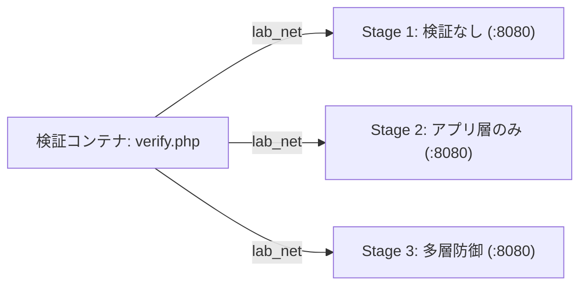

[English](./README.en.md)

# Lab 01 自動検証スイート

> [!CAUTION]
> 本ラボはローカル隔離環境での学習専用です。公開サーバや共有ネットワークへ絶対にデプロイしないでください。詳細は [SAFETY.md](../../../SAFETY.md) を参照してください。

`verify.php` は PHP 8.3 標準機能のみで動作する自動検証スクリプトです。ホスト側への PHP や `curl` の導入は不要で、Docker の `verifier` コンテナから全3ステージの挙動と安全性を一括検証します。

## 構成



## 実行手順

すべて `labs/01-php-upload-defense` ディレクトリで実行します。

```bash
cd labs/01-php-upload-defense
docker compose up --build -d
docker compose --profile test run --rm verifier
```

検証終了後は `docker compose down` でコンテナを停止します。環境変数 `STAGE1_URL`・`STAGE2_URL`・`STAGE3_URL` で接続先 URL の上書きも可能です。

## 検証内容

全項目を通過した場合のみ終了コード `0` を返し、1件でも失敗すると `[FAIL]` を出力して終了コード `1` で終了します。

- **UI・オフライン検証（全ステージ）**: `GET /?lang=ja`（`ローカル学習専用`）と `GET /?lang=en`（`FOR LOCAL EDUCATIONAL USE ONLY`）が HTTP `200` を返し、外部 URL の読み込みがゼロであること。
- **静的安全性スキャン**: `samples/` の3ファイルが存在すること、および PHP トークナイザ解析で `marker-basic.php`・`marker-bypass.phtml`・各ステージのコードに禁止されたスーパーグローバルや危険な実行関数（`system`, `exec`, `eval` 等）が含まれないこと。
- **Stage 1**: `sample-valid.png` の配信、`marker-basic.php` のアップロードと PHP 実行（`LAB_EXECUTION_MARKER_STAGE1` 出力）、`POST /reset.php` による削除（HTTP `404`）を確認。
- **Stage 2**: `marker-basic.php` の拒否（HTTP `400`）、`marker-bypass.phtml` の通過と PHP 実行（`LAB_EXECUTION_MARKER_STAGE2` 出力）、`POST /reset.php` による削除を確認。
- **Stage 3**: `.php`・`.phtml`・偽装 `.png`（`evil.png`）の拒否（HTTP `400`）、正規画像の `UUIDv4` リネームと `/image.php` 配信（`X-Content-Type-Options: nosniff`・`Content-Security-Policy` 付与）、`/uploads/infra-guard-check.phtml` の HTTP `403` 遮断とリセット後の維持を確認。

## 関連ドキュメント

- [Lab 01 概要・設計解説](../README.md)
- [検証用サンプルファイル](../samples/README.md)
